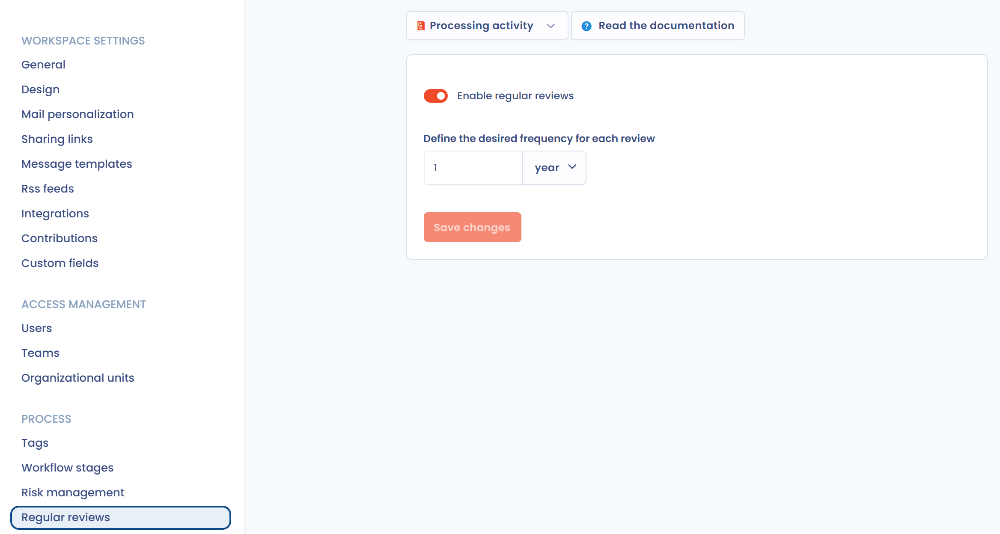

# Regular review (freshness)

Freshness tells you when an item was last reviewed. When you activate regular review for a type of item, you define an interval between two reviews. Each review sets a next review date, and the freshness degrades as that date approaches. This way, you make sure the information entered in Dastra is reviewed regularly.

Regular review is available for processing activities, stakeholders, assets, AI systems, contracts and the control points of risk management, depending on the modules of your subscription. The specifics of processing activities are described in [Processing freshness](ropa/freshness.md).

<figure><figcaption>
How the freshness indicator works
</figcaption></figure>

## Activate regular review

Only users with the **Advanced configuration** permission can change this setting.

1. In the left menu, click **Workspace settings**, then, under **Process**, click **Regular reviews**. You can also click **Set up regular review** in the options menu of a module list: the entry shows whether regular review is already enabled for that type of item.
2. In the selector at the top of the page, choose the type of item.
3. Turn on **Enable regular reviews**.
4. In **Define the desired frequency for each review**, enter the interval in years, months or days.
5. Click **Save changes**.

<figure><figcaption>
The Regular reviews settings
</figcaption></figure>

<figure><figcaption>
The available item types
</figcaption></figure>

The interval is the same for all items of a given type. Once you save it, Dastra asks **Apply the new interval ?**:

* **Apply to all existing reviews** replaces all the next review dates already set with new dates calculated from the new interval.
* **Apply only to future reviews** keeps the existing dates, and the new interval applies from the next review.

## Deactivate regular review

In the same settings, choose the type of item, turn off **Enable regular reviews** and click **Save changes**.

## Display freshness

Freshness is only displayed for **published** items that have been reviewed at least once.

All the items concerned have a **Last review date** column, which you can add to the columns of the list. It shows the freshness state of each item.

<figure><figcaption>
The Last review date column
</figcaption></figure>

On the page of a processing activity or an AI system, the right-hand panel also shows the **Freshness** bar, which shrinks as the next review date approaches. Next to the state and its color, you see the **Review** link and the number of days left or overdue.

<figure><figcaption>
The freshness indicator of a processing activity page
</figcaption></figure>

### Freshness states

| State | Display rule |
| --- | --- |
| **Fresh** (green) | The item has been reviewed recently and does not need immediate attention. This state is displayed until the current date is within the last 10 percent of the interval. |
| **Soon out of date** (orange) | The item needs to be checked. This state is displayed during the last 10 percent of the interval after the last review. |
| **Outdated** (red) | The next review date has passed: the item no longer complies with the review policy. |


**Example:** you have set an interval of 1 year. An item reviewed on 1 January 2026 is displayed as **Fresh** until the end of November 2026, then as **Soon out of date** until 1 January 2027. After that date, it is displayed as **Outdated** until it is reviewed.


## Review an item

You can review an item at any time, without waiting for its next review date. In a list, click the cell of the **Last review date** column for the item. On the page of a processing activity or an AI system, click **Review**.

<figure><figcaption>
The Review window
</figcaption></figure>

In the **New review** tab, fill in:

* **Reviewer**: the user who carried out the review.
* **Review date**.
* **Description of the version:** what was checked or changed (optional).
* **Date before next review**: calculated from the interval defined in the settings. To set a date specific to this item, turn on **Change the date of the next review** and choose a date (at the earliest the next day).

Click **Review** to save: a new freshness cycle starts from the review date.

The **Previous reviews** tab lists the past reviews of the item. It also offers the **Delete all reviews** button, which clears the history. After confirmation, the item is considered never reviewed, its review dates are cleared and the freshness indicator disappears. This action cannot be undone.

## Follow reviews on the dashboard

The **Record of processing activities** tile of the [dashboard](dashboard.md) shows the **Requires review** indicator: the number of processing activities to review according to the defined interval, and the number of fresh ones.

## Notifications

When an item becomes outdated, its creator and the users associated with it (for example the owners of a processing activity) are notified by email: the item has not been reviewed for a long time and it is time to refresh it.
