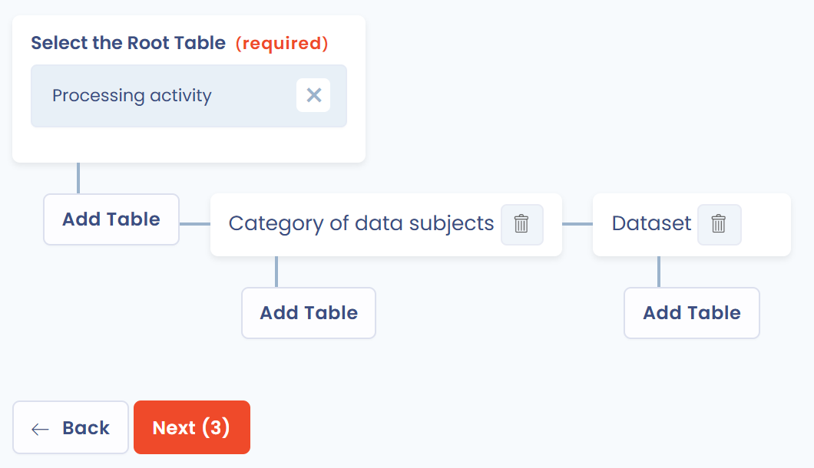
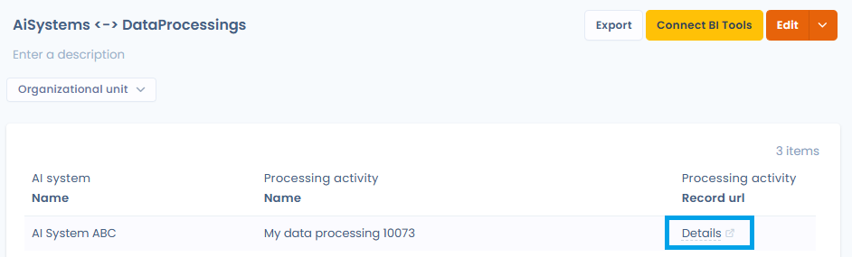

# Custom reports

Custom reports extract the information you need from Dastra data, in the form you choose: table, chart or export.

## Quick start

1. In the left menu, under **Resources**, click **Reporting**.
2. Reports are organized in categories. Before you create your first report, you need to **create a first category** with **Create Category**.
3. Click **Create Report** to build a blank report, or open the arrow of the button and choose **Create from library...**.

If AI analysis is included in your subscription, the AI button next to **Create Report** (**Generate a custom report with AI**) generates a report from a short description, for example "Number of data processing per workflow step with a chart".

## Glossary

* **Metric**: a measurable value used to group (aggregate) items. _Example: the number of processing activities, the average processing time of a task, etc._
* **Dimension**: unlike a metric, a dimension does not aggregate data. It is a simple property (a column) of an item. _Example: the processing activity name, its status, its reference, etc._

## Report construction

A report is built in four steps:

1. **Data selection**: choose the tables you want to query, then the relevant metrics and dimensions.
2. **Filters**: refine your results with criteria to keep only the data relevant to your analysis.
3. **Chart**: display the report as a chart or a table.
4. **Export and sharing**: export the report as PDF, Word, HTML, Excel, CSV, JSON or Markdown, share it, or connect it to a BI tool such as Power BI.

### Table selection

First choose the root table in the **Select the Root Table** list: it is the main table of the report, for example processing activities. Then click **Add Table** to add tables linked to the root table (processing steps, purpose, tags, etc.). You can query up to 7 tables in each report, the root table included.

<figure><figcaption>
The selection of the root table and the linked tables
</figcaption></figure>

Click **Next** when you have chosen the tables.


You can go back to the table selection from the report builder, with the **Edit** button of the **Selected Tables** card, to add more tables. The tables already used by the report are locked.


### Building with metrics and dimensions

Build your report by dragging the metrics and dimensions you want, or by selecting them, from the left panel to the **Drop Metrics and Dimensions Here** area. A message warns you when you have reached the maximum number of metrics and dimensions for a report.

<figure><figcaption>
The metrics and dimensions editor
</figcaption></figure>

The **Filters** card limits the data, and **Sort By** sets the order of the rows (tick **Ascending order** for an ascending sort). **Refresh Data** updates the preview.

Click **Save and continue** to open the report, or **Save changes** to stay in the editor.


Data is automatically aggregated by dimension to calculate the selected metrics.


Example: if you select the metric **Number of Data processing** and the dimension **Status**, you get a report grouped as follows:

| Status | Number of Data processing |
| ------ | ------------------------- |
| Draft  | 12                        |
| Active | 560                       |

### Link to the record

For tables of objects that have a record (processing activities, data subject requests, data breaches, assets, stakeholders, audits, security measures, contracts, AI systems and tasks), the **Record url** dimension adds a clickable **Details** link to each row. This link opens the record of the object in the right module, in a new tab and for the current workspace. The column is also included in exports, as a URL.

<figure><figcaption>
Adding the Record url dimension to the report
</figcaption></figure>

<figure><figcaption>
Each row shows a Details link that opens the record of the object
</figcaption></figure>

## Display the report and add a chart

Once the report is saved, you land on its page. The data table is displayed with an organizational unit filter, **Reset filters** and the description of the report, which you can edit in place.

<figure><figcaption>
The page of a custom report
</figcaption></figure>

To add a chart, click **Add Chart**, then set the options:

* **Chart Type**: **Column Chart**, **Bar Chart**, **Pie Chart** or **Heatmap**.
* **Displayed Metric**: the value measured by the chart.
* **Dimension #1** and **Dimension #2**: the axes of the chart.
* **Data Stacking**: **Default**, **Stacking in Column** (stacked values) or **Stacking by Percentage** (stacked to 100%).
* **Sort By** and **Ascending order**: the display order.

The preview updates as you make your choices. To change or remove the chart later, use **Edit Chart** or **Remove Chart** above the chart.

<figure><figcaption>
The Add Chart window
</figcaption></figure>

## Print, export and share

From the page of a report:

* **Export** downloads the report as CSV, Excel, JSON, PDF, Word, HTML or Markdown.
* The menu of the **Edit** button offers **Print**, **Export**, **Share** (reserved for users with the **Advanced configuration** permission) and **Move to recycle bin**.
* **Connect BI Tools** connects the report to a data analysis tool: see [Integration with data analysis tools (BI)](bi-tools.md).

## Recycle bin

A deleted report or category first goes to the recycle bin: you can restore it as long as it has not been permanently deleted.

* **Move an item to the recycle bin**: in the actions menu of a report, click **Move to recycle bin** and confirm. The actions menu of a category, in the left panel, offers the same action: the category and all its reports are moved to the recycle bin.
* **View the recycle bin**: turn on the **View recycle bin** option above the list of reports, or use the menu of the categories panel.
* **Restore**: from the recycle bin, **Restore** puts the item back in the active list. Restoring a category also restores the reports moved to the recycle bin with it; restoring a report whose category is in the recycle bin also restores that category.
* **Permanently delete**: from the recycle bin, **Delete** erases the item after confirmation. Deleting a category also deletes all its reports. This action cannot be undone.


Recycle bin actions require the permission to edit custom reports.

