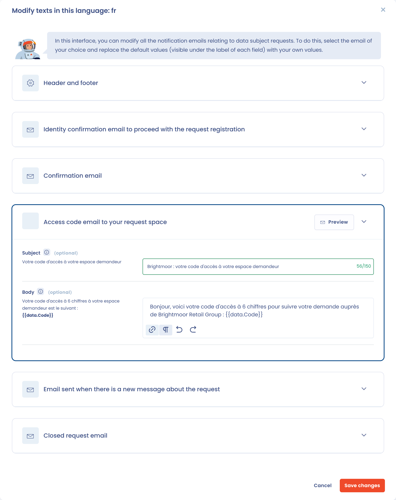

# Customizing emails sent to requesters

If you do not want to use the default wording, you can edit all the notification emails sent to requesters.

You can:

* Edit the **subjects and bodies** of the messages.
* Manage **translations** so emails go out in the requester's language.
* Add languages. If the language of a request is not set up, the requester receives the emails in English.

## Add a language and edit the texts

1. In the workspace settings, under **Process**, open **Requests**.
2. Open the **Notification email texts and translations** section.
3. Choose a language in the **Add a language** list.
4. Click **Edit** next to the language, then adapt the subjects and texts.
5. Open the email to customize (**Header and footer**, **Identity confirmation email to proceed with the request registration**, **Confirmation email**, **Access code email to your request space**, **Email sent when there is a new message about the request** or **Closed request email**), replace the default values shown under each field label, then click **Save changes**.

<figure><figcaption>
Customized languages
</figcaption></figure>

<figure><figcaption>
Customizing a message
</figcaption></figure>


Keep placeholders such as `{{data.Code}}`: they are replaced with data when the email is sent, and the message needs them to work. You can add other variables in the text: type `{{` to open the list of available variables.

