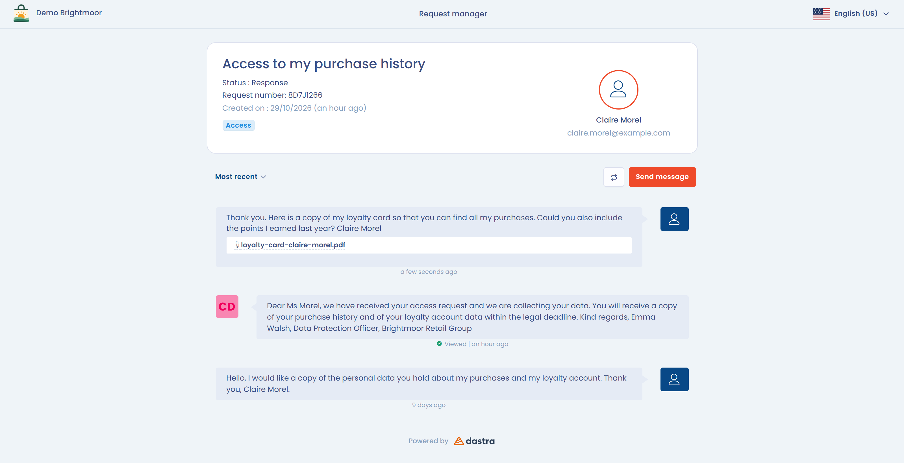
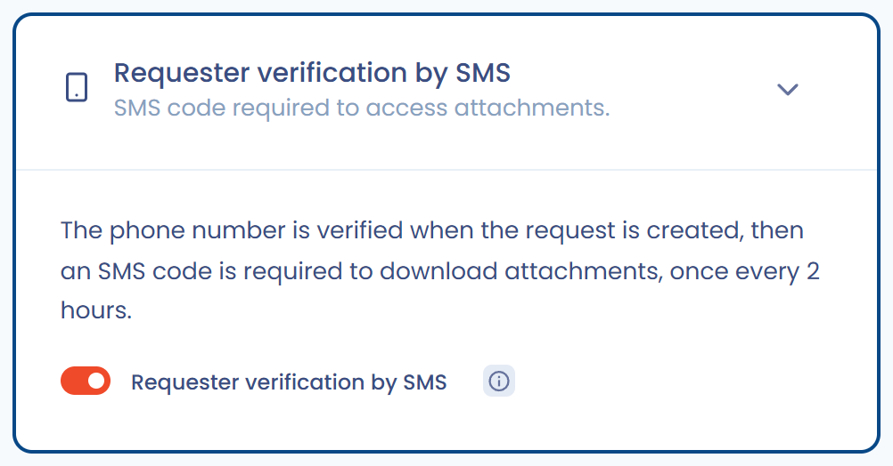
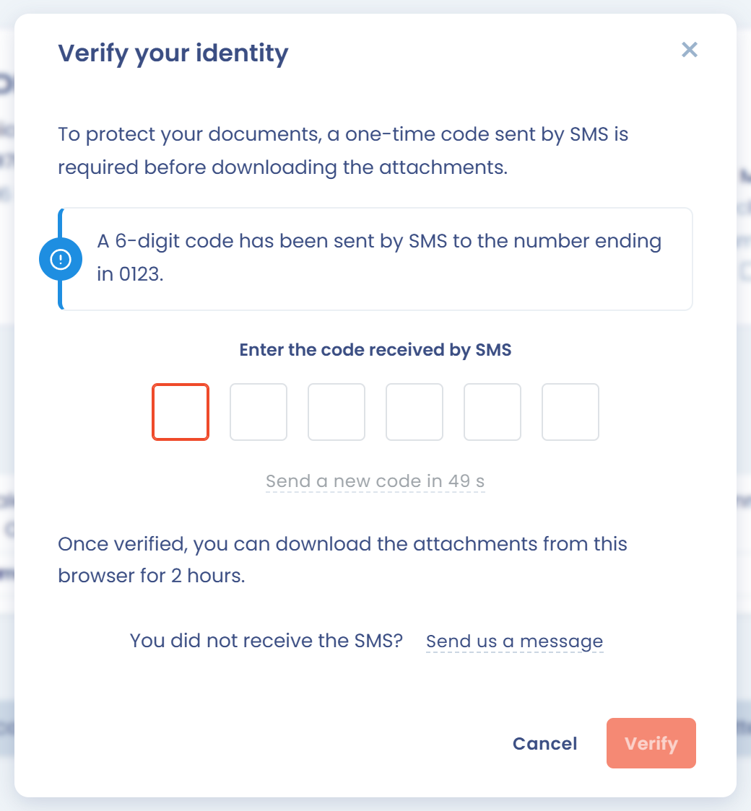

# Requester space

Each person who submits a request gets a **dedicated space**, secured by a one-time 6-digit code sent by email.

From this space, the requester can:

* Follow the progress of the request.
* Read the messages sent by the organization.
* Reply and exchange directly with the person handling the request.
* Download or upload supporting documents.

<figure><figcaption>
The space for exchanges with the requester
</figcaption></figure>

This space ensures the traceability, follow-up and transparency of the exchanges, and avoids unsecured plain email. After the request is closed, the requester keeps access to the space for a limited time: see the [FAQ](../faq.md).

To retrieve the access link to the space of a request, open the **Actions** menu of the request and click **Copy the access link to the request space**.


**Health data**: Dastra is not HDS certified (the French certification for health data hosting), but our host, Microsoft Azure, is. If documents sent through the interface (by the requester or by your organization) contain health data, make sure this use is compatible with your own obligations.


***

## Verify the requester by SMS

Requester verification by SMS adds a second factor, independent of email. The requester proves that they hold a phone number, then enters a code sent by SMS before downloading the attachments of the request. The SMS proves possession of a number: it does not replace the check of the requester's identity (see [Verifying the identity](../process.md#verifying-the-identity)).

This is an option of your plan. Without it, the setting shows **Option not included in your subscription**.

### Turn it on

1. In the workspace settings, under **Process**, open **Requests**.
2. Open the **Requester verification by SMS** section and switch the option on. You need the right to manage advanced settings.
3. Open each collection form, go to its **Settings** section and check **Enable phone validation**. This switch only appears once the option is on in the workspace, and it is on by default in each form.

<figure><figcaption>
The option in the workspace settings
</figcaption></figure>

When a form verifies the number, its phone field is always displayed and required, for every request type. In the field customization it appears locked, with a tooltip that explains why.

### What the requester sees

At creation, the requester validates their email address. The confirmation page then asks them to verify their phone number: Dastra sends a 6-digit code by SMS to the number entered, and the requester types it. The request is registered once the email address is validated, even if the number is not verified yet. The phone check is available for 24 hours after the submission. If your form redirects to your own page (**Redirection link in case of success**), the confirmation page is not displayed and this step is skipped.

When the requester downloads an attachment from their space, a lock icon shows that a code is required. The **Verify your identity** window asks for a code sent by SMS to the number on the request, of which only the last four digits are shown. Once the code is valid, the requester can download the attachments from the same browser for 2 hours, then a new code is needed. Changing the phone number of the request ends this session.

<figure><figcaption>
The window that asks for the SMS code before a download
</figcaption></figure>

A request with no attachment triggers no SMS beyond the initial verification.

If the requester did not receive the SMS, they click **Send a new code**, or **Send us a message** to write to the organization.

### Limits

| Rule | Value |
| --- | --- |
| Validity of a code | 10 minutes, and a code can be used once |
| Delay before a new code | 60 seconds |
| Codes sent per request | 5 per hour |
| Incorrect codes before the lock | 4, then the verification is locked for 30 minutes |
| Download session after a valid code | 2 hours |

### On the organization side

In the **Identifying information** section of a request, the **Phone number** field shows **Verified on** followed by the date, **Not verified**, or the warning **Attachments not protected by SMS: no phone number provided**. Without a phone number, no code is asked and the attachments are downloaded without SMS.

A number entered or changed by a user is never considered verified. When you change it, Dastra asks you to confirm in the **Change the phone number?** window: change the number only if you are sure the request comes from the requester. The verification is then reset, the pending code and the download session are dropped, and the next codes go to the new number.

The history of the request records each step: code sent, number verified, download validated, verification locked and number changed. See [Edit and process requests](../process.md#overall-tracking).
