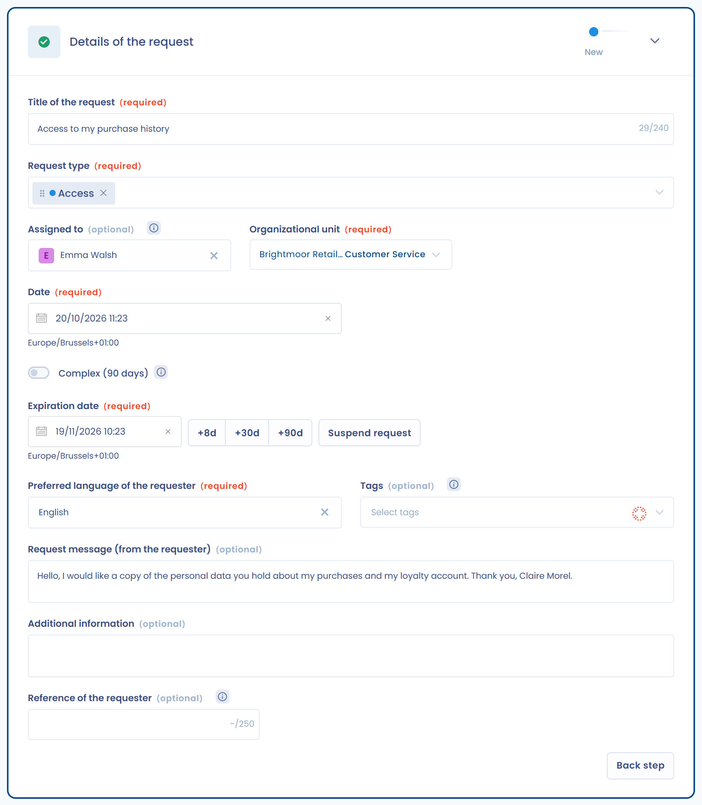
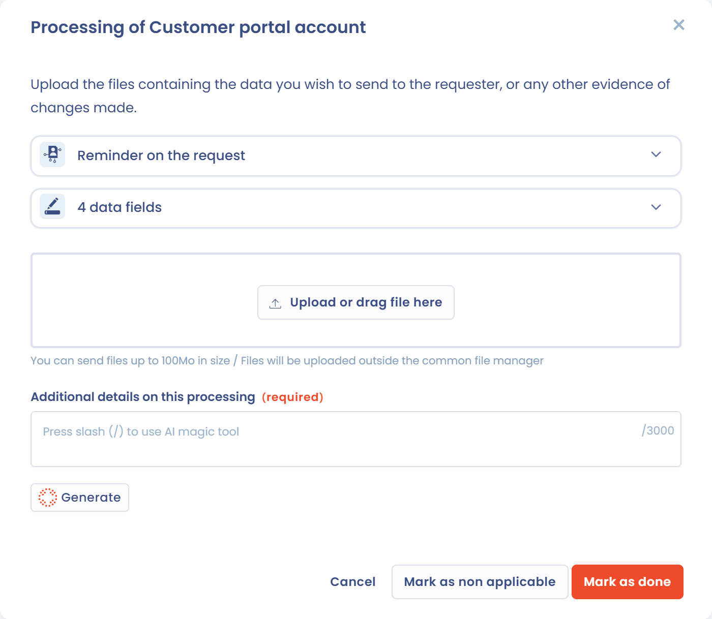
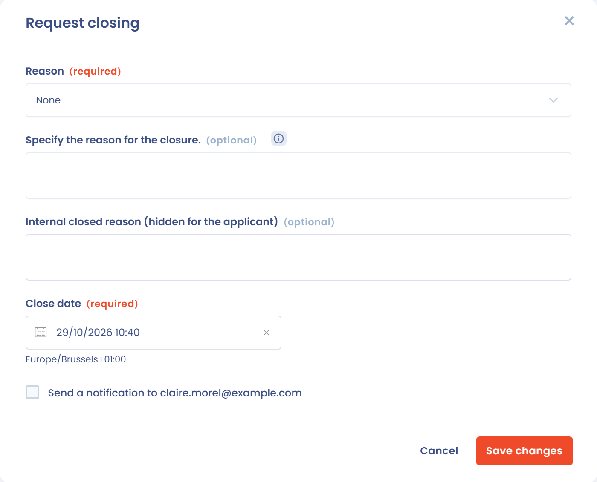
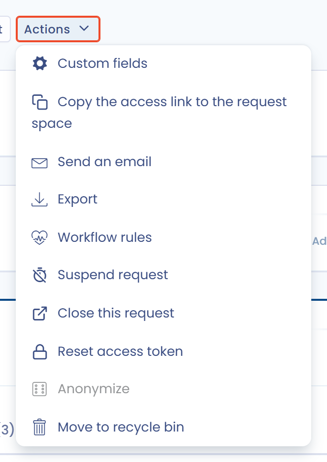

# Edit and process requests

Dastra lets you manage the entire lifecycle of a data subject right request (DSAR).\
From the interface, you can:

* **Qualify the request**: type of right concerned, organizational unit, deadline management.
* **Verify the identity** of the requester by completing or adjusting the information collected.
* **Process the associated data** by consulting the linked datasets, uploading evidence and notifying the owners.
* **Respond directly** to the requester, with the help of the AI assistant if you wish, with full traceability of the exchanges.
* **Close the request** by recording the closing reason.

Each step is documented and recorded in the history, which lets you demonstrate compliance and give data subjects a clear response.

***

## Qualifying the request

When a request is registered, it appears in the record of requests.\
In the **Details of the request** section, you can:

1. Define the **request types** concerned.
2. Assign the request to an operator and to an **organizational unit**.
3. Manage the **processing deadlines**.

<figure><figcaption>
The Details of the request section
</figcaption></figure>

The section also holds the **Preferred language of the requester**, the **Tags**, the **Request message (from the requester)**, **Additional information** and the **Reference of the requester**.

### Request types

Dastra offers 17 request types:

| Type | What the requester asks |
| --- | --- |
| Information | Information about the processing of their data |
| Access | A copy of their personal data (Article 15) |
| Rectification | The correction of inaccurate data (Article 16) |
| Erasure | The deletion of their data (Article 17) |
| Restriction | The limitation of the processing (Article 18) |
| Opposition | To stop a processing based on legitimate interests or used for marketing (Article 21) |
| Portability | To receive their data in a structured format or have it transferred (Article 20) |
| Advance directives | To set instructions for the fate of their data after their death (French law) |
| Automated decision making | Not to be subject to a decision based solely on automated processing (Article 22) |
| Freedom of information | Access to administrative documents, for French public bodies |
| Request to DPO | A request addressed to the data protection officer |
| Third party request | A request made by a third party |
| Data protection complaint | A complaint about the handling of personal data |
| Do Not Sell/Share My Data | To opt out of the sale or sharing of personal information (California law) |
| Limit Use of Sensitive Personal Information | To limit the use of sensitive personal information (California law) |
| Withdrawal of Consent | To withdraw a consent given earlier (Article 7(3)) |
| Other | Any request that fits none of the types above |

A request can cover several types.

### Processing deadlines

The legal deadline is calculated from the date of the request:

* 30 days by default.
* 20 days when the **Freedom of information** type is selected.
* 90 days when you select **Complex (90 days)**. This option takes precedence over the two other deadlines, and the extension must be justified.

You can also set the **Expiration date** in one click: the **+8d**, **+30d** and **+90d** buttons add 8, 30 or 90 days to the request date.

If you suspend the request (see [Suspending a request](process.md#suspending-a-request)), the **Expected expiry date** pushes the deadline back by the length of the suspension.

***

## Verifying the identity

Dastra makes it possible to verify the identity of the person who submitted the request.\
You can complete or modify the information collected via the initial form:

* Email address, first name, last name.
* Additional data: country, postal address, phone number, user identifier, etc.
* Data subject category (for example newsletter subscribers, customers, employees).

<figure><figcaption>
The Identifying information section
</figcaption></figure>

When the request comes from a collection form, the fields filled in by the requester (the message and the email address) are locked and cannot be edited.

If other requests have the same email address, the side panel shows the **n requests with similar e-mail** link. Use it to spot duplicates.

***

## Request processing

The **Request processing** section brings together all the actions related to processing. It has three tabs: **Attachments**, **Related data processing** and **Related purposes**.

### Attachments

You can upload evidence files or exports containing the requester's data.\
These files can then be attached when responding. Each file has buttons to preview, redact (depending on your plan), download or delete it, and **Download all (.zip)** downloads all the files at once. Files can be up to 100 MB.

<figure><figcaption>
Adding files to the request
</figcaption></figure>

To hide third-party information in a document before sending it, see [Document redaction](redaction.md).


**Health data**: Dastra is not HDS certified (the French certification for health data hosting), but our host, Microsoft Azure, is. Keep this in mind before sending documents that contain health data through the interface.


### Related data processing

Dastra automatically identifies the datasets associated with the **data subject category**.\
Each dataset must be processed individually.

* Available statuses: **Pending** / **Processed**. A dataset can also be set to non applicable.
* Display of the overall progress (as a percentage).

The **Related data processing** tab displays all the relevant datasets according to a **cumulative model**: those attached to the organizational unit assigned to the request, those of **all its parent units** (up to the root of the hierarchy) and those of **all its descendant units**. This view ensures that no inherited dataset is overlooked during processing.

<figure><figcaption>
The datasets inherited from the parent and descendant units are displayed according to a cumulative model
</figcaption></figure>


A request cannot be declared 100% processed as long as inherited datasets have not been processed or explicitly marked as non applicable.


If the operator in charge of the request does not have access rights to some of the datasets displayed, a **visual indication** invites them to contact the owners concerned.

#### Details of a dataset

Click the **Mapping** button to view the links between the data subject category, the datasets and the assets.

<figure><figcaption>
View the link between the data subject category and the owner to contact
</figcaption></figure>

By clicking **Process**, you access the detailed information:

* Personal data fields concerned (for example full name, email address).
* Legal basis and retention period.
* Terms of erasure after the retention period.

<figure><figcaption>
Quick access to the asset detail
</figcaption></figure>

#### Marking a dataset as processed

For each dataset:

1. Review the information.
2. Justify the processing carried out (for example erasure, rectification) in **Additional details on this processing**. This field is required, and **Generate** drafts the text with AI.
3. Add evidence files if necessary.
4. Click **Mark as done**.

If the dataset is not concerned by the request, click **Mark as non applicable**. The status is updated and the comment is kept.

<figure><figcaption>
Request processing interface specific to the asset
</figcaption></figure>

#### Collaboration and notifications

You can automatically notify the owners of the assets concerned.\
Click **Notify owners**: a window lets you select the people to notify by email, then click **Send**.

<figure><figcaption>
Quickly notify the owners of the assets
</figcaption></figure>

### Related purposes

The **Related purposes** tab lists, in a table, the processing purposes linked to the data subject category (**Purpose label**), with their **Legal basis** and the **Related data processing**. Purposes only appear if they belong to the same organizational unit as the request.

<figure><figcaption>
The purposes associated with the data subject category
</figcaption></figure>

***

## Responding to the request

Once processing is complete, you can respond directly to the requester in the **Response** section.

* Click **Generate with AI**: the **AI assistant** suggests a compliant and customizable message in the **Requests AI Chatbot** window.
* Adjust the message with the suggestions: more formal, less formal, shorter, longer, with emojis, approve the request, validate identity. You can also type your own instruction with **Use a custom instruction**.
* Click **Use this message**, then send it directly from Dastra.

<figure><figcaption>
Exchange messages with the requester, using AI if you wish
</figcaption></figure>

***

## Close a request

To close a request, click **Close this request** in the **Actions** menu or at the bottom of the page. In the window that opens:

1. In the **Reason** list, choose the closing reason. This field is required.
2. In **Specify the reason for the closure.**, add an explanation that the requester will see in their space. This field is optional.
3. In **Internal closed reason (hidden for the applicant)**, add a note for your team if needed.
4. Check the **Close date**.
5. To notify the requester by email, select **Send a notification to** followed by their address. The box only appears if the request has an email address, and it is not selected by default.
6. Click **Save changes**.

<figure><figcaption>
The window for closing a request
</figcaption></figure>

If the request is suspended, closing it lifts the suspension automatically. A closed request can be reopened with the **reopen** button.

***

## Additional actions on a request

In addition to the main steps (qualification, verification, processing and response), Dastra offers an **Actions** menu that makes it possible to carry out advanced operations on a request.

<figure><figcaption>
Quickly access the many additional actions available
</figcaption></figure>

The available actions notably include:

* **Custom fields**: add or modify specific fields to enrich the request.
* **Copy the access link to the request space**: share a direct link with the data subject.
* **Send an email**: send a message related to the request directly from the platform.
* **Export**: export the information of the request.
* **Workflow rules**: apply or trigger an automation rule.
* **Suspend request**: pause the legal processing deadline (see below).
* **Close this request**: manually mark the request as completed.
* **Reset access token**: recreate a secure link for the requester.
* **Anonymize**: erase the identifying data linked to the request. It becomes available once the request is closed.
* **Purge files**: delete the transmitted attachments. The menu shows their number, for example **Purge files (1)**. Their names and dates are kept. This action only appears once the request is closed.
* **Move to recycle bin**: place the request in the recycle bin. The purge rules then apply (see [Request purge rules](advanced/purge.md)).

### Suspending a request

In some cases, it is necessary to **temporarily suspend** a request (for example, while awaiting identity verification).\
The suspension interrupts the legal deadline, which only resumes once the suspension is lifted.

<figure><figcaption>
Suspend a request while awaiting a response from the requester, for example
</figcaption></figure>

* **Suspension date**: required.
* **Suspension justification**: free-text field to document the reason (for example awaiting supporting documents).

Then click **Save changes**.

Once the request is suspended, the interface clearly displays the state and offers the **Resume the legal deadline** button.

<figure><figcaption></figcaption></figure>

The counter of remaining days is automatically recalculated, taking the suspension period into account.

***

## Requester messages

The **Messages** page of the **Requests** menu gathers, request by request, the messages exchanged with requesters. Each group shows the request title and the requester's name. You can filter the list by operator (**Assigned to**), by sender (**Message sender**), by message type (**Messages from requesters**, **Operator messages** or **All messages**) and by period.

<figure><figcaption>
The inbox of requester messages
</figcaption></figure>

A requester message that has not been read yet is marked with an envelope icon. A **Viewed** check mark appears once it has been read. To open the conversation, click **View**: in the request, the **Mark as read** button marks the new messages as read.

## Request statistics

The **Reporting** page of the **Requests** menu shows the activity of the module over the period you choose (30, 90, 180 or 365 days, or a custom period). It notably shows:

* the number of requests created, closed, closed late and complex;
* the average closing time;
* the evolution of open and closed requests;
* the breakdown of requests by type, by step, by operator and by closing reason.

You can filter by organizational unit and by step, include the recycle bin, use **Filters** (for example to pick a collection form or exclude anonymized requests) and print the page with **Print**.

<figure><figcaption>
The request statistics
</figcaption></figure>

***

## Overall tracking

Each request keeps the complete history:

* Messages exchanged.
* Attachments added.
* Status and processing progress.

This makes it possible to ensure traceability and compliance in the event of an audit.
