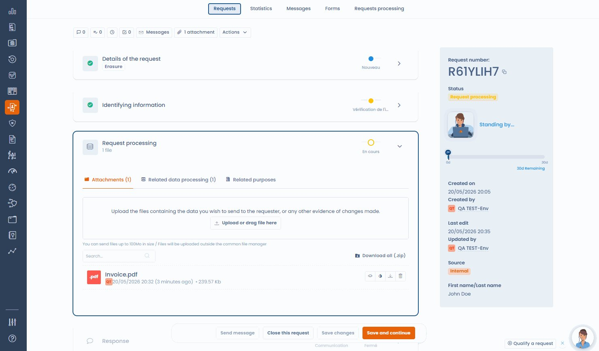
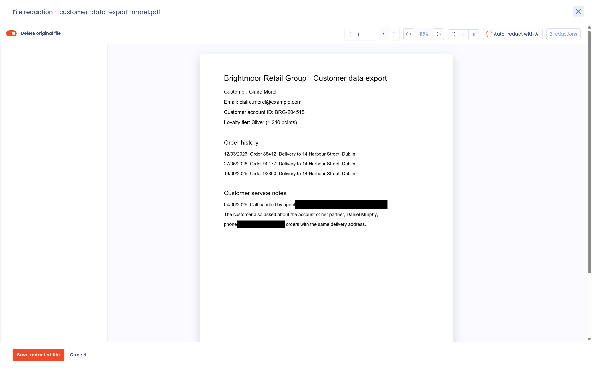

# Document redaction

When you process a data subject request, you often have to send documents to the requester: a copy of an ID, a contract, an account history, a customer file. These documents almost always contain confidential information that must not be disclosed: data about third parties, internal contract terms, named references.

Dastra includes a redaction tool inside the request. The interface calls it **File redaction**.

***

## Open the redaction tool

The tool opens from the attachments of the request. It accepts PDF, PNG and JPEG files and depends on your plan: the button does not appear if redaction is not included.

1. In the **Requests** menu, open **Record of requests**, then open the request to process.
2. In the **Request processing** section, open the **Attachments** tab. Upload the document if needed.
3. On the file row, click the **Data redaction** icon. You can also open the file preview and click **Data redaction**.

The **File redaction** editor opens on the document.

<figure><figcaption>
The request attachments, with the redaction icon on each compatible file
</figcaption></figure>

***

## Redact manually

Draw the areas to hide on each page with the mouse. The editor shows the number of redactions and offers these actions:

* **Remove redaction** deletes one area.
* **Undo last redaction** goes back by one area.
* **Clear page redactions** and **Clear all redactions** start again from a clean page.
* The zoom and page buttons make long documents easier to read.

<figure><figcaption>
Draw the areas to redact directly on the document
</figcaption></figure>

<figure><figcaption>
The File redaction editor
</figcaption></figure>

***

## Redact with AI

In the editor, click **Auto-redact with AI** to open the **Auto-redact with AI** dialog. The AI analyzes the document, finds third-party personal data (names, addresses, contact details, identification numbers) and places redaction areas. No data is kept beyond the session.

The dialog offers three options:

* **Exclude the data subject's own information from redaction**: selected by default, so the requester's own data stays readable.
* **Custom instruction**: an additional instruction, for example also redact all company names.
* **Additional phrases to redact**: up to 20 phrases to hide wherever they appear. Type a phrase, then press Enter.

Then click **Auto-redact with AI**. The suggested areas are added to the editor: remove the ones detected by mistake and add the ones the AI missed. The **Auto-redact with AI** button only appears if AI redaction is included in your plan.

<figure><figcaption>
The options of AI auto-redaction
</figcaption></figure>

<figure><figcaption>
The AI analyzes the document and places the redaction areas for you to review
</figcaption></figure>


The AI result is a starting proposal, not a final decision. A qualified person must review and validate every area before the document is sent.


***

## Save the redacted file

When the review is done, click **Save redacted file**. The button stays inactive until at least one area is drawn. The **Delete original file** switch, on by default, decides what happens to the original:

* On: the redacted file permanently replaces the original, which is deleted.
* Off: the redacted file is added as a new attachment, named with the suffix `-redacted`, and the original is kept.

Dastra asks you to confirm before saving. Pages are flattened into images: the hidden text no longer exists in the resulting file and cannot be extracted. A redacted file shows the **File data redacted** indicator, with the number of redacted areas.


A plain opaque rectangle over an unflattened PDF can be bypassed and is not a compliant redaction. Flattening to an image is the method recommended by data protection authorities.


***

## Best practices

* Review the redacted document before sending it to check that no confidential information is visible.
* Turn off **Delete original file** to keep the original in the request, for example for your compliance record, unless your internal policy requires deleting it.
* For long or complex documents (multi-page contracts, account statements), combine AI detection with a page-by-page manual review.
