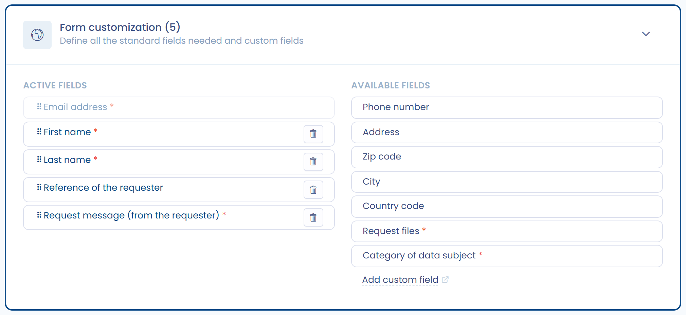
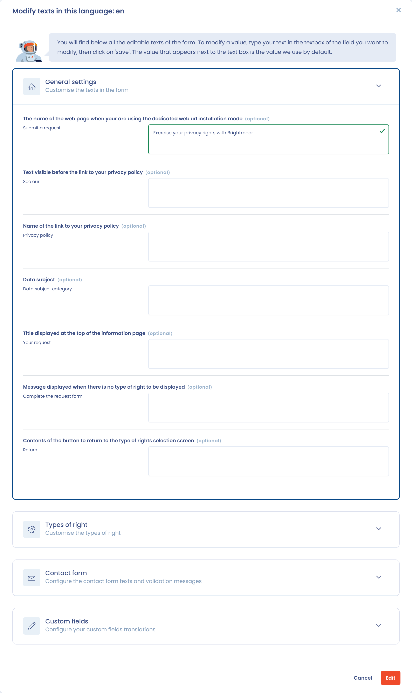

# Set up a data subject right request widget

The Dastra widget adds a data subject request form directly to your website. In the application, you manage it under **Requests** > **Forms**: click **Create form** to add one.

You can customize it in five ways:

* **General settings**: the request types offered, redirections and the privacy policy link.
* **Visual customization**: colors, logo, background image, icons, font and progress bar.
* **Fields**: standard and custom fields, required or optional.
* **Integration modes**: in a page, in a modal window (popup), in an iframe or on a dedicated web page.
* **Multilingual**: translate and adapt every text of the widget.

***

## Integration workflow

The diagram below shows how a data subject request widget works in Dastra:

<figure><figcaption>
The journey of a request collected through the widget
</figcaption></figure>

The process is as follows:

1. The data subject submits a request through the widget.
2. The request is sent to Dastra and recorded.
3. You are notified and can qualify and process the request in the platform.
4. The data subject receives an answer in the requester portal.

***

## General settings

Open a form and go to the **Settings** section. You define:

* The **Name** of the widget and its **Organizational unit**.
* The available request types, with the question **Which rights are concerned?**: **Default rights**, **Specific rights** (you then pick the types in **Choose specific request types**) or **No rights (simple form)**, which does not ask the person to choose a request type.
* The links **Redirection link in case of success (after the identification phase)**, **Redirection link in case of an error (e.g. validation link expires)** and **Link to the privacy policy**. All three links are optional.

<figure><figcaption>
Widget settings
</figcaption></figure>

***

## Customizing the appearance

The **Templating of the form** section adapts the form to your brand. The preview updates as you edit.

Available options:

* **Logo**, and **Background image** (offered with the **Background image** header layout or with the dedicated web page mode).
* Colors: **Primary color**, **Secondary color** (with the **Default** header layout), **Titles color**, **Color text** and **Muted color**.
* **Header layout**: **Default**, **Flat**, **Background image** or **No header**.
* **Box shadow**: **Large**, **Standard** or **No shadow**.
* **Icon layout**: **No icons** or **Standard icons**.
* **Display progress bar**.
* **Font family name**: the name of a font installed on your website.
* **Custom CSS**, for advanced users.

<figure><figcaption>
Adapt the appearance of the widget
</figcaption></figure>

***

## Customizing the fields

The **Form customization** section lists the **Active fields** on the left and the **Available fields** on the right. Click an available field to add it, drag the active fields to change their order and click an active field to edit it.

* The email address is always present. By default, the form also asks for the first name, the last name, the reference of the requester and the message.
* You can add standard fields: **Phone number**, **Address**, **Zip code**, **City**, **Country code**, **Request files** and **Category of data subject**.
* You can add your own **custom fields**, created in the custom fields of requests.
* Each field has a **Required** switch.
* For the **Category of data subject** field, click **Configure categories** to choose the categories offered to the person.

<figure><figcaption>
Customize the fields available in the widget
</figcaption></figure>

***

## Conditional logic (skip logic)

For each field, you choose when it is displayed: **Display always**, **Afficher en fonction du type de demande** or **Custom display conditions**. With custom conditions, a field appears only if the answer to a previous question meets a defined condition.

The operators offered depend on the field type, as in workflow rules:

* comparisons (less than, greater than and their inclusive variants) for numbers and dates;
* "is in" and "is not in" for drop-down lists and radio buttons;
* "contains all", "excludes all", "is empty" and "is not empty" for checkboxes;
* presence or absence of a value for optional fields.

The form preview applies these rules. They are interpreted dynamically on the respondent side: the form adjusts in real time as answers are entered.

You can then:

* Show or hide fields depending on the type of right exercised, the nature of the request, or any previous answer
* Manage multiple scenarios within a **single widget**, without creating and maintaining a separate form for each variant
* Reduce maintenance overhead when content evolves or compliance requirements change

***

## Installing the widget

The **Installation** section offers four integration modes, chosen with **Choose the layout of the widget**:

* **Block (recommended)**: an HTML snippet to place where the form should appear.
* **Modal**: a button opens the form in a window.
* **Page (With url)**: Dastra hosts a page and you share its URL, for example in your privacy policy.
* **Embedded in an Iframe**: an iframe to place in your page. The **Resize iframe automatically** option avoids a scroll bar; otherwise the height is fixed at 1000 px.

The code provided is an HTML snippet and a JavaScript script to insert on your site or in a tag manager (for example Google Tag Manager). For advanced options (language, prefilled fields, several widgets in one page), see [Technical integration](integration.md).

<figure><figcaption>
Installation guide
</figcaption></figure>

***

## Texts and translations

The widget is multilingual: in the **Texts and localizations** section, add languages with **Add a language** and customize the translations.\
The first language in the list is the default language: Dastra uses it when the person's browser language is not available.

<figure><figcaption>
Customize the texts of the widget
</figcaption></figure>

For each language, click **Edit** to open the texts, grouped in four sections (**General settings**, **Types of right**, **Contact form** and **Custom fields**). You can edit:

* The page name (for the dedicated web page mode).
* The messages shown before the privacy policy links.
* The text of buttons and instructions.
* The translation of data subject categories and custom fields (label, description, placeholder and options).

<figure><figcaption>
Change part of the texts
</figcaption></figure>

***

## Result for the data subject

Once configured, the widget lets data subjects select the type of right they want to exercise and submit their request.\
The form adapts to the configuration (languages, appearance, fields).
