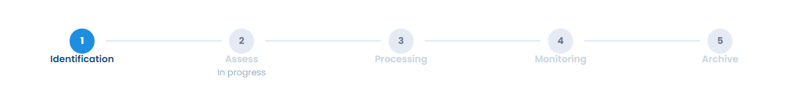

# Risk management process

The Dastra risk management process is a **simplified version** of the **eBios Risk Manager** model and of the **CNIL risk assessment methodology**.

## Manage your risks in 4 steps 

Managing a risk follows four main steps, followed by archiving. At the top of a risk page, the progress bar shows them under the labels **Identification**, **Assess**, **Processing**, **Monitoring** and **Archive**.

<figure><figcaption>
The 4 steps of risk management, then archiving
</figcaption></figure>

**1. Identify**\
Identification determines the events likely to occur and cause a dreaded event (such as a loss). It gives an overview of how, where and when this event could occur.

**2. Assess**\
The risk is assessed according to the **level of impact** of the dreaded event and the **probability** that it occurs, based on the **threats** that enable it. The app labels these two measures **Severity** and **likelihood**.

**3. Treat**\
Treatment is the response given to the risk. It takes one of five forms:

* _risk reduction_: measures must be implemented to reduce the risk;
* _risk acceptance_: the organization accepts the raw risk as it stands, without reduction measures;
* _risk avoidance_: the risk prevents the activity in question from being carried out;
* _risk transfer_: the risk weighing on the organization is transferred to another organization, for example through insurance;
* _risk-taking_: the risk should be subject to reduction measures, but the organization agrees not to implement them.

**4. Monitor**\
Once a response has been given, the risk is under control. Review and reassess it regularly to take its changes into account, in particular when you set up control points.

Finally, **archive** your risks once they have disappeared, to keep a record of them.


The distinctive feature of the Dastra risk management process is that it updates the risk assessment in near real time, based on the results of the control points.

