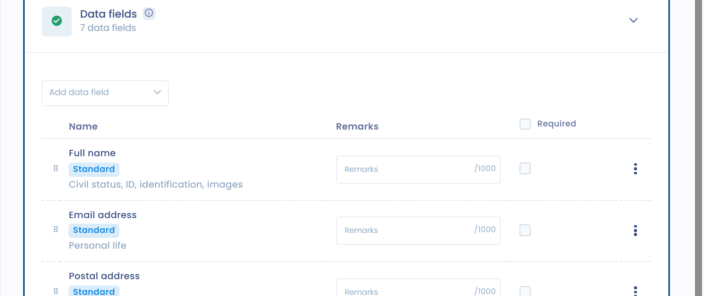
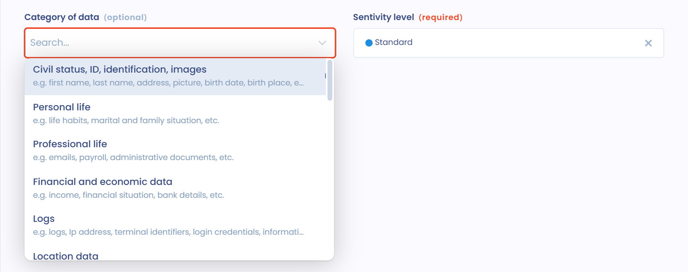
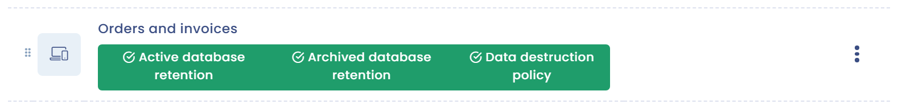

# Datasets and retention

[**Article 30 of the GDPR**](https://gdpr-info.eu/art-30-gdpr/) also requires the record to list the categories of data processed.

This section is where you define the categories of data processed. They can be common or sensitive. Some data present a greater risk to natural persons, such as data relating to health, political opinions or trade union membership. Data relating to criminal offenses or convictions are also particularly protected.

Similarly, the national identification number (such as the social security number) can be considered as sensitive data.

The collection of sensitive data is prohibited in principle. Only the exceptions provided for in [**Article 9 of the GDPR**](https://gdpr-info.eu/art-9-gdpr/) allow it.

## Datasets

A dataset groups the data of a specific element, for example a table in a database or a paper collection form.

### Several ways to use datasets

Datasets can be used in several ways:

* **Case 1**: by associating **a dataset with a single asset**. In this case, the dataset corresponds to the data of the asset and is not generic.
* **Case 2**: by associating **a dataset with the processing activity**. This dataset can be specific to the processing activity and is not reused in another processing activity.
* **Case 3**: by associating **generic datasets with the processing activity**. In this case, the dataset can be reused in several processing activities.

To use generic datasets, we recommend the following procedure:

* Open the **Datasets** section of the processing activity.
* Open the datasets page of the data mapping in a new tab.
* Select the dataset in the processing activity.
* If the dataset needs to be modified, create another one: go to the other tab and duplicate the generic dataset, removing or adding the desired fields.
* For more clarity, we recommend tagging these datasets, so that you can tell them apart in the dataset selector. For example: a "generic" tag and a tag for the added or removed data.


A dataset can be linked to several processing activities. When you edit a dataset used by several processing activities, Dastra warns you that your changes affect all of them. If the data fields differ significantly for one processing activity, create a copy of the dataset and customize the copy.


#### Use datasets without fields

You can also stay even more generic by not specifying the data fields of the dataset, and by naming the dataset after a category of data (which is also valid under the GDPR, for example).

Depending on the processing activity, you can take different approaches, according to its sensitivity with regard to the rights and freedoms of the data subjects.

### Add datasets to the processing activity

In the **Datasets** section, you have two options:

* if your datasets are already documented in your data mapping, click **Existing datasets** and select the datasets to link to the processing activity;
* otherwise, click **Add a dataset** to open the **Dataset creation wizard**. Create the dataset with the AI assistant (**AI Generated**), from an existing dataset (**Use as a model**), by selecting its data fields (**Step by step guide**) or from scratch (**Empty dataset**).

Each dataset of the processing activity shows its retention rules and the purposes it serves. Switch on **Display data fields** to also show the data fields of each dataset. By default, a dataset is linked to all the purposes of the processing activity: from the **...** menu of the dataset, you can select one or more specific purposes. The same menu lets you **Edit** the dataset, **Create a copy**, view its **Details** or **Remove connection** with the processing activity.

Click a dataset to open it and complete the information described below.

### Associate the source of the data with the dataset

In each dataset, you can enter the origin of the data in **Data source origin**: **Direct**, **Indirect**, or **Direct and indirect**.

The **Description of the collection source** field lets you add any necessary detail.

<figure><figcaption>
Source of the data
</figcaption></figure>

### Associate an asset with the dataset

Datasets are naturally meant to be linked to [assets](assets.md).

You can link an asset to your dataset in the **Linked asset** field, in the **General information** block of the dataset.

<figure><figcaption>
Asset selector
</figcaption></figure>

A dataset can only be linked to one asset: the datasets of an asset are specific to it.

For example, if you consider accounting software as an asset, several datasets could be linked to it, such as "billing data" with the data of the invoice tracking module, or "customer data" with the data of the customer accounts.

### Associate data subject categories

For each dataset, you can link one or more data subject categories in **Related subject categories**.

This helps you understand which data relates to which data subjects. It also simplifies your data mapping work.

<figure><figcaption>
Data subject categories selector
</figcaption></figure>


Specifying the data subjects is useful when managing [data subject requests](../../requests/README.md): you can quickly identify the datasets concerned and find the data covered by the request.


### Associate data fields

Each dataset is meant to be completed with data fields. These fields are the data themselves.

In the **Data fields** block, click **Add data field**. The fields offered in the selector are those available in your data glossary.

<figure><figcaption>
Data fields selector
</figcaption></figure>

If a field does not exist yet, click **Create a data field** to create it and add it to the dataset.

Fields can be classified into predefined categories of data, such as **Civil status, ID, identification, images**, **Personal life**, **Professional life** or **Financial and economic data**. These categories follow those recommended by the French supervisory authority (CNIL).

<figure><figcaption>
Category of data selector
</figcaption></figure>

The data field is also where you indicate the sensitivity level of the data: **Standard**, **Data of a highly personal nature** or **Special categories (sensitive)**, for example health data.

For special categories of data, you are asked to justify the collection of this data, and in particular its lawful basis, in **Lawful basis for collection** and **Justification for collecting sensitive personal data**.

<figure><figcaption>
Sensitive data
</figcaption></figure>


Sensitive data is taken into account in the **Sensitivity** indicator of the processing activity. Datasets containing it are flagged with the **Special categories of personal data (sensitive)** badge in the **Datasets** section.


### Associate a retention policy with the dataset

In each dataset, you can define default retention policies in the **Default retention policies** block.

<figure><figcaption>
Retention periods
</figcaption></figure>

These retention periods are defaults: they can be customized at the level of each processing activity (see below).

You can define a retention in the active database, a retention in archived database and a destruction policy:

* **Active database retention**: the active database is the current database of the processing.
* **Archived database retention**: intermediate archiving is a more restricted form of storage.
* **Data destruction policy**: describe the conditions for deleting the data or transferring it for permanent archiving.

For the active and archived databases, enter the **Retention period**, then **Describe the policy (duration, conditions...)** and add a **Justification**. For the destruction policy, fill in the **Description of the data purge policy** and its **Justification**.

## Data retention

The limited retention of data is one of the general principles of personal data protection, recalled in [**Article 5 1. e) of the GDPR**](https://gdpr-info.eu/art-5-gdpr/). Personal data shall be

> kept in a form which permits identification of data subjects for no longer than is necessary for the purposes for which the personal data are processed.

In practice, when you implement a processing activity, you must plan what will become of the data once the purpose has been achieved. The data will then have to be permanently destroyed, anonymized, or processed for a new compatible purpose.

The retention period depends on the purpose of the processing and the nature of the data. Retention periods can be defined according to the types of data. For example, for payroll management, the data relating to the payslip are kept for 1 month in the active database and 5 years in intermediate archiving, while the data relating to the transfer order for payment are kept in the active database for the time necessary to issue the payslip, and for 10 years from the closing in intermediate archiving.

The duration can be expressed as a value or, if this is not possible, as the criteria used to define the retention period (until unsubscription, for example). It is recommended, in particular by the CNIL in its [**recommendation of 11 October 2005 on electronic archiving in the private sector**](https://www.legifrance.gouv.fr/affichCnil.do?id=CNILTEXT000017651957) (in French), to set up procedures to manage retention periods at the level of the category of data and, in particular, to manage the purge or destruction of data.

### Customize the retention policy of a dataset for a processing activity

The data fields of a generic dataset cannot vary from one processing activity to another. However, the retention period can. You can customize the retention period of a dataset for a given processing activity: the default retention period of the dataset then no longer applies to this processing activity.

To do this, the dataset must be added to the processing activity. In the **Datasets** section, click one of the retention buttons of the dataset: **Active database retention**, **Archived database retention** or **Data destruction policy**. A green button means that the rule is defined; a red **Active database retention** button means that it is missing.

<figure><figcaption>
Retention buttons of a dataset, with a customized rule
</figcaption></figure>

The **Custom retention policy** panel opens. It reminds you of the dataset concerned. Switch on **Customize rule**, then enter the **Retention period**, **Describe the policy (duration, conditions...)** and the **Justification** that apply to this processing activity only.

<figure><figcaption>
Customizing the retention period for a processing activity
</figcaption></figure>

When a retention period is customized at the processing activity level, a pencil icon appears on the corresponding button.

To change the retention rule that applies to the dataset in all processing activities, click the dataset shown at the top of the panel.

In the long term, the objective may be to limit the use of generic datasets and to move towards a more precise mapping, either through processing activities (case 2) or through assets (case 1).
