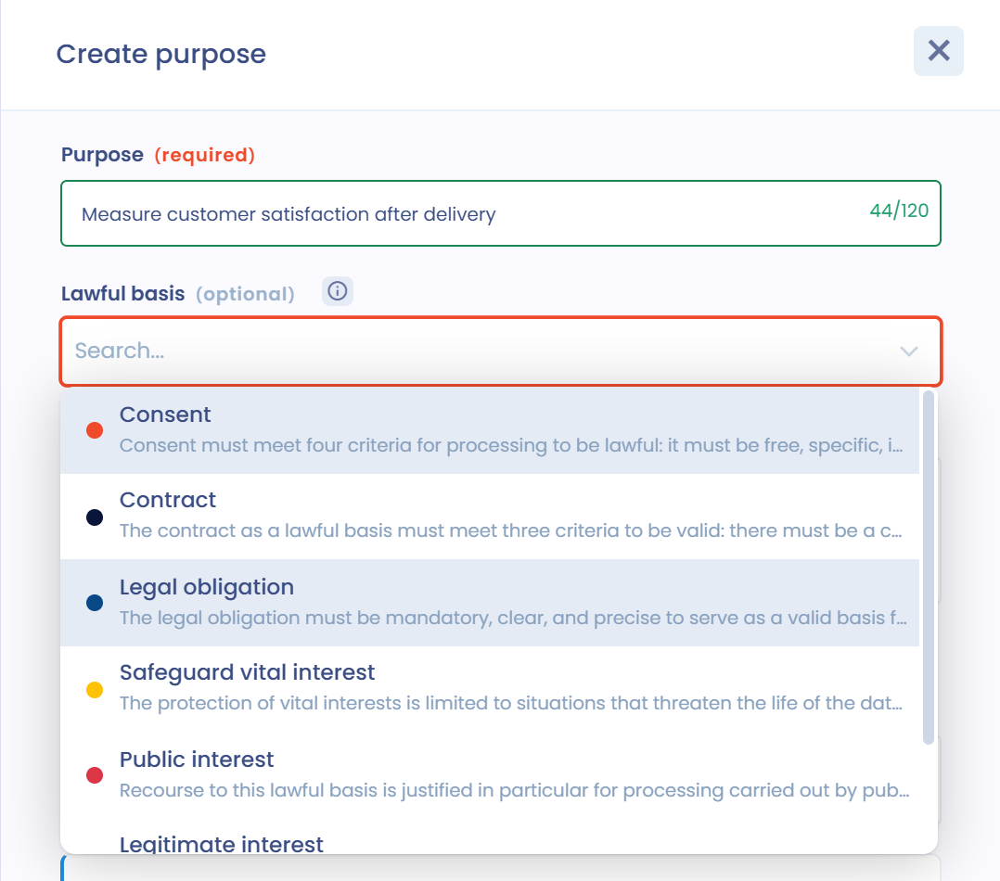

# Purposes

## Purposes of a processing activity

A **purpose** is the objective pursued by the creation of your file. It indicates what the processing of personal data will be used for, its raison d'être. This objective must be clear and understandable.

The definition of the purpose is fundamental because it is a prerequisite for the other elements framing the processing, such as the data retention period, the adequacy, relevance and proportionality of the data, as well as the accuracy and updating of the data.

[**Article 5 1. b) of the GDPR**](https://gdpr-info.eu/art-5-gdpr/) provides that the purpose must be determined, explicit and legitimate.

**The purpose must be determined:** the purpose must be defined with sufficient precision to adapt the necessary data protection guarantees and to define the scope of the data processing. The level of detail required depends on the particular context of the data collection and the data involved. Sometimes simple language will be enough. For example, a local family business will not require the same level of detail to describe the purpose of its customer file as a multinational using complex algorithms to make personalized offers and targeted advertising. The purpose must be determined before the processing is carried out.

**The purpose must be explicit**: the purpose must not be ambiguous and must be clearly expressed.

**The purpose must be legitimate**: legitimacy refers to the lawful basis on which the data processing is founded, as required by [_Article 6 of the GDPR_](https://gdpr-info.eu/art-6-gdpr/).

This notion also requires that the purpose does not contravene the law in general. For example, the purpose will not be legitimate if it leads to discrimination prohibited by criminal law. Labor law, consumer law or contract law, in particular, can be taken into account.

In addition, the context of the processing must be taken into account to assess its legitimacy and, in particular, the reasonable expectations of the data subject.

A processing activity can have several purposes. For example, the "recruitment" activity could have two distinct purposes: the analysis of applications and the management of interviews, and the creation of a CV library.

For each purpose, you must define the applicable [**lawful basis**](https://ico.org.uk/for-organisations/guide-to-data-protection/guide-to-the-general-data-protection-regulation-gdpr/lawful-basis-for-processing/). There can only be one lawful basis per purpose. The choice of this lawful basis must be made according to the context of the processing.

## Add a purpose in Dastra

Purposes are added in the **Purposes** section, the third section of the processing activity. You can add as many purposes as you need.

1. In the **Purposes** section, click **Add a purpose**. The **Create purpose** window opens.
2. Choose how to create the purpose:
   * **Generated by AI**: generate a list of purposes with AI. Select the purposes to keep, then click **Add**.
   * **From another purpose**: start with an existing purpose. You can filter the purposes by **Data processing** and by **Lawful basis**.
   * **Personalized**: create a new purpose from scratch.

You can also open these three options directly from the arrow next to the **Add a purpose** button.

<figure><figcaption>
The three ways to create a purpose
</figcaption></figure>

When you create a purpose from scratch, fill in the following fields, then click **Add**:

* **Purpose** (required): the name of the purpose, limited to 120 characters. Dastra suggests existing purposes as you type.
* **Lawful basis** (optional): the lawful basis of this purpose (see below).
* **Purpose description** (optional): describe the purpose. The AI **Generate** button can draft this description for you.
* **Give further details on this lawful basis**: displayed once a lawful basis is selected, for example to specify the legitimate interests pursued or the legal provision that imposes the processing.

<figure><figcaption>
Creating a purpose from scratch
</figcaption></figure>

The purposes are listed in a table with their name, their description and their lawful basis. Click a purpose to edit it, or use the **...** menu to **Edit purpose** or **Delete** it.

## Lawful bases

There are 6 possible lawful bases for data processing. In Dastra, the **Lawful basis** list offers these 6 lawful bases, plus **Other**.

### Consent

**Consent** must meet four criteria for processing to be lawful: it must be

* freely given,
* specific,
* informed and
* unambiguous.

It must be as easy to withdraw as to give. You must document proof that consent was validly obtained. You can do this by attaching a description of the consent collection process to the processing activity, in the **Documentation** section (section 11).

### Contract

The **contract** (contract or pre-contractual measures) must meet three criteria to be a valid lawful basis:

* there must be a contractual or pre-contractual relationship between the controller and the data subject;
* the contract must be valid under the applicable law and
* the processing must be objectively necessary for the performance of the contract.

The right to object cannot be exercised on a processing based on this lawful basis, whereas the right to data portability can. You can add the contract on which you base the processing as an attachment in the **Documentation** section (section 11).

### Legal obligation

The **legal obligation** must be

* imperative,
* sufficiently clear and precise to provide a valid basis for processing.

The texts creating this obligation must at least define the purpose of the processing.

The obligation must be imposed on the controller and not on the data subjects. You must detail the text that imposes the processing (for example, an article of law).

### Safeguard vital interest

The **safeguarding of vital interests** is limited to situations that threaten the life of the data subject or of another natural person. The most obvious application is the situation where a person is the victim of an accident and, being seriously injured, is admitted to a hospital while unconscious and is not in a condition to give consent to the processing of his or her data for treatment. This basis must be interpreted strictly and used only if consent cannot be sought.

### Public interest

**The performance of a task carried out in the public interest or in the exercise of official authority**. The use of this lawful basis is justified in particular for processing operations implemented by public authorities to carry out their missions.

Two conditions are necessary:

* the processing must allow the relevant and appropriate exercise of the task entrusted to the public authority and must not pursue another purpose that is unrelated or too far removed from the specificities of the public interest task in question;
* the public interest must be defined in the law and cannot be presumed.

You will need to detail the public interest task that requires the processing.

### Legitimate interest

The **legitimate interests** of the controller or of a third party.

This lawful basis cannot be invoked by public bodies in the performance of their tasks and must meet 3 conditions:

* the interest pursued must be legitimate, that is, lawful, clear and precise, and real (not fictitious);
* the processing must be necessary to achieve the objective, and therefore be the least intrusive means;
* and finally, the processing must not override the rights and freedoms of the data subjects, taking into account their reasonable expectations.

A balancing test must be carried out, for example with a proportionality test.

You can keep the results of this test as a document in the **Documentation** section (section 11). You will also need to detail the legitimate interests invoked (e.g. security of the computer network or the fight against fraud).

### Other

Only the 6 lawful bases above can be invoked to found a processing. Use **Other** only if you are not yet sure which lawful basis applies.

## Add the lawful basis to a purpose

In each purpose, select one of the lawful bases above in the **Lawful basis** list. A description of each option is displayed in the list.

<figure><figcaption>
Selecting the lawful basis of a purpose
</figcaption></figure>

Once the lawful basis is selected, a reminder of its conditions is displayed and you can add a description in **Give further details on this lawful basis**. For example, to specify the legitimate interests or the legal provision concerned.


If you use [questionnaires](../../questionnaires/README.md), Dastra suggests creating an assessment when a purpose is based on **Legitimate interest** (**Create a Legitimate Interests Assessment (LIA)**) or on **Consent** (**Create a legal basis for consent questionnaire**).

