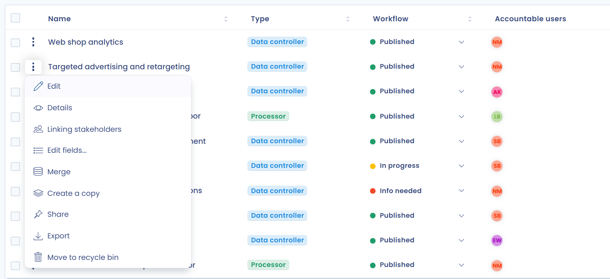

# Declare a processing activity

## Definition of a processing activity

A processing activity is an operation or set of operations performed on personal data, such as payroll management. All processing activities taken together make up the record of processing activities.

## Create a processing activity

To create a processing activity, open the record of processing activities and click **Create data processing**. The **Processing activity creation** window offers four options:

* **AI Generated**: describe your processing activity in a few words and let our AI Assistant (Beta) generate it for you, when this feature is enabled in your workspace. The AI button next to **Create data processing** opens this option directly.
* **Built-in template**: start from one of our predefined templates (see [Use a processing activity template](templates.md)).
* **From an asset**: create a processing activity from an asset and its associated data.
* **Personalized**: create a new processing activity from scratch.

<figure><figcaption>
Choosing how to create the new processing activity
</figcaption></figure>

With **Personalized**, enter the **Name of this processing activity**, select the **Organizational unit** and click **Create data processing**. You are then taken to the questionnaire, where you can add all the required information.

## Create a processing operation as a data processor

Creating a processing activity as a processor is very simple: when you create it with **Personalized** (or **AI Generated**), turn on the **This activity is carried out as a processor** switch.

<figure><figcaption>
Creating a processing activity as a data processor
</figcaption></figure>

You then go straight to the documentation of a processing activity as a data processor, where you can declare your data controllers (usually your clients) in the **Controllers** section.

## Modify a data processing

To modify an existing processing activity, click its row in the record, or open the menu at the end of the row and choose **Edit**:

<figure><figcaption>
Opening a processing activity for editing
</figcaption></figure>

The sections of the questionnaire are listed on the left of the screen: click a section to go straight to it, or use the **Back**, **Go to section** and **Next** buttons at the bottom of the page. Click **Save changes** to save your work.

Then follow each step of the questionnaire, starting with the next section:


[remplir-le-questionnaire](activity/README.md)

