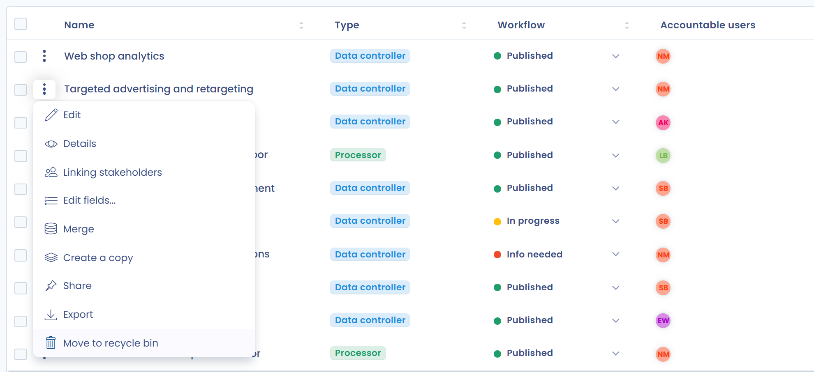
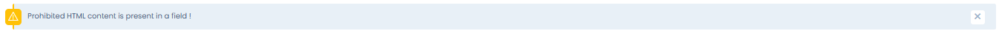
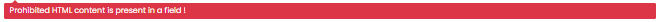

# FAQ

## How to display the history of modifications on a processing activity?

For all processing activities, you can display the history of modifications as well as the details of the changes.&#x20;

Click the clock icon (**Activity history**) at the top of the processing activity page.

<figure><figcaption>
History access button
</figcaption></figure>

Click **Change details** on an entry to compare the versions. From there, a **Restore** button lets you go back to that version, if your role allows it.

Please note that changes in organizational units are not tracked.

## Is it possible to automatically add elements in the "stakeholders" field in a new processing activity?

No, stakeholders cannot be updated automatically through an automated workflow.&#x20;

However, you can create a custom field at the stakeholder level, which can be modified through the automated workflow.

## How to delete a processing activity?

To delete a processing activity, you must first move it to the recycle bin with **Move to recycle bin**. Then, by displaying the recycle bin from the filters, you can delete the processing activity permanently. This is a safeguard against hasty deletions.&#x20;

To move a processing activity to the recycle bin, open the menu at the end of its row and choose **Move to recycle bin**.

<figure><figcaption>
Moving a processing activity to the recycle bin
</figcaption></figure>

Then display the recycle bin: click **Filters** and tick **View recycle bin**.

<figure><figcaption>
Displaying the recycle bin
</figcaption></figure>

Finally, open the menu at the end of the row and choose **Delete**. You can also choose **Restore** to put the processing activity back in the record.

<figure><figcaption>
Deleting a processing activity permanently
</figcaption></figure>

## How can users work with datasets without being able to modify them?

Your DPO relays may need to use the datasets you provide in their processing activities without creating new ones or changing the data fields they contain, so that the links with other processing activities stay consistent.

In this case, create a custom role. Go to the roles: [https://app.dastra.eu/general-settings/roles](https://app.dastra.eu/general-settings/roles) (see [Roles and permissions](../settings/roles.md)).

Then create a custom role with the following permissions:

* **Data processing records**: Read, Write
* **Data mapping and repositories**: Read

Then assign this role to the users concerned. They will be able to use the datasets in their processing activities, but not to modify the elements of the data map.

## How to add stakeholders or recipients to several processing activities?

You can add stakeholders or recipients to several processing activities at once with batch actions.

In **List view**, select the processing activities with the checkboxes. The **Select a batch action** button appears.

Choose **Linking stakeholders**, select **Add**, choose the stakeholders, then their **Type** (for example stakeholder or recipient) and their category, and confirm. If your selection mixes data controller and processor activities, only the stakeholder type is available.

The same window, with **Delete** selected, removes stakeholders from the selected processing activities.

## How to get the list of assets per organizational unit?

You can get the list of assets per organizational unit through the links between assets and processing activities.

Use the Excel export of the processing activities: filter the record by organizational unit, select the processing activities and export them. In the export window, turn on **Export custom fields** and keep only the assets column: you get the assets of that organizational unit. You can also keep only the organizational unit and assets columns to get the assets of all organizational units at once.

The [record data map](visualization/data-map.md) also shows this information graphically.

## How to duplicate a record in another workspace?

You can duplicate a record and its processing activities in several ways:

* either by [exporting and re-importing](export-import.md) the processing activities in JSON format,
* or by going to the target workspace and creating the processing activities with **Create from library...**: in **Choose the library source**, select the workspace that holds the original record.

## How can I change my type of processing activity (from one created as a data controller to one created as a processor, and vice versa)?

Open the processing activity, click the arrow on the right of **Save changes**, then click **Switch to processor record** or **Switch to responsible of the processing**:

<figure><figcaption>
Switching the type of a processing activity
</figcaption></figure>

When you switch a processor activity back to a data controller activity, the clients linked to it are removed. A confirmation is requested beforehand.

## Error Message: "Label field is required."&#x20;

This message typically appears when a field is left blank while answering a questionnaire.

## Error message : "Prohibited HTML content is present in a field !"

<figure><figcaption>
Prohibited HTML content is present in a field !
</figcaption></figure>

\
This message means that HTML code (usually enclosed in angle brackets `< >`) is present in a field where HTML is not allowed (for security reasons). 

\
The following message makes it easy to identify the affected field:

<figure><figcaption>
Prohibited HTML content is present in a field !
</figcaption></figure>

## Error message: "Stakeholders provided does not exist in your current organization." when saving a data processing

The full message reads: "Stakeholders provided does not exist in your current organization. Please check the stakeholders section and remove users not related to your organization."

It means that a user who has been removed from your workspace is still set as an accountable user in the stakeholders of the data processing.

Remove the deleted user from the stakeholders of the data processing to resolve this issue.


If you can't find the answer in this guide, you can [contact our support](../../getting-started/support/request.md).

