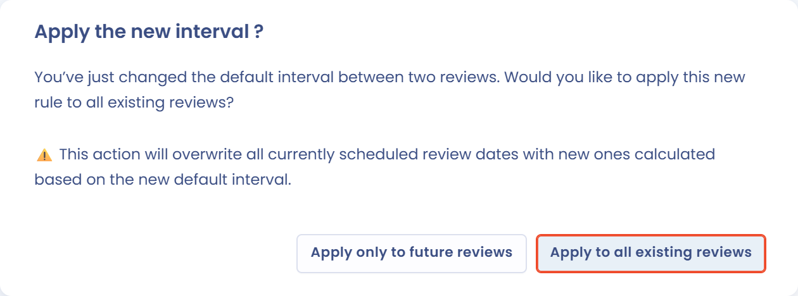
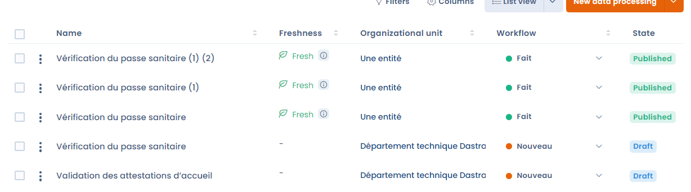

# Processing freshness

The freshness of a processing activity shows when it was last reviewed. Once regular reviews are enabled, each review sets a next review date, and the freshness decreases as that date approaches. It is a simple way to make sure the information in your record of processing activities is reviewed regularly and stays up to date.


Regular reviews are also available for other items, such as stakeholders, assets, contracts or AI systems. The common mechanism is described in [Regular review (freshness)](../regular-review.md); this page details how it works for processing activities.


### Activate the processing freshness option

Processing freshness is optional and deactivated by default. It is set up for the whole workspace, in the workspace settings, under **Regular reviews**.

To open this setting from your record, click the arrow next to the **Create data processing** button, then **Set up regular review**. The menu item also shows whether the option is currently **Enabled** or **Disabled**.

<figure><figcaption>
The Set up regular review entry of the Create data processing menu
</figcaption></figure>

In the **Regular reviews** settings:

1. Select **Processing activity** in the item type selector.
2. Turn on **Enable regular reviews**.
3. In **Define the desired frequency for each review**, enter the interval between two reviews, in years, months or days.
4. Click **Save changes**.

Only users with the **Advanced configuration** permission can change this setting.

<figure><figcaption>
The Regular reviews settings for processing activities
</figcaption></figure>

The interval applies to all the processing activities of the workspace. The next review date of a processing activity is the date of its last review plus this interval, unless a specific date was chosen during the review (see [Review a processing activity](#review-a-processing-activity)).

When you save a new interval, Dastra asks whether it should apply to the reviews already recorded:

* **Apply to all existing reviews**: the review dates already scheduled are recalculated with the new interval, which overwrites them;
* **Apply only to future reviews**: the review dates already scheduled are kept, and the new interval is used from the next review onwards.

<figure><figcaption>
Choose whether the new interval applies to existing reviews
</figcaption></figure>


**Example:** you set an interval of 1 year. A processing activity reviewed on 15 January 2026 has a next review date of 15 January 2027. It is displayed **Fresh** for most of the year, **Soon out of date** during the last 10% of the interval (a little over a month), then **Outdated** once its next review date has passed, until it is reviewed again.


### Disable the processing freshness option

To deactivate the option, go back to the **Regular reviews** settings, select **Processing activity**, turn off **Enable regular reviews** and click **Save changes**.

The freshness indicators are then no longer displayed. Each processing activity keeps its review history and its last review date, which are used again if you reactivate the option later.

### Freshness indicators

Freshness is only displayed for **published** processing activities that have been **reviewed at least once**. A processing activity can be in one of the following states:

| State                     | Meaning                                                                                              |
| ------------------------- | ---------------------------------------------------------------------------------------------------- |
| Fresh (green)             | The processing activity was reviewed recently and does not need immediate attention.                |
| Soon out of date (orange) | The last 10% of the interval between two reviews has started: the review should be planned.         |
| Outdated (red)            | The next review date has passed: the processing activity no longer complies with the review policy. |
| Pending review            | The processing activity is published but has never been reviewed.                                   |

A processing activity still in draft is shown as **not published** in the list, and as **Awaiting publication** on its record.

#### On the processing activity record

On a wide screen, the freshness indicator is at the top of the right-hand panel of the processing activity record. It shows the **Freshness** bar, which shrinks as the next review date approaches, the state and its colour, a **Review** link and the number of days remaining or late.

On a smaller screen, the right-hand panel is hidden: the state (for example **Fresh**) is displayed in the header of the record, next to the **Overall progression**, **Quality** and **Sensitivity** indicators. Click it to open the **Review** window.

<figure><figcaption>
On a smaller screen, the freshness indicator is displayed in the header of the record
</figcaption></figure>

#### In the list of your record

The **Last review date** column shows the freshness state of each processing activity and the date of its last review. Hover over the state to see the number of days remaining or late. This column is added to your list view when you activate the option; you can also add it to the displayed columns at any time.

<figure><figcaption>
The Last review date column
</figcaption></figure>

You can also display the **Future review date** column, which shows the next review date recorded for each processing activity, and filter your record with the **Freshness** filter (available under **Filters**), using the values **Fresh**, **Pending** (published but never reviewed) or **Outdated**.

### Review a processing activity

You can review a processing activity at any time, without waiting for its next review date. Reviewing requires write access to the record of processing activities. Open the **Review** window:

* from the processing activity record: click the freshness indicator, the **Review** link of the right-hand panel, or **Review** in the menu next to the **Save changes** button;
* from the list: click the cell of the **Last review date** column.

To review several processing activities at once, select them in the list, then choose **Review** in **Select a batch action**.

<figure><figcaption>
The Review window
</figcaption></figure>

In the **New review** tab, fill in:

* **Reviewer** (required): the user who carried out the review, yourself by default;
* **Review date** (required): today by default;
* **Description of the version** (optional): a short description of what was checked or changed;
* **Date before next review**: calculated from the review date and the interval set for the workspace. To apply a specific date to this processing activity, turn on **Change the date of the next review** and select a new date (at the earliest, the next day).

Click **Review** to save. A new freshness cycle starts from the review date until the next review date.

When the window is opened for a single processing activity, the **Previous reviews** tab lists its past reviews. This tab also offers the **Delete all reviews** button, which clears the review history: once confirmed, the last and next review dates are cleared and the freshness indicator is no longer displayed. This action cannot be undone.

### Important information about how freshness works

Saving a processing activity does not count as a review: the date of the last review is independent of the date on which the record was last updated. To (re)start the freshness cycle of a processing activity, you must review it.

Moving a processing activity to the final step of its workflow can also record a review: the step change window then shows a **Review** switch, enabled by default.
