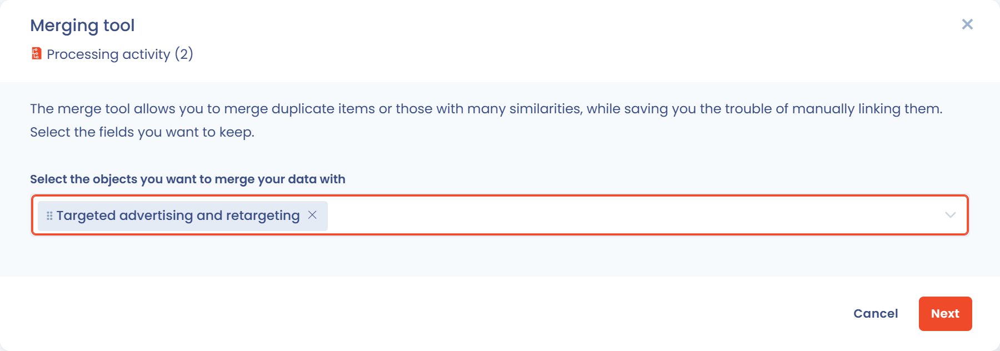

# Merge processing activities

## Introduction

Merging processing activities lets you **combine several processing activities into a single one**, while keeping the information you choose and the items linked to them. It is particularly useful to **consolidate your record of processing activities**, remove duplicates and keep your documentation consistent.

One of the processing activities is kept as the **reference version**: you choose, field by field, the values to carry over from the others, then the others are deleted.

Merging requires write access to the record of processing activities. When task management, risk management or questionnaires are enabled in your workspace, you also need write access to these modules, so that the linked items can be moved to the reference version.

## Start a merge

You can start a merge from three places:

* **From the list, for several processing activities**: select the processing activities to merge (fewer than 30), click **Select a batch action**, then **Merge**. The comparison opens directly.
* **From the list, for one processing activity**: open the action menu at the end of its row and click **Merge**.
* **From a processing activity**: click the arrow next to the **Save changes** button, then **Merge**.

<figure><figcaption>
The Merge entry of the action menu of a processing activity
</figcaption></figure>

When you start from a single processing activity, the **Merging tool** window first asks you to choose the processing activities to merge it with: select them in **Select the objects you want to merge your data with**, then click **Next**.

<figure><figcaption>
Select the processing activities to merge with
</figcaption></figure>

## Choose the values to keep

The **Merging tool** window compares the processing activities side by side, one column per processing activity.

1. Tick, in the header of its column, the processing activity to keep: it becomes the **Reference version**. It keeps its identifier and its history. The other columns show the **Keep selected fields** badge: these processing activities are deleted once the merge is confirmed, and only the fields you select in them are carried over to the reference version.
2. For each field holding a single value, select the column whose value you want to keep.
3. For each field holding a list (purposes, datasets, recipients, security measures, etc.), tick the items to keep, whichever processing activity they come from: they are combined in the reference version.
4. Click **Merge**.

<figure><figcaption>
The Merging tool window
</figcaption></figure>

To make the comparison easier:

* each field whose value differs from one processing activity to another is marked **Different**, and a counter shows the number of rows concerned;
* the table only shows the rows that differ; turn on **View all fields** to display all the comparable fields. Hidden identical fields keep the value of the reference version;
* the **Select all** button, under a column header, keeps the values of that column on all the rows that differ; **Undo selection** reverts it. An empty value never replaces a filled-in value.

The **Linked objects kept** section shows how many risk assessments, tasks and questionnaire responses are linked to the merged processing activities. They are automatically attached to the reference version, so nothing linked to the deleted processing activities is lost.

Once the merge is done, a message confirms it with a **Show item** link to open the reference version.


The processing activities other than the reference version are deleted when the merge is confirmed, and this cannot be undone. Check your choices before clicking **Merge**, and export the processing activities beforehand if you want to keep a copy of their content.


## Find duplicates automatically

To identify processing activities that are likely duplicates, click the arrow next to the **Create data processing** button, then **Data quality tool**. The detected duplicates are listed with a confidence score, and you can merge them from there.


[merge.md](../general/merge.md)


## Typical use cases

| Case                                 | Example                                                                         | Benefit                                         |
| ------------------------------------ | ------------------------------------------------------------------------------- | ----------------------------------------------- |
| **Consolidation**                    | Two processing activities "HR management" and "Staff management"                | Avoid duplicates and simplify maintenance       |
| **Reorganization**                   | Similar processing activities created in several organizational units          | Keep a single, up-to-date processing activity   |
| **Harmonization across entities**    | Equivalent processing activities documented separately by several subsidiaries | Make governance and global reporting easier     |
| **Record cleanup**                   | Duplicates created during an initial import                                     | Improve the clarity and reliability of the record |

## Good practices

1. **Check compatibility**: only merge processing activities with identical or very close purposes.
2. **Keep the legal analysis consistent**: avoid merging processing activities that rely on different legal bases.
3. **Document your decision**: explain the reasons for the merge in an internal discussion on the reference version.


Merging processing activities helps you keep a clean, up-to-date record while reducing the administrative workload, and you keep control over every value carried over.

