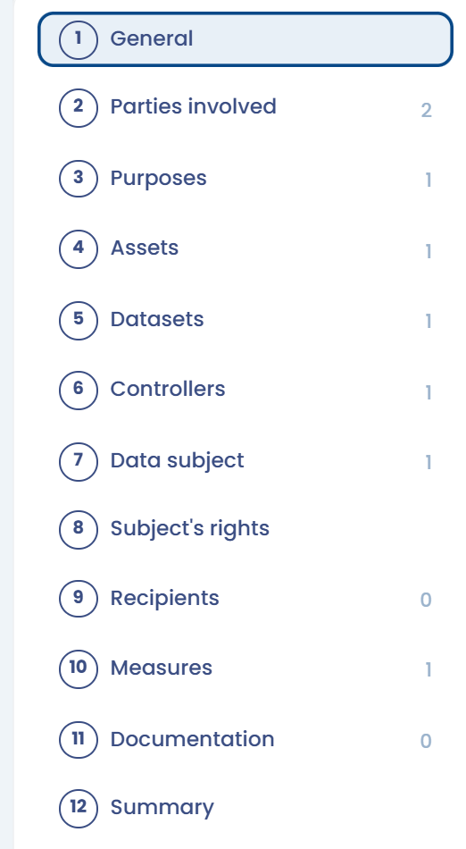

# "Data processor" record

## Introduction

Article 30 of the GDPR sets out specific obligations for the personal _data controller record_ and the _data_ _processor record_. If your organization acts as both a processor and a controller, your record must therefore clearly distinguish between the two categories of activities.

**In practice, in this case, the CNIL recommends that you keep 2 records:**

1. one for the processing of personal data for which you yourself are responsible,
2. another for the processing operations that you carry out, as a data processor, on behalf of your clients.

The rest of this page deals only with the "Data processor" record.

## The "Data processor" record

Each data processor is required to keep a less extensive record.&#x20;

This record contains:&#x20;

* the **contact details of the data processor**, its representative, if applicable, and its DPO&#x20;
* the **contact details of all data controllers on whose behalf the data processor acts** (usually the clients)&#x20;
* the **categories of data** processed&#x20;
* the **recipients**&#x20;
* the **transfers** outside the EEA&#x20;
* the **security measures**

In Dastra, a processing activity created as a data processor is documented in 12 sections: **General**, **Parties involved**, **Purposes**, **Assets**, **Datasets**, **Controllers**, **Data subject**, **Subject's rights**, **Recipients**, **Measures**, **Documentation** and **Summary**.

Compared with a data controller activity, the **Controllers** section lets you declare the data controllers on whose behalf you act (usually your clients), and there is no **Impact assessment** section.

<figure><figcaption>
The different sections of a "data processor" processing activity in Dastra
</figcaption></figure>

## The Controllers section

The **Controllers** section lists the data controllers on whose behalf you process the data, usually your clients. You must sign a contract with each of them that includes the clauses set out in Article 28 of the GDPR.

<figure><figcaption>
The Controllers section of a data processor activity
</figcaption></figure>

To declare a controller:

1. Click **Add controller**.
2. Choose **Directory** to select a stakeholder of your repository, or **Select an organizational unit**.
3. Optionally, describe your operations in **Describe how data are processed**.
4. If the controller also receives the data, turn on **Is client/data controller recipient ?**. Under **What data does he have access to?**, choose **Access to all data (default)** or **Access to certain data sets** and tick the datasets concerned.
5. Confirm.

To add several controllers at once, click the arrow on the right of **Add controller**, then choose **Add actors in batch** to select several stakeholders, or **Add org. units in batch** to select several organizational units.

The menu at the end of each row lets you **Edit** the controller, **Edit stakeholder** or **Delete** it. When your workspace uses the Contracts module, **Generate DPA** creates the data processing agreement of the controller. To delete several controllers, tick them and click **Delete**.

To send a controller only its own data, use the **Export for customer/data controller** option of the export window: the file then excludes the other controllers (see [Export / import the record](export-import.md)).

***


You can change the type of processing activity (from one created as a data controller to one created as a processor, and vice versa)\
[The procedure is available here](faq.md#how-can-i-change-my-type-of-processing-activity-from-one-created-as-a-data-controller-to-one-created)

When you switch a processor activity back to a data controller activity, the clients linked to it are removed.


## For more information


[data-controller-record.md](controller.md)

