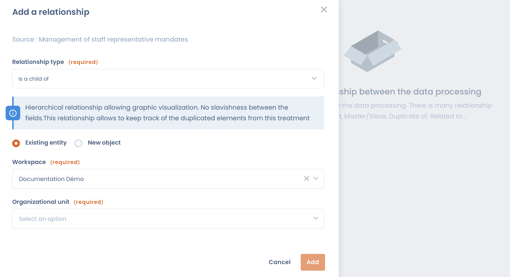

# Create relationships between processing activities

In Dastra, you can create relationships between your processing activities to make them easier to manage.

These relationships are possible between processing activities located in the same workspace.

## Why create relationships between processing activities?

Relationships between processing activities can be used to materialize the responsibility relationships between the various entities responsible for processing.

For example, in a group of companies, you can link a processing activity carried out by the parent company with the processing activities carried out by its subsidiaries. This is often the case for processing activities relating to the general administration of the group, such as human resources management, accounting or supplier management.

> A parent company X manages payroll on behalf of its subsidiaries Y and Z. In entity X, a "Payroll management" processing activity (P1) is created as a processor. From P1, you create an **Is source of (strict inheritance)** relationship with two processing activities (C1 and C2), located in Y and Z and created as controller processing activities.
>
> Any update made to P1 is then automatically passed on to C1 and C2.

## Add a relationship

On a processing activity record, click the **Relationships** button in the toolbar at the top of the record. The button shows the number of existing relationships.

<figure><figcaption>
The Relationships panel of a processing activity
</figcaption></figure>

The **Relationships** panel lists the existing relationships, grouped by type, with the organizational unit of each related processing activity and the date the relationship was created. Click a processing activity to open it in a new tab, or click the bin icon to remove the relationship.

To create a relationship, click **Add a relationship**, then:

1. Select the **Relationship type**. A description of the selected type is displayed below it.
2. Choose **Existing data processing** to link processing activities that already exist, or **Create data processing** to create the related processing activity at the same time.
3. For an existing processing activity, select its **Organizational unit**, then the processing activity in **Select the attached objects**.
4. For a new processing activity, enter the **New data processing's name**, turn on **This activity is carried out as a processor** if needed, and select its organizational unit.
5. Click **Add**.

<figure><figcaption>
The Add a relationship window
</figcaption></figure>

You can create relationships with several processing activities at once:

* with **Is source of (strict inheritance)** or **Is source of (soft inheritance)**, you can select several existing processing activities;
* with **Is parent of**, **Is related to**, **Is source of (strict inheritance)** or **Is source of (soft inheritance)**, the **Create data processing** option lets you select several organizational units: a new processing activity is created in each of them.

Up to 50 processing activities or organizational units can be selected at a time.


Relationships can only be created with processing activities located in the same workspace.


## Types of relationships

There are two types of relationships:

1. **Declarative relationships**: they establish a simple link between two processing activities, without any functional dependency.
2. **Functional relationships**: they transmit or inherit fields from one processing activity to another.

### Declarative relationships

#### Is a child of

Hierarchical relationship allowing a structured reading of the processing activities, **without functional dependency** between fields.

> Processing activity A is hierarchically attached to processing activity B.

#### Is parent of

Hierarchical relationship allowing a structured reading of the processing activities, **without functional dependency** between fields.

> Processing activity A is hierarchically above processing activity B.

#### Is related to

Simple logical link between two processing activities, **without any dependency** between their fields.

> Processing activity A is related to processing activity B.

#### Has the following duplicate

This relationship keeps track of the copies made from this processing activity. It is created automatically when you use **Create a copy** on a processing activity.

> Processing activity A is the source (of the copy) of processing activity B.

#### Is copied from

This relationship keeps track of the processing activity a copy was made from. It is created automatically when you use **Create a copy** on a processing activity.

> Processing activity A is a copy of processing activity B.


**Has the following duplicate** and **Is copied from** are only created automatically: they cannot be selected in the **Add a relationship** window.


### Functional relationships

Functional relationships transmit fields from one processing activity to another, or make a processing activity inherit them.

#### Is source of (strict inheritance)

The source processing activity **A** transmits its fields to the dependent processing activity **B**.


Except for the fields of tab 1 **"General"** and the documents uploaded to the processing activity in tab 11 **"Documentation"**.


This creates a strict relationship between **A (source)** and **B (dependent)**:

* the pre-existing fields of **B** are deleted when the relationship is created;
* the fields inherited from **A** can neither be modified nor deleted in **B**, and no new field can be added to **B**;
* any modification made in **A** is automatically reflected in **B**.

If the relationship is removed, the inherited fields become editable again and the original fields of **B** are restored (the items of your referentials are kept).

#### Is dependent on (strict inheritance)

Processing activity **A** depends on processing activity **B** and inherits its fields.


Except for the fields of tab 1 **"General"** and the documents uploaded to the processing activity in tab 11 **"Documentation"**.


This creates a strict relationship between **B (source)** and **A (dependent)**:

* the pre-existing fields of **A** are deleted when the relationship is created;
* the fields inherited from **B** can neither be modified nor deleted in **A**, and no new field can be added to **A**;
* any modification made in **B** is automatically reflected in **A**.

If the relationship is removed, the inherited fields become editable again and the original fields of **A** are restored (the items of your referentials are kept).

A processing activity that depends on another one in strict inheritance displays a **Data processing inherits** banner with a link to its source, and its inherited tabs are locked.


A processing activity can only depend on **one source processing activity at a time**.


#### Is source of (soft inheritance)

The source processing activity **A** automatically transmits its fields to the dependent processing activity **B**.


Except for the fields of tab 1 **"General"** and the documents uploaded to the processing activity in tab 11 **"Documentation"**.


This creates a soft inheritance relationship between **A (source)** and **B (dependent)**:

* the fields inherited from **A** cannot be modified in **B**;
* **B** can add, modify or delete its own fields;
* any modification made in **A** is automatically reflected in **B**.

If the relationship is removed, the inherited fields become editable again and the pre-existing fields of **B** are kept.

#### Is dependent on (soft inheritance)

Processing activity **A** depends on processing activity **B** and automatically inherits its fields.


Except for the fields of tab 1 **"General"** and the documents uploaded to the processing activity in tab 11 **"Documentation"**.


This creates a soft inheritance relationship between **B (source)** and **A (dependent)**:

* the fields inherited from **B** cannot be modified in **A**;
* **A** can add, modify or delete its own fields;
* any modification made in **B** is automatically reflected in **A**.

If the relationship is removed, the inherited fields become editable again and the pre-existing fields of **A** are kept.


A processing activity can only depend on **one source processing activity at a time**.


## Summary table of relationships

| Type of relationship                                                                                             | Tab 1 – "General" | Tabs 2 to 10 (business fields) | Documents uploaded in tab 11 – "Documentation" | Fields specific to the dependent processing activity |
| ---------------------------------------------------------------------------------------------------------------- | ----------------- | ------------------------------ | ---------------------------------------------- | ---------------------------------------------------- |
| **Declarative relationships** (Is a child of / Is parent of / Is related to / Has the following duplicate / Is copied from) | No impact         | No impact                      | No impact                                      | No impact                                            |
| **Is source of (strict inheritance)**                                                                            | ❌ Not transmitted | ✅ Transmitted                  | ❌ Not transmitted                              | ❌ Cannot be added, modified or deleted               |
| **Is dependent on (strict inheritance)**                                                                         | ❌ Not inherited   | ✅ Inherited                    | ❌ Not inherited                                | ❌ Cannot be added, modified or deleted               |
| **Is source of (soft inheritance)**                                                                              | ❌ Not transmitted | ✅ Transmitted                  | ❌ Not transmitted                              | ✅ Can be added, modified or deleted                  |
| **Is dependent on (soft inheritance)**                                                                           | ❌ Not inherited   | ✅ Inherited                    | ❌ Not inherited                                | ✅ Can be added, modified or deleted                  |
