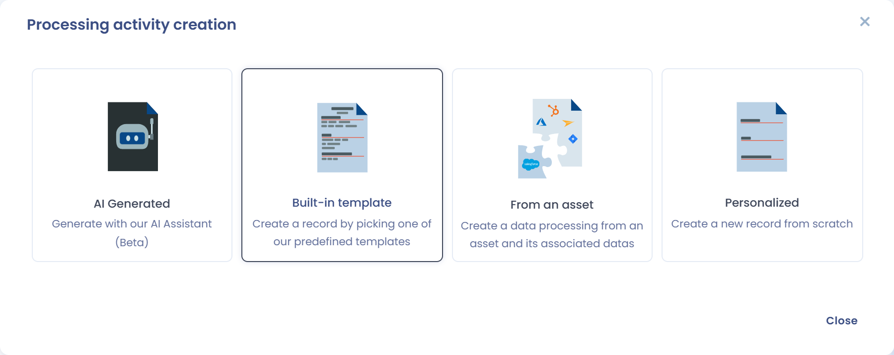
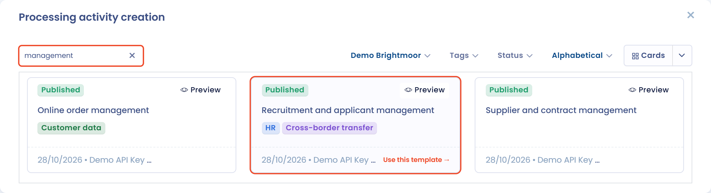

# Use a processing activity template

Dastra allows you to create your record of processing activities from templates designed by our experts.

Processing activity templates save time when you enter common processing activities.

## Create a processing activity from a template

Click **Create data processing**

<figure><figcaption>
The Create data processing button
</figcaption></figure>

and select **Built-in template**.

<figure><figcaption>
The Built-in template option
</figcaption></figure>

You can then search for processing activity templates with the search bar.

<figure><figcaption>
Searching the template library
</figcaption></figure>

Several filters help you find the right template:

* **Choose the library source** lets you pick the library to browse: the **Dastra default library**, or your partner library if your organization has one.
* The **language** selector shows the templates of the Dastra default library in other languages.
* **Tags** let you filter the templates by industry.
* **Status** and **Sort by** (**Most recent**, **Most downloaded**, **Alphabetical**) refine and order the results.

You can display the results as a list or as cards.

To **view the content of a template** before using it, click the **Preview** button of the template.

<figure><figcaption>
Previewing a template before using it
</figcaption></figure>

Click the template you want to use, check the **Name of this processing activity**, choose the **Organizational unit**, then click **Create data processing**. You are taken to the new processing activity, where you can adapt it to your organization.

## Suggest a processing template

If your search returns no template from the Dastra default library, you can click **Ask for a model** to suggest it to our team: enter the **Name of the desired model**, add any **Additional information**, then click **Send**. You can also click **Try with AI** to generate the processing activity with our AI Assistant.

<figure><figcaption>
Suggesting a new template
</figcaption></figure>

## Create several processing activities from templates at once

You can select several processing activity templates and import them all at once through the library.

Open the menu of the **Create data processing** button (the arrow on its right), then choose **Create from library...**.

<figure><figcaption>
The Create from library... entry
</figcaption></figure>

In the panel that opens, **Choose the library source**, **Choose the destination organisational unit**, then tick one or more templates and click **Add**.

<figure><figcaption>
Selecting several templates in the library
</figcaption></figure>

The **Details** button lets you preview a template.&#x20;

Your processing activities are then created in the background.

## Contribute a template

You can submit one of your processing activities, questionnaire templates or asset templates to the Dastra libraries, so that all Dastra users can use it once our team approves it.

1. Open the processing activity or the template, then click **Contribute**.
2. Enter the **Name of the contribution**. Add a comment for our team in **Your comment** if it helps the review.
3. Choose whether you want to be credited: when you answer yes to **Would you like to be credited for this contribution?** and the contribution is approved, your avatar and username are displayed with the template.
4. Accept the sharing of the whole template for publication in the Dastra library, then submit.

To follow your contributions, open **Workspace settings** > **Contributions**. This page requires the permission to write contributions. It lists, for each contribution, its name, the user, its **Status**, whether it is **Published** and its type. Filter the list by status and type, open a contribution to read **Outcome of your contribution**, the comment left by our team, or click **Withdraw this contribution** to ask for its removal from the library.
