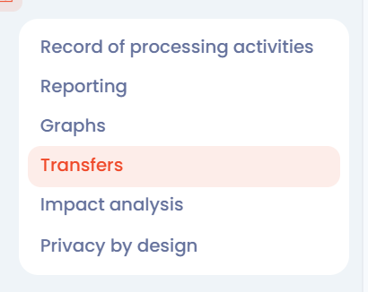

# View the transfers map

## Introduction

In Dastra, data can be visualized in several ways. One of them is the **data transfers map**.

This view lets you explore, analyze and understand the geographic transfers of the data of your record.

## View the transfers map

To view the transfers map, in the left-hand menu, click **ROPA**, then **Transfers**.

<figure><figcaption>
The Transfers entry of the ROPA menu
</figcaption></figure>

You can then **view the transfers map**. Three views are available from the buttons of the toolbar:

* **Globe view** (default): the transfers on a globe;
* **Map view**: the transfers on a flat world map;
* **List view**: the transfers as a table.

In the map views, the list of transfers is displayed next to the map; use the arrow button at the edge of the map to hide or show it. The filters of the toolbar let you narrow down the transfers displayed. Turn **Display sub processors** on or off (it is on by default) to include or exclude the transfers of subsequent processors. The menu next to the **Create a transfer** button lets you print the map or export the transfers.

<figure><figcaption>
Example of data transfers
</figcaption></figure>

On the map, countries are colored by status: **European countries**, **Adequate country**, **Partially adequate country** and **Not adequate country**.


Click the point corresponding to a country to access the details of its transfers.


The **Details of incoming/outgoing transfers from this country** window shows the status of the country (European country, adequate country, partially adequate country or not adequate country) and lists its **Input** and **Output** transfers.

## Go further


[risk-management](../../risks/README.md)

