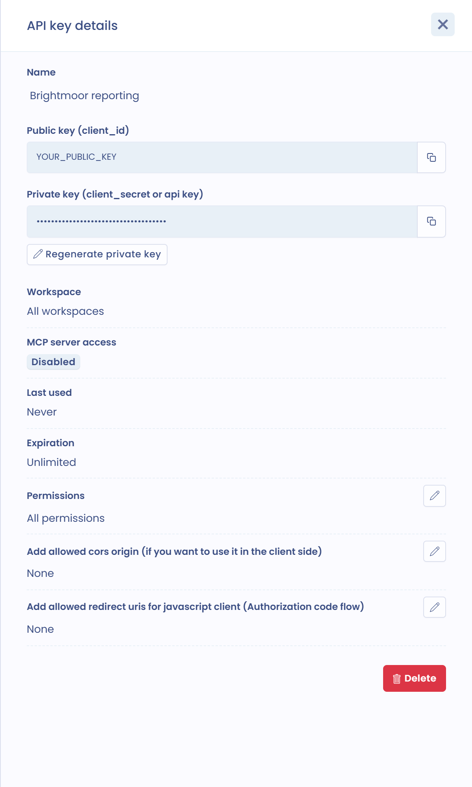

# API key management

This page explains what Dastra API keys are used for and how to create and manage them. Only organization owners have access to them.

## Uses of API keys

* **Create a Dastra API client** to retrieve or modify data outside the application. This client can be server-to-server (Client credential) or JavaScript (Authorization code). To find out more, please [read the Dastra API authentication documentation](../../api/authentication.md).
* **Configure a data subject request widget** (public key only). Read the [documentation about DSR forms](../requests/widget.md).
* **Configure a cookie widget** (public key only). Read the [documentation related to cookies](../cookies/banner/configure.md).
* **Connect an AI tool to the Dastra MCP server**. Read the [MCP server documentation](../general/ai-assistant/mcp.md).

## Where to manage API keys

Click the gear icon in the top bar (**Organization settings**), then **Api keys & MCP** in the left menu. The direct address is [https://app.dastra.eu/general-settings/api](https://app.dastra.eu/general-settings/api).

The page has three tabs:

* **API keys**: the list of keys. For each key it shows the name, the last use (**Never** if the key has not been used) and the workspace. The **Expired** badge marks a key whose expiration date has passed, and the `MCP` badge a key allowed to access the MCP server.
* **MCP Server**: connect an AI tool to the Dastra MCP server. See [The MCP server](../general/ai-assistant/mcp.md).
* **tenantId & workspaceId**: the identifier of the organization (**TENANT ID**) and of each workspace (**WORKSPACE ID**), with a button to copy them. API calls that ask for these identifiers use them.

## Create an API key

1. In the **API keys** tab, click **Create a new Api key**.
2. Enter the **Name** of the key.
3. To restrict the key to one workspace, choose it in **Select a specific workspace**. If you choose none, the key applies to **All workspaces**.
4. Choose the **Expiration**: **Unlimited**, 30 days, 180 days, 365 days or **Custom date**.
5. For **Give this api key full permissions?**, answer **Yes** for a key without restrictions, or **No** to tick only the permissions the key can use.
6. Click **Create**.

<figure><figcaption>
Creating an API key
</figcaption></figure>

The **API key details** panel opens. It shows:

* the public key (`client_id`) and the private key (`client_secret` or API key), which is masked and can be copied from the panel;
* the **Regenerate private key** button, which generates a new private key without deleting the API key;
* the workspace, the MCP server access, the last use and the expiration of the key;
* the **Permissions** of the key, which you can adjust with the edit button;
* the allowed CORS origins and the allowed redirect URIs, to fill in if you use the API in JavaScript with OAuth2 (Authorization code).

<figure><figcaption>
The details of an API key
</figcaption></figure>


The expiration and the MCP server access are chosen when the key is created and cannot be changed afterwards. To change either of them, create a new key.


## Use a key with the MCP server

If your plan includes the MCP server (Dastra AI Pro), the creation window offers the **Allow this key to access the MCP server (requires a specific workspace)** option. Turn it on and choose a workspace: the MCP server refuses a key without this option or without a workspace. Allowed keys carry an `MCP` badge in the list. See [The MCP server](../general/ai-assistant/mcp.md).

## Replace or delete a key


Keep your API keys safe. The private key must never be made public.

If the security of your API key is compromised, click **Regenerate private key** in the details panel, or delete the key from the list (three-dot menu > **Delete**) and create a new one.

