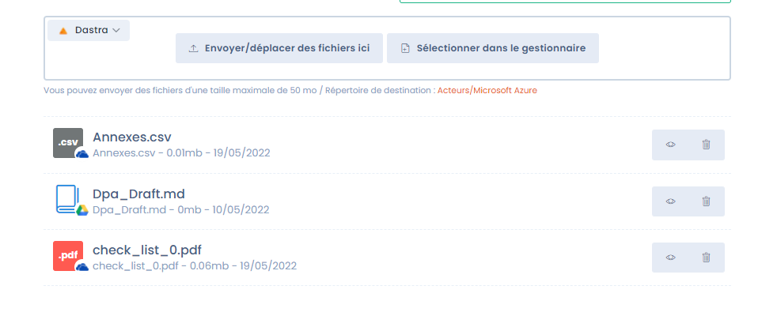
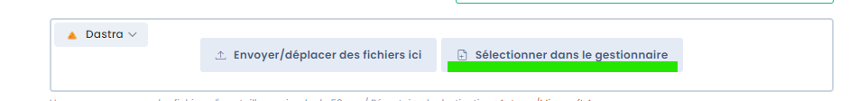

# OneDrive & SharePoint / Google Drive integrations

## Benefits of custom cloud storage

By default, Dastra's [document management system](../files/README.md) relies on Azure Blob Storage: files are encrypted, scanned for viruses, and redundantly stored on a secondary server. For more details, see the [security documentation](../../security/general.md).

In some organizations, this storage duplicates an existing cloud file system (SharePoint, OneDrive, Google Drive). Dastra integrates natively with these providers to avoid this duplication:

* **Microsoft OneDrive & SharePoint**: a OneDrive or a **SharePoint document library** of your Microsoft 365 organization;
* **Google Drive**.

<figure><figcaption>
Files can be stored in Dastra, OneDrive & SharePoint, or Google Drive
</figcaption></figure>

## Connection type: user OAuth


This integration uses **OAuth authentication with a user account's credentials**. It is not an application-level connection via the Microsoft Graph API or the Google API.

In practice, this means:

* The connection is established **on behalf of the user** who configures the integration
* Access to files depends on **that account's permissions**
* If the account is deactivated or its tokens revoked, the integration stops working until it is reconnected
* It is recommended to use a **dedicated service account** (non-personal) to configure this integration


## Setting up the integration

Open **Workspace settings** > **Integrations**, then click **Microsoft OneDrive & SharePoint** or **Google Drive**.

Click **Add integration**. You will be redirected to the provider's login page, where you will be asked to authorize access to your storage.

### Choosing the drive (OneDrive & SharePoint only)

After authentication, Dastra lists the drives the connected account can reach. Choose the one Dastra will use in **Choosing the Root Drive**:

| Option | Description | Recommendation |
| --- | --- | --- |
| **<Site> / <Library>** (e.g. `Root site / Documents`) | A document library of a SharePoint site of your organization | Recommended for enterprise use: shared space, not tied to a personal account |
| **Your personal drive** | Personal OneDrive of the connected account | Avoid in production: grants access to all personal drive files |

Click **Refresh** if a site or library you just created does not appear yet.


If you use a personal drive, it is strongly recommended to use a dedicated service account that does not contain personal files. You can also create a [dedicated SharePoint site](https://learn.microsoft.com/en-us/sharepoint/create-site-collection) to isolate Dastra files.


### Choosing a root folder (OneDrive & SharePoint only)

By default, Dastra uses the **root of the drive**. You can restrict it to a folder of the drive:

1. Under **Root folder**, click **Choose a folder**.
2. Browse the drive and click **Select** on the folder to use. **Use the root of the drive** goes back to the default.
3. Save the configuration.

Dastra then stores its files in this folder, and browsing from Dastra is limited to it: users cannot go above it. This is the simplest way to share a single folder of a SharePoint library with Dastra, without exposing the rest of the library.

<figure><figcaption>
Choosing the drive and the root folder
</figcaption></figure>


The root folder limits what Dastra shows and where it writes. It does not change the permissions of the connected account in Microsoft 365: that account keeps access to everything it could already open. To restrict access on the Microsoft side as well, connect the integration with a service account that only has access to the chosen library or folder.


If the root folder is deleted or moved in SharePoint or OneDrive, Dastra displays an error asking you to choose another folder in the integration settings.

## Attaching cloud files to a Dastra entity

From any entity (processing activity, task, stakeholder…), you can attach files stored in your cloud:

1. Open the file panel of the entity
2. Select the **data source** at the top left of the panel

3. Browse your drive via the file manager
4. Click **Add a file from the library** to attach the file

You can also upload new files directly from Dastra to your drive.

A storage whose use case is deactivated in the integration settings is no longer offered as a data source.

## Limitations

### OneDrive & SharePoint

* The connection uses user OAuth, not the Microsoft Graph API. If the account that set up the integration is deactivated, the connection is interrupted.
* Dastra only works in the chosen drive, and in its root folder when one is set.
* For enterprise environments, prefer a SharePoint document library over a personal drive.

### Google Drive

* Only files **created from within Dastra** can be added or modified in Google Drive. Dastra does not have access rights to files created directly in Drive. This is a limitation of the OAuth connector.
* Files created in Dastra can be shared with other collaborators without restriction.
