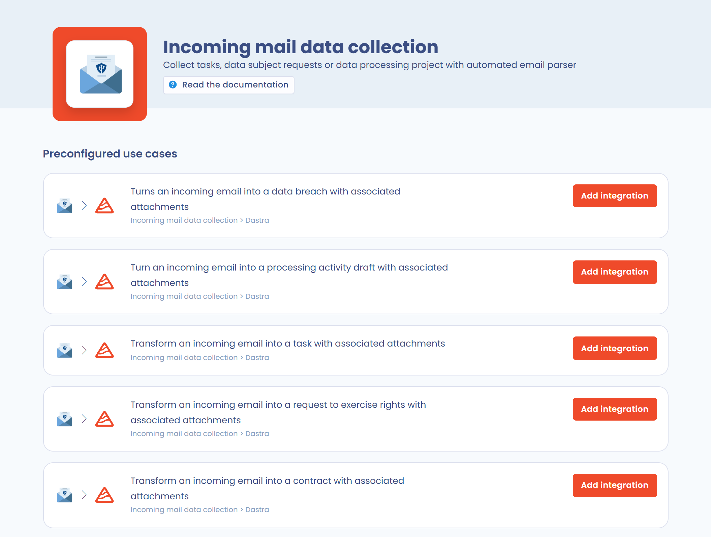
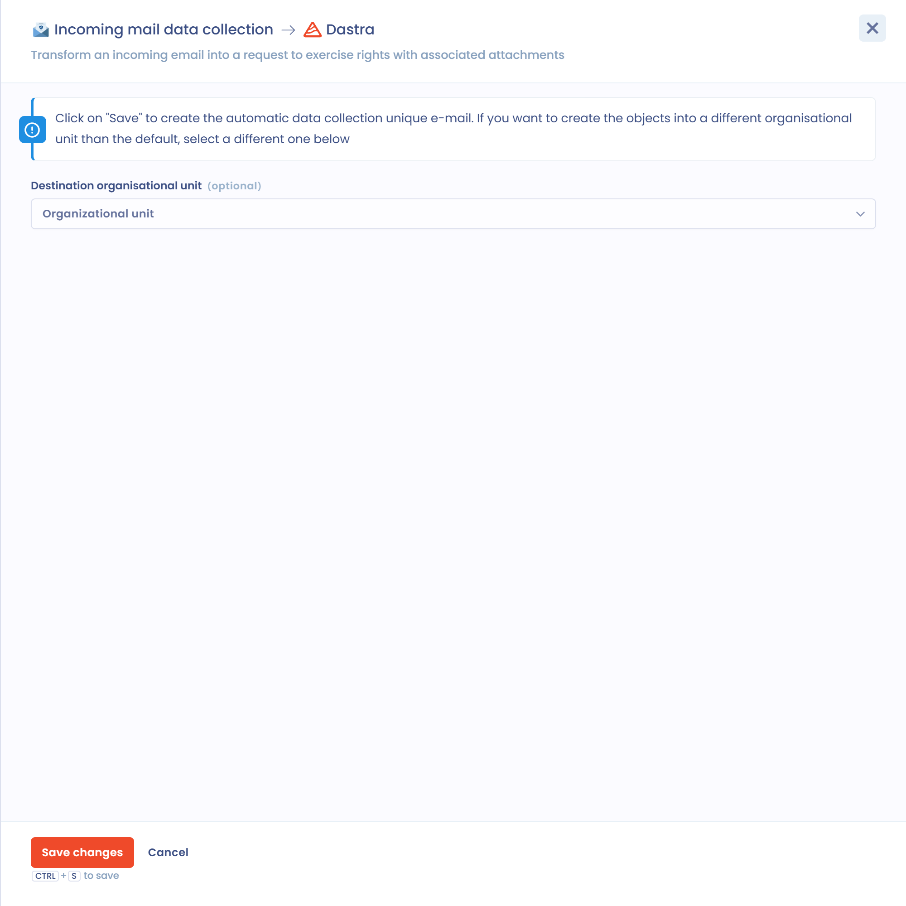

# Incoming mail data collection

This integration automatically creates objects in Dastra from emails received at dedicated collection addresses. Dastra provides these addresses and turns each incoming email into an object.

Five types of objects can be associated with a collection address:

* tasks;
* data processing;
* data subject requests;
* contracts;
* data breaches.

## Set up a collection address

Installing requires the permission to manage integrations in the workspace. You can only have one collection address per object type and per workspace.

1. Open **Workspace settings** > **Integrations**, then click the **Incoming mail data collection** card.

   <figure><figcaption>
The Incoming mail data collection card in the integrations
</figcaption></figure>
2. In the **Preconfigured use cases** list, find the object type you want to feed and click **Add integration**.

   <figure><figcaption>
One use case per object type
</figcaption></figure>
3. In the panel that opens, choose the **Destination organisational unit** of the created objects if needed. If you leave this field empty, objects are created in the default organizational unit.

   <figure><figcaption>
Choosing the destination organizational unit
</figcaption></figure>
4. Click **Save changes**. Dastra completes the installation and displays the email address to use.

   <figure><figcaption>
The generated collection address
</figcaption></figure>

To remove a collection address, open the use case panel again and click **Delete**. The address is released and no longer receives emails.

## How it works

* Each email received at a collection address creates an object of the associated type in Dastra.
* The object is created in the organizational unit chosen during installation.
* The email subject becomes the name of the object.
* The email body becomes the description of the object.
* The email attachments become attachments of the object, under the conditions described below.

## Attachments

An attachment is kept when:

* its extension is valid. The allowed extensions are `7z`, `csv`, `doc`, `docx`, `eml`, `epub`, `gif`, `htm`, `html`, `jpeg`, `jpg`, `json`, `md`, `msg`, `ods`, `odg`, `odp`, `odt`, `pdf`, `png`, `ppt`, `pptx`, `rar`, `rtf`, `svg`, `txt`, `xls`, `xlsm`, `xlsx` and `zip`;
* if it is an image (jpg, png, gif, etc.), it is at least 5 KB. This limit avoids adding irrelevant images such as email signature logos.

## Find the objects created by a collection address

The objects concerned have a **source**, or **collection origin**, field. To display it in a table, add the matching column.

All objects created from a collection address also carry the **Incoming email** tag, which helps you find them.

## Success notification

When an object is created after an email is received, Dastra automatically sends an email notification to the address that triggered the integration. This email confirms that the object was created in Dastra.

The confirmation email is written in the default language of the workspace where the integration is installed (workspace settings, default language).

## Automatically forward your existing emails to Dastra

If you already have a dedicated address for data subject requests (for example `privacy@yourcompany.com`), you do not need to replace it. Set up a forwarding rule in your mail server to redirect incoming emails to the Dastra collection address.

Emails then arrive directly in Dastra with no manual action, and your contacts keep using your usual address.

### With Microsoft Exchange / Office 365

Open the **Exchange Admin Center** > **Mail flow** > **Rules**, then click **+ Add a rule**. Configure the rule as follows:

1. Condition: **The sender is located** > **Outside the organization**. You can add a filter on subject keywords to redirect only the relevant requests (for example, the subject contains "request" or "erasure").
2. Action: **Redirect the message to**, then enter the Dastra collection address generated in the previous step.
3. Mode: **Enforce**.


With subject filters, you redirect only some types of requests (erasure, access, portability, etc.) to the matching collection address, and keep the other messages in your usual inbox.



Make sure your rule does not create a forwarding loop if the Dastra address itself redirects emails. Use the condition "Received from outside the organization" to prevent loops.


### With Google Workspace (Gmail)

In the **Google Admin Console** > **Apps** > **Google Workspace** > **Gmail** > **Routing**, add an inbound routing rule with the action **Change route**, then enter the Dastra collection address.
