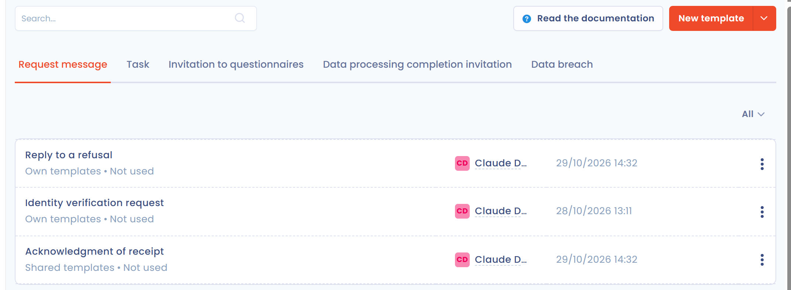

# Message templates

Message templates save you time: you write them once and reuse them in the Dastra modules. To manage them, open **Workspace settings** > **Message templates**. This menu entry is visible to users who have the write permission on message templates, for all items or for their own items.

## Types of message templates

Each type of template has its own tab on the page. The tabs you see depend on the modules included in your plan.

<figure><figcaption>
The message templates list, Request message tab
</figcaption></figure>

* **Request message**: to save time when you exchange with requesters. For example, a template to acknowledge receipt of a request.
* **Task**: to customize the content of a task description, for example when you regularly ask someone to fill in details about a processing activity.
* **Invitation to questionnaires**: to customize the invitations to answer a questionnaire. The same message goes to all your respondents. For example, you can invite your processors to complete a questionnaire that checks the application of the data processing agreement.
* **Data processing completion invitation**: to invite a Dastra user to complete a processing activity from a step. Write the template once, or prepare one template per type of recipient (lawyer, CIO, etc.).
* **Data breach**: to invite a Dastra user to complete a data breach from a step, in the same way.

## Create a template

You can create a template from the workspace settings or from the place where you write the message.

From the settings:

1. Open **Workspace settings** > **Message templates** and click the tab of the type of template you need.
2. Click **New template**.
3. Enter the **Name** of the template (150 characters maximum) and its **Template body** (9,000 characters maximum).
4. To let all the users of the workspace use the template, turn on **Would you like to share this template with all users in your workspace?**
5. Save the template.

<figure><figcaption>
Creating a template
</figcaption></figure>

## Shared and private templates

The list shows for each template whether it is shared or private, with its number of uses. A shared template is available to all the users of the workspace. A private template is visible only to its creator.

To display only one of the two, use the filter above the list (**All**, **Shared templates**, **Own templates**). Editing or deleting a shared template requires the write permission on message templates; for a private template, the permission on your own items is enough.

## Import and export templates

The arrow of the **New template** button opens two actions:

* **Import**: imports templates from a file.
* **Export**: exports the templates of the type shown, in CSV, XLSX, JSON or Markdown format.

## Custom variables in templates

Dastra can fill the template automatically with variables. You can include in the template text information about the object it is linked to. For example, in the invitation to answer a questionnaire, you can include the due date.

<figure><figcaption>
The fields available in the template editor
</figcaption></figure>

Templates use the LiquidJS syntax. The complete guide is available here: [tags](https://liquidjs.com/tags/overview.html) and [filters](https://liquidjs.com/filters/overview.html).

To translate statuses, use the custom filter `getTranslation` like this: `{{ data | getTranslation: '' }}`. For example: `{{ data | getTranslation: 'dataSubjectRequestStates' }}`.

The custom fields of the workspace are available as `customFields.<variable name>`, where the variable name is the one defined in the custom field (**Variable name (slug)**).

## Detail of variable fields


This list is a starting point: the technical name in parentheses is the one to use in the template, but the labels can differ slightly from those displayed in the editor. The fields available for your workspace, custom fields included, are the ones the template editor offers.


### Data subject request message

* Request title (`title`)
* Closed by (`closedByUser`)
* Organizational unit (`area`)
* Created by (`creator`)
* Operator (`operator`)
* Language (`locale`)
* Archived (`archived`)
* Archived on (`archivedDate`)
* Data subject category (`subjectCategory`)
* Complex request (`complex`)
* Closing date (`dateClosed`)
* Additional information (internal) (`description`)
* Request message (`message`)
* Email (`email`)
* Phone number (`phoneNumber`)
* First name (`givenName`)
* Last name (`familyName`)
* Updated on (`dateUpdate`)
* Ref. ID (`refId`)
* User ID (`userId`)
* Reason for closing (`closedReason`)
* Description of closing (`closedReasonDescription`)
* Expiry date (`expiryTime`)
* Address (`address`)
* Postal code (`zipCode`)
* City (`city`)
* Country (`countryCode`)
* Email validation date (`emailValidationDate`)
* Email validated (`mailValidated`)
* Source URL (`referrerUrl`)
* Identity validated (`identityValidated`)
* Identity validation date (`dateIdentityValidated`)
* Request ID (`demandId`)
* Status (`state`)
* Date (`dateCreation`)
* Workflow step (`workFlowStep`)
* Collection channel (`channel`)
* Types of rights (`purposes`)
* Messages (`nbMessages`)
* Remaining days (`remainingDays`)
* Closing time (days) (`closingTime`)
* Tags (`tags`)

### Task description

* Project (`project`)
* Iteration (`iteration`)
* Order (`order`)
* Owner (`owner`)
* Organizational unit (`area`)
* Created by (`creator`)
* Remaining days (`remainingDays`)
* Closing time (days) (`closingTime`)
* Number of subtasks (`nbSubTasks`)
* Number of closed subtasks (`nbSubTasksClosed`)
* Id (`id`)
* Internal reference (`ref`)
* Archived (`archived`)
* Name (`label`)
* Description (`descriptionHtml`)
* Linked to (`objectType`)
* Status (`state`)
* Due date (`deadline`)
* Start date (`startDate`)
* Closed on (`dateClosed`)
* Activated on (`dateActivated`)
* Created on (`dateCreation`)
* Updated on (`dateUpdate`)
* Source (`source`)
* Tags (`tags`)
* Workflow step (`workFlowStep`)
* Priority (`priority`)
* Assigned to (`assignedToUser`)

### Questionnaire invitations

* Template (`template`)
* Next audit date (`dateNextAudit`)
* Audit duration (`auditDurationDays`)
* Number of corrections (`nbCorrections`)
* Number of validations (`nbValidations`)
* Days before the next audit (`nextAuditDaysRemaining`)
* Id (`id`)
* Name (`label`)
* Old version (`isRevision`)
* Version name (`revisionDescription`)
* Archived (`archived`)
* Overdue (`isOverdue`)
* Organizational unit (`area`)
* Updated on (`dateUpdate`)
* Archived on (`archivedDate`)
* Score (`readiness`)
* Points (`score`)
* Completion rate (%) (`completionRate`)
* Number of answers (`nbAnswers`)
* Number of questions (`nbQuestions`)
* Owners (`owners`)
* Respondents (`respondants`)
* Action plan generated on (`actionPlanDate`)
* Status (`state`)
* Start date (`startDate`)
* Completed on (`responseDate`)
* Publication date (`publishedDate`)
* Created on (`dateCreation`)
* Linked object (`objectLabel`)
* Due date (`deadline`)

### Processing activity completion invitations

* Organizational unit (`area`)
* Workflow step (`workflowStep.label`)
* ID (`id`)
* Source (`source`)
* Name (`label`)
* Status (`state`)
* Created on (`dateCreation`)
* Archiving date (`dateArchived`)
* Archived (`archived`)
* Version description (`versionDescription`)
* Type (`processingType`)
* Organizational unit (`areaId`)
* Assets (`assets`)
* Internal reference (`ref`)
* Processing state (`processingState`)
* Documentation (`descriptionHtml`)
* Tags (`tags`)
* Processing owner (`owner`)
* Stakeholders (`stakeHolders`)
* DPIA required (`isDPIARequired`)
* DPIA date (`dpiaDate`)
* Exempted from DPIA (`dpiaExemption`)
* Recipients (`recipients`)
* Controllers / clients (`dataControllers`)
* Datasets (`dataRetentionRules`)
* Purposes (`purposes`)
* Measures (`securityMeasures`)
* Data subject categories (`personCategories`)
* Progress (%) (`progression`)
* Quality (%) (`quality`)
* Sensitivity (%) (`sensitivity`)
* Created by (`creatorUser`)
* Deployment date (`dateDeployment`)
* Publication date (`datePublication`)
* Last modified (`dateUpdate`)
* Description (`description`)

### Data breach completion invitations

* Name (`label`)
* ID (`id`)
* Data location (`location`)
* Loss of confidentiality (`access`)
* Loss of integrity (`integrity`)
* Loss of availability (`availability`)
* Cause (`reason`)
* Source (`source`)
* Involved processors (`processorInvolved`)
* Processors (`processors`)
* Sensitive data (`sensitiveData`)
* Probability score (`probabilityScore`)
* Impact level (`impactScore`)
* Score (`score`)
* Risk level (`riskLevel`)
* Data record volume (`dataVolume`)
* Data support (`dataSupport`)
* Communication done? (`communicationDone`)
* Reason for no communication (`noCommunicationReason`)
* Period (`period`)
* Start date (`startDate`)
* End date (`endDate`)
* Detection date (`constatationDate`)
* Notification deadline to the supervisory authority (`notificationDueTime`)
* Operator (`operator`)
* Workflow step (`workFlowStep`)
* Organizational unit (`area`)
* Created on (`dateCreation`)
* Updated on (`dateUpdate`)
* Post-mortem done (`postMortemDone`)
* Tags (`tags`)
* Remarks (`complementaryInformations`)
* Closure date (`dateClosed`)
* Archiving date (`dateArchived`)
* Created by (`creator`)
