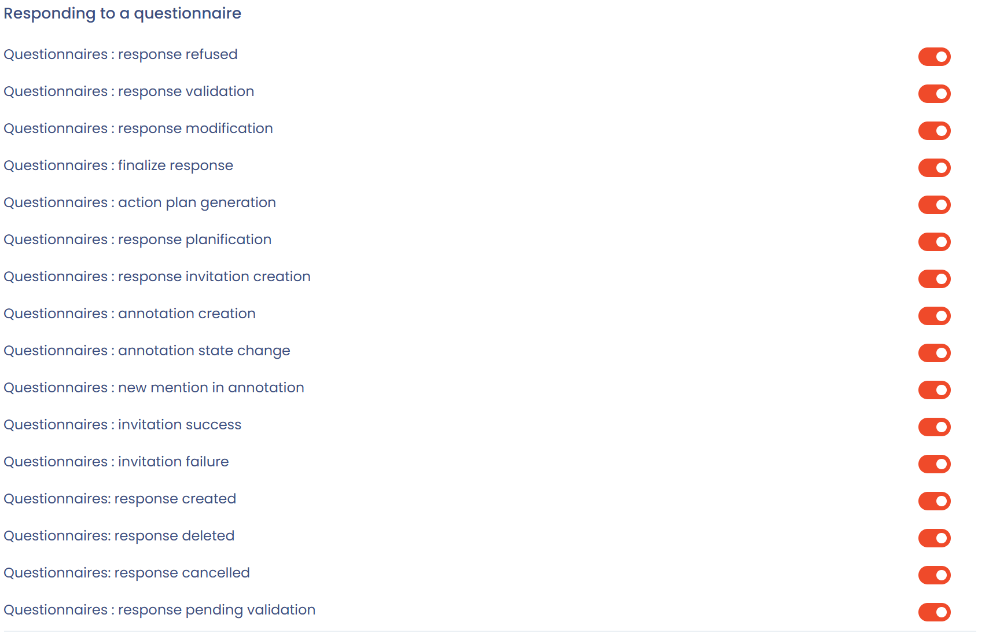

# Notifications

## Overview

Notifications in Dastra keep you informed of important activity on your processing activities, questionnaires, tasks and data subject requests.

There are **two types of notifications**:

1. **The notification center**, built directly into the application.
2. **Email notifications**, which each user customizes according to their preferences.

## Notification center (in the application)

The notification center groups the alerts you see through the notifications icon at the top right of the screen. It has two tabs: **Notifications** and **Task assigned**.

* It is available to all users of the workspace.
* It cannot be customized: it is shared across the whole workspace.
* It contains general notifications about recent activity: creation, modification or deletion of items.
* The **Refresh** button reloads the list, **View more** opens the history page, and the **My activity** switch limits the list to your own actions.

<figure><figcaption>
The notification center
</figcaption></figure>


Example: "The processing activity Recruitment management has been modified".


## Email notifications

Each user chooses from their profile which notifications they receive by email.

### How to customize your notifications

1. Click your **avatar** at the top right of Dastra.
2. Select **Notifications center**.
3. Turn events on or off according to your needs. Each change is saved immediately.

<figure><figcaption>
The "Notifications center" entry of the avatar menu
</figcaption></figure>

The page has three blocks: **Push notifications** (desktop notifications, even when your browser is closed), **Marketing and advertising** (newsletter subscription and commercial communication) and **Notifications event subscription**, which groups the email events. The switch at the top of that last block turns all events on or off at once.


Email notifications are ideal for being alerted to actions that need a quick response (questionnaires, requests, data breaches, etc.).


### Prerequisite: the Notification permission in the role

Customizing email notifications only works if the user's role allows it.

In the role configuration (**Organisation Configuration** > **Roles and permissions**), each module has a **Notification** checkbox. If it is not ticked, users with that role receive no email notification for that module, whatever their personal preferences. When it is ticked, they receive a compiled notification about one hour after the last activity.


The role opens or closes the right to receive notifications. The user can then refine their preferences, but only within the limits of what their role allows.


### Notification categories

Email notifications are organized by **categories**, one per object type. Each category contains several events that you can turn on individually.

| Category                      | Events offered                                                                                                                  |
| ----------------------------- | ------------------------------------------------------------------------------------------------------------------------------- |
| Processing activity           | Creation, modification, status change, publication, archiving, deletion, relationships, invitation, review                       |
| Request                       | Creation, modification, status change, new message, assignment, identity validation, suspension, anonymization                  |
| Data breach                   | Creation, modification, state change, archiving, invitation                                                                     |
| Task                          | Creation, modification, status change, mention, assignment, archiving, deletion                                                 |
| Comment                       | New message, new mention                                                                                                        |
| Cookie consent's widgets      | Widget creation                                                                                                                 |
| Responding to a questionnaire | Response refused, validated or finalized, invitation, annotations, action plan generated, response pending validation           |
| Questionnaire template        | Creation, modification, deletion                                                                                                |
| Trust Center                  | Creation, update                                                                                                                |
| Analytics reporting           | Monthly report subscription                                                                                                     |
| Generic relationships         | Creation, deletion of a relationship                                                                                            |
| Risk assessment               | Creation, modification, state change                                                                                            |
| Control point                 | Creation, modification, review                                                                                                  |
| Contribution                  | Approval, rejection                                                                                                             |
| Stakeholder                   | Import, creation, modification, status change, deletion, review                                                                 |
| Dataset                       | Import                                                                                                                          |
| Asset                         | Import, creation, modification, status change, deletion, review                                                                 |
| Category of data subjects     | Import, creation, modification, status change, deletion                                                                         |
| Datafield                     | Import, creation, modification, status change, deletion                                                                         |
| Security measure              | Import, creation, modification, status change, deletion                                                                         |
| Team                          | User added or removed, creation, modification, deletion                                                                         |
| Organizational unit           | Team added or removed, modification, deletion                                                                                   |
| Contract                      | Creation, modification, status change, deletion, review, electronic signature, assignment, expiration                           |
| AI system                     | Creation, update, stage change, deletion, review, invitation to complete                                                        |
| Compliance project            | Creation, archiving, status change                                                                                              |
| Compliance Audit              | Creation, archiving, finalization                                                                                               |
| Test campaign                 | Creation, finalization                                                                                                          |
| Custom report                 | Creation, modification, moved to recycle bin, restoration, permanent deletion                                                   |

For example, for processing activities you can choose whether to be notified of a modification, a status change or the removal of a relationship:

<figure><figcaption>
The events of the Processing activity category
</figcaption></figure>

For questionnaires, you can choose to receive an email when a response is rejected or validated, on an invitation to respond, or when an annotation is added:

<figure><figcaption>
The events of the Responding to a questionnaire category
</figcaption></figure>

## Automatic notifications

Some notifications are **systemic**: they are sent automatically, even if you turned off the matching category.

These notifications are considered essential to collaboration:

* Invitation to a **questionnaire**
* **Assignment** to a task or a request
* **Direct mention** in a comment (@your-name)
* Invitation to complete the **record of processing activities**
* Immediate sending of a **scheduled invitation** (if the option is enabled)

## Best practices

* Turn on emails for activities that need action from you (questionnaires, requests, data breaches).
* Check the notification center regularly for an overview of the workspace.
* Check your "Notifications" folder in your mailbox if you think you no longer receive some messages.
* For a DPO: turn on all categories.
* For a contributor: prioritize tasks, comments and questionnaires.

## FAQ

### I no longer receive my notifications. What should I do?

Check your preferences in **Notifications center**, from your avatar menu. Also make sure that Dastra emails are not redirected to your "Promotions" or "Spam" folder.


By default, you do not receive notifications for actions that you perform yourself.


### Can I receive a monthly summary?

Yes, you can receive a monthly summary of your workspace activity. In **Notifications center**, turn on the **Preferences : mensual report subscription** event of the **Analytics reporting** category.

## See also

* [Set up your user profile](../../getting-started/setup/profile.md)
* [Manage roles and permissions](roles.md)
* [Monitor your questionnaires](../questionnaires/README.md)
