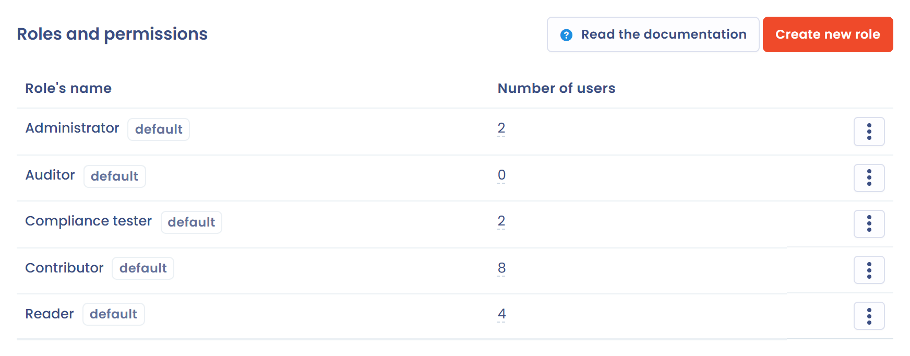
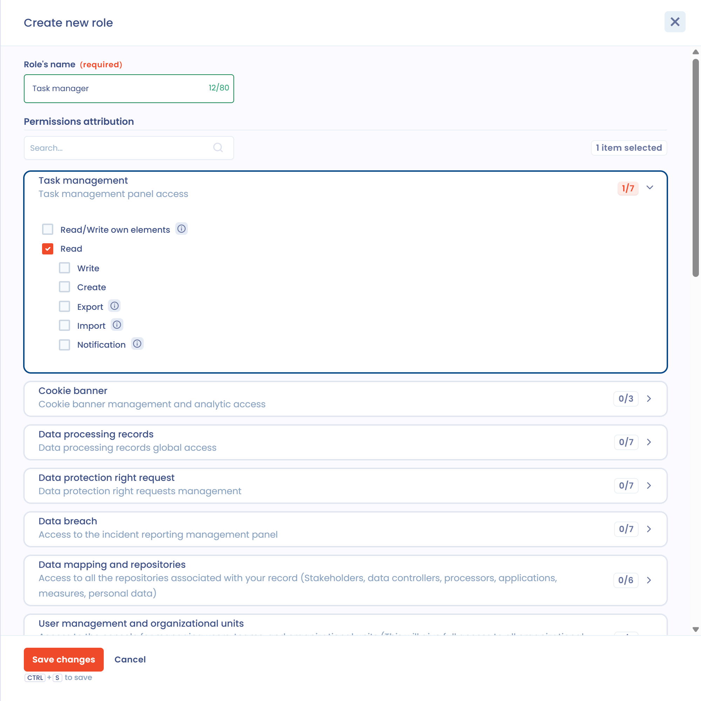

# Roles and permissions

## General functioning

Each user can be associated with 1 or more roles. The roles are themselves associated with a list of permissions (for example: write in the register, create a questionnaire...). There are two ways to manage the roles associated with users.&#x20;

* If you are an owner, click the gear icon in the top bar (**Organization settings**), then **Users**. The direct address is [https://app.dastra.eu/general-settings/users](https://app.dastra.eu/general-settings/users).
* If you have the workspace administrator role, open **Workspace settings** > **Users** to manage the roles and permissions of the users who belong to your workspace.

The default roles (**Administrator**, **Contributor**, **Reader**) are described in [Managing roles and permissions](../../getting-started/setup/roles.md). This page explains how to create your own roles.


A role is not always enough to see an item: access to **organizational units** and the user's **teams** also matter. See [Why can't a user see a processing activity?](../../getting-started/setup/visibility.md)


## Create your own roles

The **Roles and permissions** page is reserved for organization owners. It appears when your plan includes advanced personalization. To open it, click the gear icon in the top bar (**Organization settings**), then **Roles and permissions** in the left menu. The direct address is [https://app.dastra.eu/general-settings/roles](https://app.dastra.eu/general-settings/roles).

Click **Create new role** to create a custom role.

<figure><figcaption>
The roles list
</figcaption></figure>

Enter the name of the role, then tick the boxes that match the permissions of each module.

<figure><figcaption>
Creating a task management role
</figcaption></figure>

* **Read/Write own elements:** users can only view and edit the items assigned to them within the module.
* **Read:** users can view all items in the module.
* **Write:** users can modify all existing items in the module. In modules that offer the **Create** permission, **Write** does not grant the right to create new items.
* **Create:** users can create new items in the module. This permission is independent of the **Write** permission.
* **Export:** users can export all items of the module.
* **Import:** users can import items into the module.
* **Notification:** users receive notifications for all items in the module.


It is not possible to select both **Read/Write own elements** and the permissions on all items for the same role in a module, except for the **Create** permission. Users access either only their own items or all items; the **Create** permission additionally lets them create new items.


Once you have created your custom role, you can assign it to any workspace user within your organization.

### Create permission

The following modules offer a **Create** permission that is separate from the **Write** permission:

* Task management
* Data processing records
* Data protection right request
* Data breach
* Data mapping and repositories
* Contracts management
* AI systems management

In these modules, **Create** can be checked together with **Read** or with **Read/Write own elements**. A role that combines **Read/Write own elements** and **Create** lets the user create new items and edit only the items assigned to them. For a role to edit existing items without creating new ones, check **Write** without checking **Create**.

The default **Administrator** and **Contributor** roles include the **Create** permission in these modules.

<figure><figcaption>
Create permission combined with editing own elements
</figcaption></figure>

## Clone an existing role

To create a role from an existing configuration, clone it:

1. In the roles list, click the three-dot menu on the row of the role you want to duplicate.
2. Click **Clone**.

Dastra creates a new role with all the permissions of the source role. Its name is the name of the source role followed by a number, for example "Contributor (2)". Its editing panel opens: rename it and adjust the permissions.

The default roles cannot be edited: cloning them lets you start from their permissions. Cloning is also useful to create variants of a role, for example a "DPO Contributor" role that is slightly different from the "Contributor" role.
