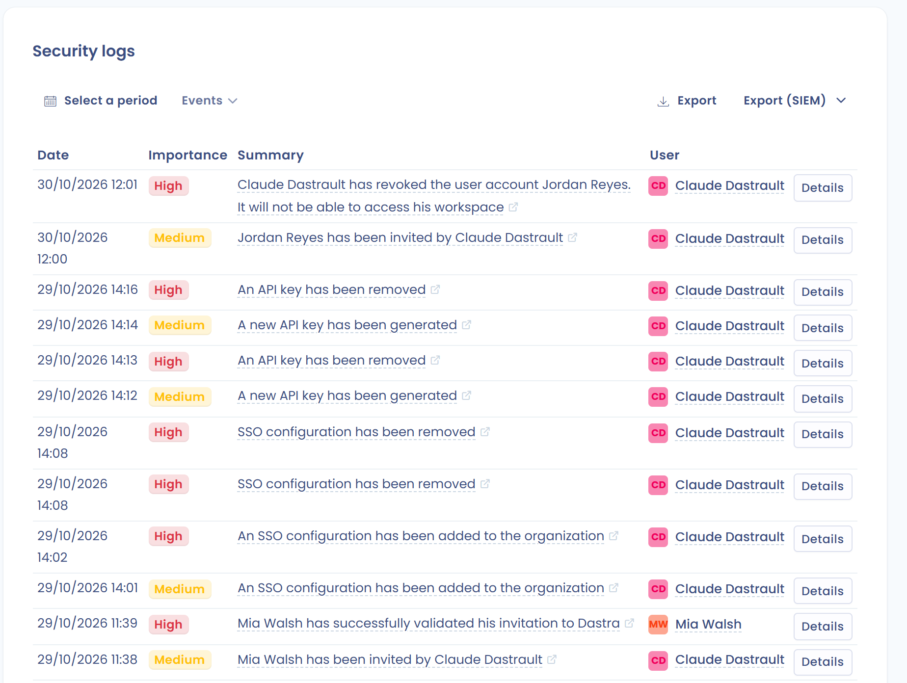

# Organization security and security logs

This page is for organization owners. It describes the **Security** page of the organization settings, where you set the security rules that apply to all users of your organization, and the two log pages that let you follow what happens in it.

## Open the Security page

Click the gear icon in the top bar (**Organization settings**), then **Security** in the left menu. The page is visible to organization owners only. It requires the **Entreprise** plan: with another plan, the page shows the message **This feature is reserved for the plan: Entreprise**.

<figure><figcaption>
The Security page, with one card per rule
</figcaption></figure>

Each card applies as soon as you change it: there is no save button.

## Password reset policy

The **Password reset policy** card sets a lifetime for passwords: **90 days**, **180 days** or **365 days**. Choose **not set** to turn the policy off.

The policy applies to the internal users of your organization who do not sign in with SSO. External users are not affected. When the lifetime has passed, the user is asked to create a new strong password at the next sign-in.

## Security logs retention

The **Security logs retention** card sets how long Dastra keeps the [security logs](#security-logs). Pick a duration in **Pick a retention duration**: 30 days, 90 days, 180 days (**Recommended**), 365 days, 730 days or 1,095 days.

Dastra purges the logs older than this period every night at 01:00. Align the duration with your own retention rules for audit trails.

## Idle timeout automatic logout

The **Idle timeout automatic logout** card has a switch, **Enabled** or **Disabled**. When it is enabled, all internal users of your organization are signed out after 1 hour of inactivity.

## Force strong authentication

The **Force users to use strong authentication (two-factor)** card has a switch. When it is enabled, all internal users of your organization must set up two-factor authentication at their next sign-in. Dastra uses the TOTP protocol, with an authenticator application, for the second step after the password. To set it up as a user, see [Sign in and manage authentication](../../getting-started/setup/login.md#enable-strong-authentication).

## Filter IP addresses and email domains

Two cards restrict who can sign in:

* **Filter user IP addresses** limits access to ranges of IP addresses. Read [IP filtering](ip-filtering.md) before you save a rule: you cannot remove it from the interface.
* **Filter the domains of your users' emails** lets only the users whose email address belongs to the listed domains sign in. Type a domain such as `dastra.eu`, then press Enter. The change can take a few minutes to apply.

The domain filter is not the same as the **Authorized email domains** block of the single sign-on page, which assigns new colleagues to a workspace: see [Email domains](email-domains.md).

## SIEM streaming

The last card streams your security events in real time to your SIEM. See [SIEM streaming](siem.md).

## Security logs

The security logs list the security events of your organization. Click the gear icon in the top bar, then **Security logs** in the left menu. Only organization owners can open this page.

<figure><figcaption>
The Security logs page
</figcaption></figure>

1. Choose a period with the date picker.
2. Click **Events** to select one or several event types, then wait for the list to refresh.
3. Read the list: **Date**, **Importance**, the event label and the **User** who triggered it.
4. Click an event or **Details** to open its page. It shows the types, the **Summary**, the user, the date and the **Event identifier**, in a **Structured view** or a **Raw view**, with a **Copy** button for the raw data.

Use **Export** to download the logs of the selected period. **Export (SIEM)** downloads them in a format your SIEM reads: **CEF (Common Event Format)**, **Syslog (RFC 5424)** or **Splunk HEC (JSON)**. The same menu opens **Configure real-time streaming** for organizations on the Entreprise plan. See [SIEM streaming](siem.md#manual-export-from-the-audit-logs).

Dastra keeps the events for the duration set in [Security logs retention](#security-logs-retention).

## Activity history

The **Activity history** page, also in the organization settings, lists the events of the whole organization: creations, updates, deletions and other actions on the records, in addition to the security events. It is visible to every user who opens the organization settings.

1. Choose a period.
2. Narrow the list with the **Workspace**, **Type**, **Events** and **User** filters. Click **Reset filters** to clear them.
3. The events are grouped by day. Click **Load more** to see older events.
4. Click an event to open its details, with the same structured and raw views as the security logs.

Only organization owners see the **Export** button on this page.
