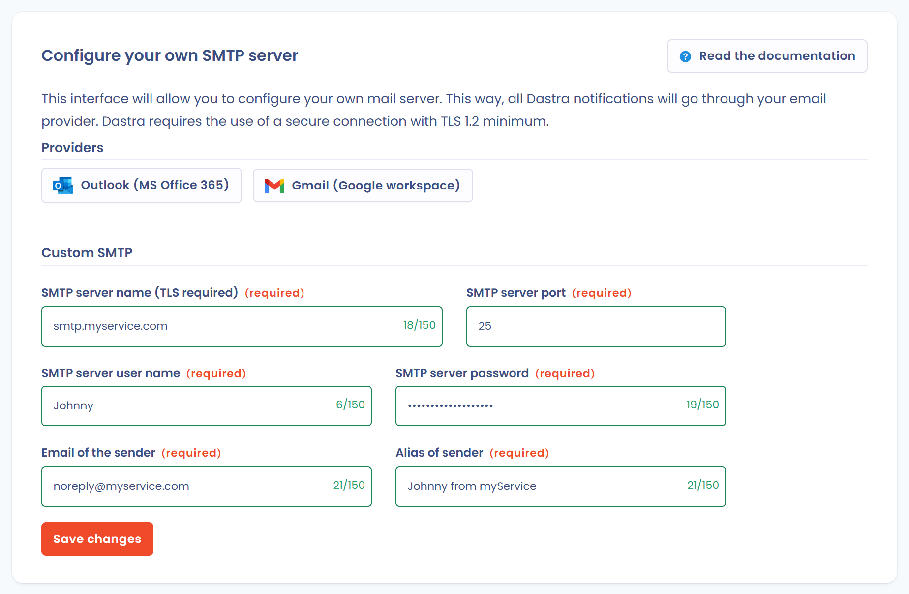

# SMTP configuration

This page explains how to route Dastra's emails through your own SMTP server. It is intended for organization owners.

## How it works

By default, Dastra sends its emails with its own SMTP service. This covers:

* real-time [notifications](../notifications.md) (new comments, tasks, etc.);
* email exchanges within a [data subject request](../../requests/README.md);
* invitations sent to respondents of [questionnaires](../../questionnaires/README.md);
* [invitations](../../../getting-started/setup/users.md) of new users.

Once your server is configured, all these emails go through it, for every workspace of the organization.


Customizing SMTP can make the platform unstable. Only do this if you are sure that your email sending service works properly and delivers reliably.


## Why customize SMTP

Dastra ensures the availability and security of transactional emails. Depending on your internal security policy, you may still need to control the routing of these emails yourself to manage your mail flows.

## Access and prerequisites

The page is in **Organization settings** > **Custom SMTP**. It is reserved for organization owners and for the Enterprise plan (advanced security feature).

You have two options:

* connect a provider (**Outlook (MS Office 365)** or **Gmail (Google workspace)**): see [Integration of external providers](office-365-gmail.md);
* enter the settings of your own SMTP server, described below.

For an SMTP server, have the following ready:

* the SMTP server name (for example `smtp.yourservice.com`);
* the SMTP server port (25 by default);
* the server user name and password;
* a valid sender email address (for example `noreply@yourservice.com`): your SMTP provider must have validated it;
* a sender alias, that is the name displayed as the sender (for example `Compliance team`).


Dastra requires a secure connection using TLS, version 1.2 at minimum. Your SMTP server must support it.


## Configuration

1. Open the [SMTP configuration page](https://app.dastra.eu/general-settings/smtp).
2. In the **Custom SMTP** section, fill in **SMTP server name (TLS required)**, **SMTP server port**, **SMTP server user name**, **SMTP server password**, **Email of the sender** and **Alias of sender**.
3. Click **Save changes**.

<figure><figcaption>
The SMTP server configuration form
</figcaption></figure>

When you save, Dastra connects to your server and sends a test message to the email address of your account. If the connection fails, the configuration is not saved and the error returned by the server is displayed.

While a provider is connected, the custom SMTP form is disabled. Click **Remove integration** first to use your own server.

## Testing

Once the configuration is saved, the **Test** button appears. Click it and confirm: Dastra sends a test message to the email address of your personal account.

You can also check that notification emails come from your server. For example, add a comment on a processing activity and see whether the notification reaches your mailbox.

* **You do not receive an email**: either the notification was not triggered, or there is a problem with your SMTP configuration.
* **You receive an email**: check that your SMTP server and your sender appear in the message details.


[How to view email details in Gmail](https://support.google.com/mail/answer/29436).

[How to view email details in Outlook](https://support.microsoft.com/en-us/office/view-internet-message-headers-in-outlook-cd039382-dc6e-4264-ac74-c048563d212c)

