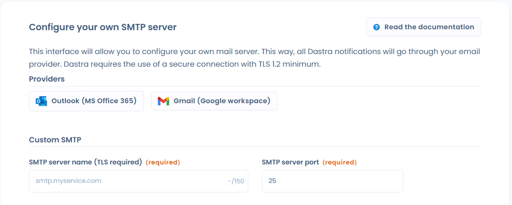

# Integration of external providers (Office 365 / Gmail)

This page explains how to send Dastra's emails from your own Office 365 or Gmail account. It is intended for organization owners. To use another sending server, see [SMTP configuration](README.md).

## Purpose

By default, all notifications sent by Dastra come from the address `no-reply@dastra.eu`. With the integration of an external email provider (Office 365 or Gmail), you send these emails from your own addresses. This lets you:

* build trust with your recipients, because emails are sent with your domain;
* centralize your sending and deliverability logs in your own email infrastructure;
* apply your own security, compliance and archiving rules.

## Emails concerned

The configuration applies to all emails sent by Dastra within your organization, for example:

* notifications of new tasks or requests;
* invitations and reminders;
* compliance alerts;
* tracking of data subject requests, incidents, workflows, etc.

Once the integration is enabled, all these emails use the configured address instead of `no-reply@dastra.eu`.


All emails sent from the organization are affected, so all workspaces.


## Set up the integration

The setup is reserved for organization owners and for the Enterprise plan (advanced security feature).

### Step 1: authorize the connection to the provider

1. Open [https://app.dastra.eu/general-settings/smtp](https://app.dastra.eu/general-settings/smtp), that is **Organization settings** > **Custom SMTP**.
2. In the **Providers** section, click **Outlook (MS Office 365)** or **Gmail (Google workspace)**.
3. A window opens so you can sign in to Microsoft or Google with OAuth. Use an account that is allowed to send emails with the address you want to use.
4. Once you are authenticated, Dastra displays the sender configuration screen.

<figure><figcaption>
The providers offered in the Custom SMTP page
</figcaption></figure>


In the workspace settings, the Office 365 or Gmail integration card leads to this same page.


This step is required: without the provider's authorization, Dastra cannot send emails with your account.

### Step 2: enter the sender

Two fields are required:

1. **Email of the sender**: the address used as the sender of notifications (for example `notifications@yourdomain.com`).
2. **Alias of sender**: the name displayed as the sender (for example `Compliance team - Your company`).

Then click **Save and test**.

### Step 3: check the sending

Dastra sends a test message to the email address of your account, with the configured sender. Check your inbox and your Office 365 or Gmail logs to make sure the message arrived.

<figure><figcaption>
The test message received
</figcaption></figure>

Once the connection is established, the **Custom SMTP** page shows the sender email and alias. Click **Remove integration** to go back to Dastra's default sending or to use another server.

## Important points

### Sending logs

With your own provider, you control your sending logs. The Dastra teams no longer see delivery, rejection or blocking information for these emails.

### IP and domain reputation

Your infrastructure is responsible for good deliverability. Make sure that:

* your SPF, DKIM and DMARC records are configured correctly;
* your sender reputation is good;
* your domain and IP address are not listed as spam.

### Impact on your recipients

Notifications appear as if they were sent directly by your organization. Recipients recognize them, and the risk of confusion with a generic address is lower.

## Security best practices

* Limit the addresses used for sending (for example `no-reply@yourdomain.com` or `notifications@yourdomain.com`).
* Enable multi-factor authentication on the accounts used for the integration.
* Review your sending logs in Office 365 or Gmail regularly to spot any anomaly.

## Technical questions for IT administrators

This section answers common questions from IT and security teams when they set up the Office 365 integration.

### What authentication model is used?

The Office 365 integration uses the OAuth 2.0 authorization code flow with **delegated** permissions: Dastra sends emails on behalf of the account that authorized the connection, with that account's rights. It is not an application connection with global admin consent. Depending on the policy of your Microsoft 365 organization, an administrator may have to approve the requested permissions.

### Which Microsoft Graph permissions are requested?

Dastra requests the following delegated permissions during authorization:

| Permission | Usage |
| --- | --- |
| `Mail.Send` | Sending emails from the mailbox of the connected account |
| `Mail.Send.Shared` | Sending from a shared mailbox |
| `offline_access` | Renewing access without signing in again |

For Gmail, Dastra requests the `https://mail.google.com/` access.

### Are shared mailboxes supported?

Yes. To use a shared mailbox (for example `privacy@yourcompany.com`):

1. Sign in with your **personal account**, which has the right to send from the shared mailbox.
2. In the **Email of the sender** field, enter the address of the shared mailbox.

No Exchange policy change (ApplicationAccessPolicy) is needed for this setup.


Make sure your personal account has the "Send As" or "Send on Behalf" permission on the shared mailbox in Active Directory or Exchange.


### Do I need to allow Dastra's outbound IP addresses?

Dastra sends emails with the Microsoft Graph API, not with a traditional SMTP server. Calls go through Microsoft's Azure infrastructure, which has many IP ranges (about 100) that change over time.

IP filtering is not recommended for this integration: it would be hard to maintain and could interrupt the service when the Azure ranges are updated. Security relies on OAuth 2.0 and on the authorization given by the connected account.


If your security policy requires an IP restriction, see the ranges published by Microsoft for Azure services: [https://www.microsoft.com/en-us/download/details.aspx?id=56519](https://www.microsoft.com/en-us/download/details.aspx?id=56519). This list is updated regularly.

