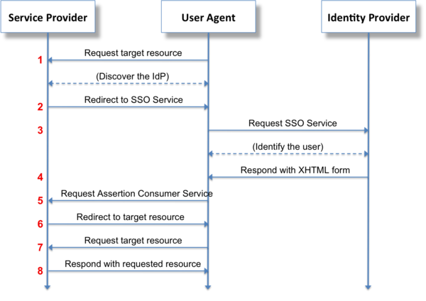
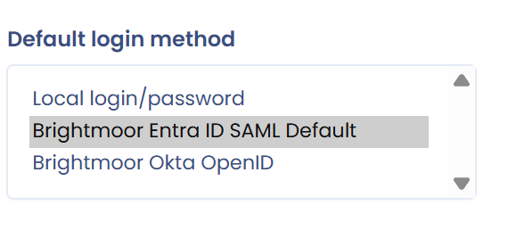

# Single Sign On (SSO)

## Working principle

**Single sign-on**, often abbreviated **SSO**, is a method that lets a user access several applications (or secure websites) after a single authentication.

A company can use **its own authentication system** instead of the local login Dastra provides by default. The most widely used SSO systems include Microsoft Active Directory, Google Workspace (formerly GSuite) and Auth0.

**The process works as follows:**

A user (**User Agent**) requests a connection to the service provider (**Service Provider**), which asks an identity provider (**Identity Provider**) to authenticate the user. The authentication result is then sent back to the service provider, which accepts the user's connection request.

In Dastra's case, the User Agent is **the browser of a Dastra user**, the Service Provider is **Dastra**, and the Identity Provider is **your authentication provider** (for example Active Directory).

<figure><figcaption></figcaption></figure>

## Implementation

A Dastra subscription can hold one or several SSO logins, if the feature is included in your subscription. To manage them, open **Organization settings** (at the bottom of the **Workspace settings** menu), then **Single sign on**. You land on the [SSO login configuration page](https://app.dastra.eu/general-settings/sso).


Only an owner of the organization can access this page.


<figure><figcaption><p>The <strong>Single sign on</strong> page</p></figcaption></figure>

The page holds three blocks:

* **Authorized email domains**, at the top: see [Email domains](../email-domains.md).
* The list of your SSO connections, which you extend with **Add a SSO login**.
* **SCIM**, at the bottom: see [SCIM](../scim.md).

To create a connection, click **Add a SSO login**, then choose the protocol. Dastra offers two single sign-on protocols, [**SAML 2**](saml.md) and [**OpenID**](openid.md). Use the links below for the configuration guides.


[saml.md](saml.md)



[openid.md](openid.md)



[adfs.md](adfs.md)



[entra-id.md](entra-id.md)



[okta.md](okta.md)



[known-problems.md](known-problems.md)


## Form fields

The form of an SSO connection opens in a side panel with three sections.

**1. General**

* **SSO connection label**: the name of the connection in the list, 80 characters at most.
* **Assign to all users**: every user must sign in with this SSO login. See [Enable SSO for all users](#enable-sso-for-all-users).
* **Enable**: when the connection is disabled, the standard password login remains in effect.
* **Assign user by default**: Dastra selects this connection by default when you invite a new user.

**2. Configuration**

* The fields specific to the protocol: see [SAML 2](saml.md) and [OpenID](openid.md).
* **User's email address claim name mapping (Used if user does not exist locally)**: the name of the claim in which your identity provider returns the user's email address. If Dastra does not recognize your users, see [Known problems](known-problems.md).

**3. Auto-provisioning**

* **Autoprovision user**: turns on automatic account creation. See [Enable automatic user provisioning](#enable-automatic-user-provisioning).
* **The default role assigned to each workspace for the newly created users**: optional.
* **Select a specific workspace**: optional. When you choose a workspace, a field appears for the name of the group claim: see [Team binding](#team-binding).

## Enable SSO for all users

1. In the list of SSO connections, click the connection.
2. In the **General** section, turn on **Assign to all users**.

<figure><figcaption><p>The <strong>General</strong> section of the connection</p></figcaption></figure>

### Users exempted from SSO login

In some cases you want to **turn SSO off for certain users**, for example a security administrator, a service account, or a user who is not in your Active Directory. You can name specific users who are not redirected to your organization's SSO login. We recommend naming at least one user with a local service account: it lets you recover from an SSO malfunction, such as an identity provider outage or a configuration error.

These users sign in to the application **with their password**.

To name them, select users of your organization in the **Specific users exempted from SSO (e.g. security administrators)** field. This field appears when **Assign to all users** is turned on.

## Enable automatic user provisioning

If you want the users of your identity provider to need no account before they access the organization, turn on **Autoprovision user** in the **Auto-provisioning** section.

Automatic provisioning only works when users sign in with the link of your SSO connection. It does not work from the standard login page. The link looks like this:

```
https://account.dastra.eu/Account/ExternalLogin?returnUrl=https://app.dastra.eu&provider={your provider id}
```

The addresses in the link are those of your region. To get it, click the **Copy signin link** button on the connection card, to the right of **Test**, then send it to your users.

<figure><figcaption><p>The <strong>Copy signin link</strong> button on the card</p></figcaption></figure>

After a successful authentication, the account is created automatically in Dastra. The organization owners then receive a notification that states the name and email address of the account created, the date and time, the SSO connection that created it, the default role assigned and, where applicable, the workspace concerned. It links to the **Users** page, so that you can grant the expected rights without delay.


If a user's account is deleted or disabled in the authentication provider, it is not erased in Dastra, but the user can no longer sign in. You can purge these accounts from the [user management of the subscription](https://app.dastra.eu/general-settings/users).


You can choose **The default role assigned to each workspace for the newly created users**.

<figure><figcaption><p>The <strong>Auto-provisioning</strong> section</p></figcaption></figure>


Dastra does not currently support binding roles from the properties of the authentication server. If this feature matters to you, report it through the [support page](https://app.dastra.eu/general-settings/support).


### Team binding

You can bind the teams of a workspace to a property (claim) returned by your authentication server. Select the workspace in **Select a specific workspace**, then enter the name of the group claim in the field that appears below: Dastra provisions the teams from that claim.

## Administer user logins

You set the login type of each user from the [user management of the subscription](https://app.dastra.eu/general-settings/users) (**Organization settings** > **Users**). Open the user's profile and choose the preferred SSO login in **Default login method**. A user who then signs in to Dastra with their email address is redirected to the login page of the authentication provider you set up.

When SSO is enforced for all users, the profile shows a message to that effect instead.

<figure><figcaption><p>The <strong>Default login method</strong> field</p></figcaption></figure>

You can also set the login type when you invite new users.

## If you cannot sign in with SSO

Check the [known problems](known-problems.md) first. If you are still blocked, contact [support](../../../getting-started/support/request.md) right away.
