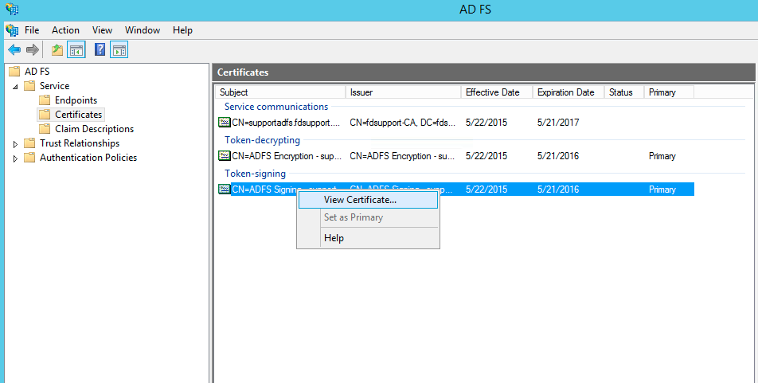
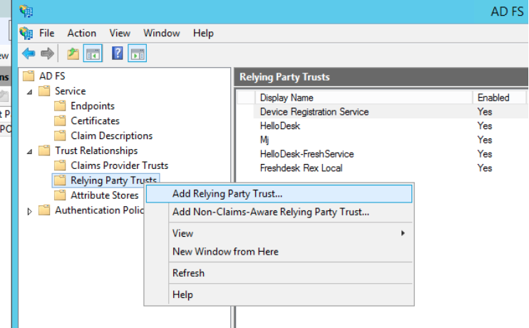
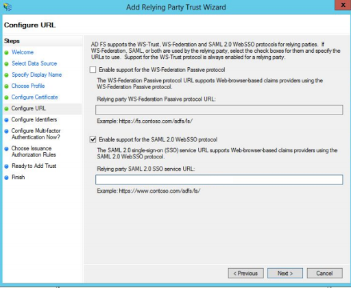

# ADFS

## About ADFS

Active Directory Federation Services (commonly abbreviated as ADFS) are a single sign-on (SSO) solution designed by Microsoft. These services, a component of Windows Server operating systems, allow users to authenticate via Active Directory (AD) when they want to access an application that cannot use Integrated Windows Authentication (IWA).

## Configure ADFS in Dastra

**Step 1: Create a SAML login in Dastra.**

* Go to the [Dastra SSO configuration page](https://app.dastra.eu/general-settings/sso) (**Organisation Configuration** > **Single sign on**)
* Click **Add a SSO login**
* Select **SAML2** in **SSO protocole**, then **Manual configuration**
* In the **Identity Provider's Entity id (issuer)** field, enter the following URL: `http://<adfs server url>/adfs/services/trust`
* In the **Identity Provider single sign on url** field, enter: `https://<adfs server url>/adfs/ls`

**Step 2: Retrieve the ADFS certificate**

* Go to the **Certificates** directory of the ADFS server
* Retrieve the .CER certificate of your ADFS server using the **Token-Signing** certificate.

<figure><figcaption></figcaption></figure>

* Click **View Certificates**.

<figure><figcaption></figcaption></figure>

Copy the X509 certificate code by opening the CER file with a text editor. Insert it into the certificate field, between `-----BEGIN CERTIFICATE-----` and `-----END CERTIFICATE-----`. Your login configuration should look like this:

<figure><figcaption></figcaption></figure>

**Step 3:** Keep the following values:

* **SP redirect URI** (format: `https://account.dastra.eu/xxxxx-xxxx-xxxx-xxxx/Acs`): the application callback URL, to which the SAML token is posted. The supported algorithms are SHA-256 and higher. Copy it from the top of the SAML form.
* **Identity Provider's Entity id (issuer)**, displayed at the top of the same form.

These two values will be used to configure the ADFS server to accept SSO requests from Dastra.

## Configure the Dastra client in ADFS

Here's how to configure Dastra SSO with ADFS SSO SAML2P.

**Step 1:** On your ADFS server, open **AD FS Management**.

**Step 2:** Right-click **Relying Party Trusts** and select **Add Relying Party Trust**. The Add Relying Party Trust wizard starts.

<figure><figcaption></figcaption></figure>

**Step 3:** On the **Select Data Source** screen, choose **Enter data about the relying party manually**.

<figure><figcaption></figcaption></figure>

**Step 4:** Enter a **Display name**, for example "Dastra", and then click **Next**.

**Step 5:** Choose **AD FS profile** (SAML 2.0) and click **Next**.

**Step 6:** On the **Configure Certificate** screen, click **Next** without selecting a certificate.

**Step 7:** Select **Enable support for the SAML 2.0 WebSSO protocol**.

<figure><figcaption></figcaption></figure>

In the **Relying party SAML 2.0 SSO service URL** field, enter the **SP redirect URI** from Dastra. It looks like this: `https://account.dastra.eu/xxxx-xxxx-xxxx-xxxx/Acs`

**Step 8:** In the **Relying party trust identifier** section, add two values: `account.dastra.eu` and `https://account.dastra.eu`.

**Step 9:** Click **Next** until the end of the wizard.

**Step 10:** Select the **Open the Edit Claim Rules dialog** check box before clicking **Close**. The **Edit Claim Rules** window appears.

<figure><figcaption></figcaption></figure>

**Step 11:** Click **Add Rule** and choose the claim rule template **Send LDAP Attributes as Claims**.

<figure><figcaption></figcaption></figure>

**Step 12:** Map the claims as follows. The claim names may vary depending on the configuration of your server. Dastra needs three attributes: email (required), last name and first name of the user.

<figure><figcaption></figcaption></figure>

**Step 13:** Click **Finish**, then click **Add Rule** again. This time, choose the template **Transform an Incoming Claim** and click **Next**.

**Step 14:** Configure the following rule: **Email Address** => **Name ID** => **Email**.

<figure><figcaption></figcaption></figure>

Then click **Apply**.

**Step 15:** Back in the **AD FS Management** window, right-click the relying party of Dastra and choose **Properties**. In the **Advanced** tab, choose SHA-256 as the secure hash algorithm.

**Step 16:** The configuration is complete.

## Finish and test

When everything is configured on both sides, go back to Dastra and click **Test** on the right of the connection in the list of SSO logins.
