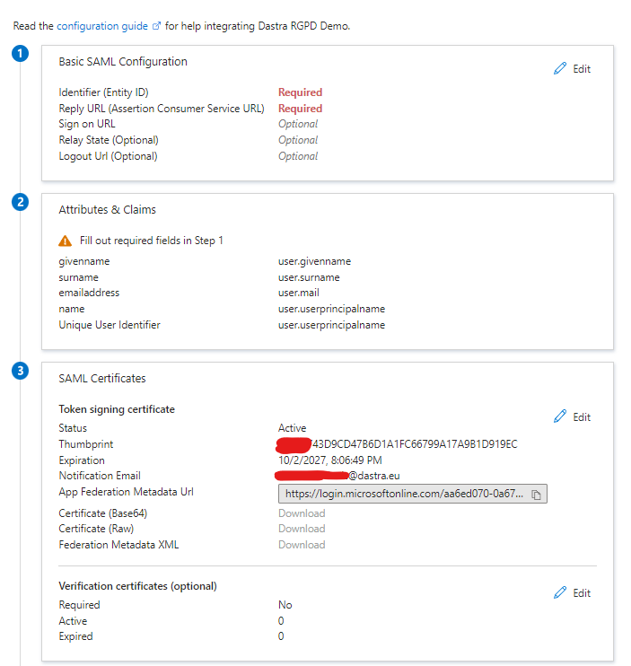
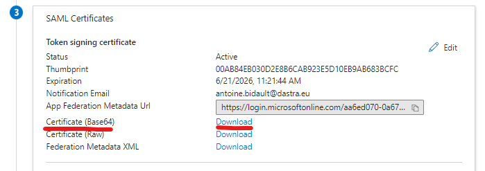
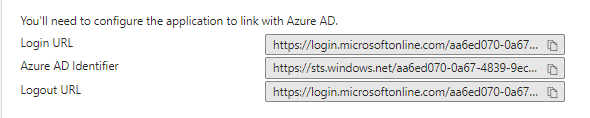

# Active Directory (Microsoft Entra ID)

## Configure the application in Microsoft Entra ID

* Go to the Microsoft Entra admin center: [https://entra.microsoft.com](https://entra.microsoft.com)
* In the left navigation, click **Entra ID** > **Enterprise apps**
* Click **New application**, then **Create your own application**
* Enter the name of the application, for example "Dastra"
* Select **Integrate any other application you don't find in the gallery (Non-gallery)**, then create the application
* In the **Manage** section, click **Single sign-on** and select **SAML**
* You arrive on this page:

<figure><figcaption></figcaption></figure>

## Configure the SSO client in Dastra

### Step 1: Create a SAML SSO login in Dastra

* Go to the [Dastra SSO configuration page](https://app.dastra.eu/general-settings/sso) (**Organisation Configuration** > **Single sign on**)
* Click **Add a SSO login**
* Select **SAML2** in **SSO protocole**, then **Manual configuration**
* Enter a connection label in **SSO connection label**, for example "Active Directory"

### Step 2: Configure the SSO login in Microsoft Entra ID

* Go back to the SAML configuration page of Microsoft Entra ID
* Click **Edit** in the **Basic SAML Configuration** section
* Enter the connection information displayed at the top of the Dastra SAML form: **Identifier (Entity ID)** and **Reply URL (Assertion Consumer Service URL)**:

<figure><figcaption></figcaption></figure>

* Click **Save**
* Go directly to the **SAML Certificates** section to **download the certificate in Base64 format**:

<figure><figcaption></figcaption></figure>

* Open the CER file with a text editor (for example, Notepad) and copy the content (Ctrl + C):

<figure><figcaption></figcaption></figure>

### Step 3: Add the certificate to the Dastra client

* Go back to the SAML connection creation screen in Dastra
* Paste the text of the certificate (Ctrl + V) into the **Identity Provider Certificate (RAW)** field

### Step 4: Configure the identity provider URLs in Dastra

* In the **Set up** section of the Entra ID application, copy the three values **Login URL**, **Microsoft Entra Identifier** and **Logout URL**:

<figure><figcaption></figcaption></figure>

* Paste them into Dastra using this mapping:
  * **Login URL**: **Identity Provider single sign on url**
  * **Microsoft Entra Identifier**: **Identity Provider's Entity id (issuer)**
  * **Logout URL**: **Identity Provider Signout url**
* Your SSO configuration form in Dastra should look like this:

<figure><figcaption></figcaption></figure>

* You can turn on the **Autoprovision user** option, in the **Auto-provisioning** section. In that case, accounts of your directory that do not exist in Dastra yet are created at their first sign-in:

<figure><figcaption></figcaption></figure>

* Save your changes in Dastra


Before testing the connection, make sure that a user is assigned to the new application.


### Test your SSO connection

In Microsoft Entra ID, click the **Test** button in the **Test single sign-on** section of the application. If everything works, you are redirected to Dastra.


If you have not turned on automatic user creation, Dastra denies access until the local account has been created by an invitation.


### For further information


[Known problems](known-problems.md)



[SAML 2](saml.md)

