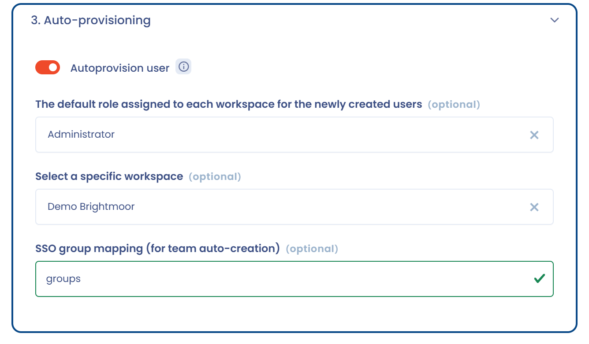

# Known problems

This page gathers the SSO incidents our customers actually run into, and how to solve them. It is organized by **symptom**: look for what you see on screen.


**Always set up an exception account before enforcing SSO for everyone.**

If you turn on **Assign to all users** and SSO breaks (expired certificate, identity provider upgrade, configuration error), **nobody can sign in any more, owners included**. Declare at least one user in the **Specific users exempted from SSO (e.g. security administrators)** field, ideally a local service account, so that you can get back into the configuration and fix the problem.

See [Users exempted from SSO login](README.md#users-exempted-from-sso-login).


## The 5 checks to run first

Before any deeper diagnosis, go through this list:

1. **Test the configuration.** The **Test** button on the SSO connection card validates the dialogue with your identity provider. If it fails, the problem is in the configuration, not in the user account.
2. **Does the user exist in the organization?** SSO is attached to the organization: the user must appear in the [user list](https://app.dastra.eu/general-settings/users).
3. **Does the email address match exactly?** Dastra matches the account using the **email address returned by the identity provider**. A single character of difference and the user is not recognized.
4. **Is the user entitled to the Dastra application on the identity provider side?** This is the number one cause of failures affecting a single person.
5. **Test in private browsing** and check that **the machine's clock is synchronized**: clock drift invalidates tokens.

***

## The user is not recognized by SSO

### The email address returned by the IdP does not match the Dastra account

By far the most frequent cause. Dastra uses the **email claim** to associate the SSO identity with an existing account. If the two values differ, Dastra considers this to be a **new** user; if automatic account creation is disabled, the login is then **rejected**.

Typical cases we have seen:

* the Dastra account is `first.last@company.com` but the staging IdP returns `first.last@company-stg.com`;
* the UPN was changed in the corporate directory (name change, domain migration) without being reflected in Dastra;
* the user was created in Dastra with a short form of their address (`flast@…`) while the IdP returns the long form.

**Resolution**: align the two values, in either direction:

* have the IdP return exactly the address registered in Dastra, **or**
* create / correct the Dastra account so that it carries the address returned by the IdP.


To find out the value actually sent, inspect the SAML assertion or the ID Token returned by your IdP (see [Collecting diagnostic evidence](#collecting-diagnostic-evidence)).


### The name of the claim containing the email does not match

Even when the address is correctly transmitted, Dastra may fail to find it: it looks the claim up **by its exact name**.

By default, Dastra expects the claim:

```
http://schemas.xmlsoap.org/ws/2005/05/identity/claims/emailaddress
```

Yet some IdPs publish the attribute under a short name, for example:

```xml
Name="emailaddress"
NameFormat="http://schemas.xmlsoap.org/ws/2005/05/identity/claims/emailaddress"
```

Dastra relies on the **`Name`** property, not on `NameFormat`: the value is indeed present in the SAML response, but the expected claim is still not found.

**Resolution**:

1. Open your SSO configuration, **Configuration** section.
2. In the **User's email address claim name mapping (Used if user does not exist locally)** field, replace the value with the name actually published by your IdP (here: `emailaddress`).
3. Save, then run a new login test **from a private browsing window** to create a fresh session.

### The user is not entitled to the application on the identity provider side

When a single user is blocked while everyone else signs in normally, the problem is almost always on the IdP side.

**Resolution**: check that the person is created in your directory **and** assigned to the Dastra application with the required access rights. A good discriminating test is to have the user sign in **without going through SSO** (exempted account or password): if that works, the Dastra account is healthy and the blockage comes from the entitlement on the IdP side.

### The user is an "external user"

SSO only applies to accounts that are **internal** to your organization. If the user already had a Dastra account (another organization, trial account, personal account), their **main organization** is a different one: its security settings apply, not yours, and they appear in your organization as an **external user**.

Check their status in the [organization's user list](https://app.dastra.eu/general-settings/users). The attachment to the main organization cannot be changed from the interface: contact support with the email address concerned.

***

## Automatic account creation does not work

### "SSO users autoprovisioning is not allowed for your organization"

This message means the **Autoprovision user** option is not enabled in your SSO configuration. While it is disabled, only a user **already invited to Dastra** can sign in through SSO.

**Resolution**: an **organization owner** turns the option on in the SSO configuration, **Auto-provisioning** section, and picks the role granted by default.

<figure><figcaption><p>The <strong>Auto-provisioning</strong> section</p></figcaption></figure>


Only an **owner** can modify the SSO configuration. An administrator does not see this page.


### The option is enabled but accounts are still not created

Automatic provisioning **only triggers when the user arrives through the SSO link**. A user going through the regular login page will not get an account created.

Distribute your SSO connection link to your users, in the form:

```
https://account.dastra.eu/Account/ExternalLogin?returnUrl=https://app.dastra.eu&provider={your provider id}
```

You can retrieve it with the **Copy signin link** button on the SSO connection card:

<figure><figcaption><p>The <strong>Copy signin link</strong> button on the card</p></figcaption></figure>

### External questionnaire respondents are not provisioned

Someone who has never opened the SSO link is not a Dastra user: automatic creation therefore does not apply to respondents invited to an external questionnaire.

Two workarounds:

* **provision the accounts upstream**: see [importing a user list](../../../getting-started/setup/users.md);
* distribute the questionnaire through a **Trust center**, which offers visitors an SSO login.

***

## Authentication loop or error when returning to Dastra (OpenID Connect)

Symptoms: redirect loop between Dastra and the IdP, the error **"An error was encountered while handling the remote login"**, or an **HTTP 400 error when retrieving the token**.

In that case the redirect to the IdP and the authentication both work: it is the processing of the OIDC callback that fails. Check the following points, in this order.

### The "Authority/Domain" field points to the wrong endpoint

A very common configuration mistake. This field must contain **the root URL of the OIDC issuer**, the one exposing `/.well-known/openid-configuration`, and **not** the `/authorize` endpoint.

| | |
| --- | --- |
| Incorrect | `https://login.example.com/user/IdPOAuth2/authorize/FB6CB139F80BCAEB` |
| Correct | `https://login.example.com/user/IdPOAuth2/FB6CB139F80BCAEB` |

The `/authorize` and `/token` endpoints are then discovered automatically through the well-known document.

### The response type is incorrect

The **Response Type** field must carry **exactly** one of the values published by your IdP, typically `id_token` or `code`.

Watch out for hyphenated variants: a value of `id-token` instead of `id_token` causes an authentication loop together with a 400 error when retrieving the token. Check it character by character.

If the `id_token` flow fails, try `code`: some IdPs do not allow the implicit flow.

### The client authentication method is not the right one

If the configuration looks correct but the token cannot be retrieved, your IdP may not accept client authentication with a secret key. In the **Configuration** section of the connection, select **JWT private key** instead of **Secret key**, then fill in the private key in PEM format and the certificate content. The fields are described in [OpenID](openid.md).


With the JWT private key, you no longer have a secret key to declare and the response type switches to `code`. Remember to **save once** so that the JSON public key URI (`jwks_uri`) is exposed, then declare it at your identity provider.


If your IdP requires another client authentication method, such as HTTP Basic authentication, contact support.

### The ID Token is signed with HS256

Depending on the integration, Dastra may require an **asymmetric RS256 signature**, with the public key exposed through the `jwks_uri`. An ID Token signed with **HS256** may be rejected at validation.

Check on the IdP side whether the Dastra client can be configured with an **RS256** signature.

### Other causes to rule out

* **The redirect URL is not declared on the IdP side.** It must be registered as-is, in the format `https://account.dastra.eu/signin-{schemeId}`, in the application declared at your provider (for example under *App Registration* > *Authentication* on Azure).
* **The `redirect_uri` used is not strictly identical** to the configured one.
* **The token issuer does not exactly match** the URL configured in Dastra.
* **The scopes are not granted.** Keep `openid profile email`; check that all three are allowed on the IdP side.
* **The `email` claim is missing from the ID Token.**

### "The value of the response\_type parameter is unknown"

When this message appears **on your identity provider's page** (and not on Dastra), the redirect is working: the problem is in the OIDC client declaration on the IdP side.

Check:

* the `response_type` values allowed on the application declared in your SSO;
* the configuration of the OIDC client associated with Dastra;
* the delegation mode in use (CAS/OIDC, for instance).

***

## Certificate errors (SAML 2)

You get an error message of this kind, reporting an untrusted or invalid key:

1. **Make sure the certificate is valid**: an expired certificate produces exactly this symptom, often "overnight" with no change on your side.
2. **Check that copying/pasting the certificate did not introduce a line break or a stray space.**
3. **Check that the certificate configured in Dastra is the one used by the IdP of the relevant environment**: a frequent mistake is leaving the staging certificate on the production configuration.

### Renewing an SSO certificate

The certificate is updated directly from your [organization's SSO configuration](https://app.dastra.eu/general-settings/sso). As an **owner**, replace the current certificate with the new one provided by your teams, then use the **Test** button.


Plan ahead for expiry: schedule the renewal **before** the due date, and check that your SSO exception account still works before making any change.


### The configuration works in staging but not in production

When the production configuration is modelled on a working staging one, three parameters almost always differ:

* **the ACS / Reply URL** declared on the IdP side must **exactly** match the production callback URL provided by Dastra: make sure the staging URL has not been copied over;
* **the SAML certificate** must be the one of the production IdP;
* **the Tenant ID** must be the production one. This parameter is not configured in Dastra: it can only be checked on the IdP side.

***

## The user signs in but has access to nothing

### "You are not allowed to access this feature or resource (area/entity)"

If the user **authenticates correctly** and then lands on this page when selecting their workspace, the problem is not SSO but their **permissions**.

One cause identified in production: the user holds a **custom role containing no permission at all**. Dastra then cannot grant any access and redirects them to this page.

**Resolution**: open the role concerned and give it **at least one permission**, matching the expected level of access. There is no need to clear the cache or to keep troubleshooting SSO.


[roles-et-permissions.md](../roles.md)


### "Access denied (401)" error after signing in through SSO

Before suspecting SSO, check that **the machine's clock is synchronized with the internet**: token expiry times are compared with the machine's time. This is a classic cause of a 401 right after a successful authentication.

See also the 401 section of the [general known problems](../../../other/known-problems.md).

***

## Email address change and domain migration (UPN)

In Dastra, **the email address is the structural identifier of the account**: it underpins identification, invitations, authentication and the attachment to platform items. It therefore cannot be changed in bulk from the administration interface.

The direct consequence for SSO: if the UPN changes in the directory without the address being updated in Dastra, **the user is no longer recognized**.

| Situation | What to do |
| --- | --- |
| A single user | **The user changes their own address** from their profile settings. Only the person concerned can perform this action. |
| Bulk domain migration | An exceptional operation carried out by Dastra, **in a single pass**, from a complete and verified file you provide (old address ↔ new address). Open a support ticket beforehand. |


For a bulk migration, three rules to keep in mind:

* **one single pass**: successive partial migrations create inconsistencies in SSO, user identification, permissions and attachments;
* **no intermediate address**: provide the **final target address** directly; the same account cannot be migrated twice;
* **anticipate side effects**: ongoing data subject requests and questionnaires may contain the old addresses: state explicitly whether they must be updated too.



Do not delete and recreate accounts "to go faster": you would lose the history and the link between the person and the items they are responsible for. Note also that when a deleted user is re-invited, their first and last name are retained. This is the expected behavior.


***

## Two SSO accounts in the same browser

It is **not possible to sign in to several different SSO accounts at the same time** from the same browser or the same machine, even using separate browser profiles.

**Workaround**: sign in to the second account with **standard authentication** (email / password) rather than SSO. If that account is subject to SSO, declare it among the **exempted users**.

This behavior also explains some errors observed in private browsing when an SSO session is already open elsewhere.

***

## The identity provider login screen appears at every sign-in

With OpenID Connect, the journey differs slightly from SAML:

* **on the first sign-in**, the user enters their email address on the Dastra login page; this identifies their organization and redirects them to your identity provider. A cookie then remembers this provider as the preferred login method;
* **on subsequent sign-ins**, the user is redirected automatically to the IdP without re-entering their address.

If the login screen appears every time although a session is already active on the IdP side, an OIDC setting may be forcing the authentication prompt to be displayed. Check this on the identity provider side and report it to support if the behavior persists.

***

## SSO stopped working after an IdP upgrade

An upgrade of your identity infrastructure (OpenAM or ADFS version change, migration to Entra ID…) can alter certificates, validation mechanisms and OIDC flow handling. Typical symptom: an **authentication loop** although nothing changed on the Dastra side.

**What to do**:

1. Work on a **test / sandbox environment**, never directly in production.
2. **Recreate the SSO configuration from scratch** rather than patching the existing one: this rules out a parameter inherited from the previous version.
3. Pay particular attention to **updating and validating the certificates**.
4. Re-run the checks from the [OpenID Connect section](#authentication-loop-or-error-when-returning-to-dastra-openid-connect) above.

***

## Nobody can sign in any more


For security and access governance reasons, **the Dastra support team does not create or modify user accounts within customer organizations**, and does not generate login credentials. Only an **owner of your organization** can do this.


If SSO is enforced for everyone and is out of service:

1. Sign in with an **SSO exception account** (declared in advance in the **Specific users exempted from SSO** field).
2. From that account, **disable the SSO connection** (the **Enable** option) while you fix the configuration, so that users can sign in with a password again.
3. Fix it, test with the **Test** button, then re-enable.

If no exception account exists, contact support immediately, stating your organization's name. Plan to create one as soon as access is restored.

***

## Collecting diagnostic evidence

When the problem is not solved by the points above, a network export allows our teams to analyze the authentication flow precisely. Here is the procedure.

**Step 1: Open the developer tools**

* Open a **private browsing window** (Chrome or Edge).
* Press `F12` (or `Ctrl + Shift + I`).
* Select the **Network** tab.

**Step 2: Enable log preservation**

Tick the **Preserve log** option. It is essential: without it, the history is lost during the redirects between Dastra and your identity provider.

**Step 3: Reproduce the problem**

Start the SSO login and go all the way to the error or the redirect loop. **Do not close the window** after the error.

**Step 4: Export**

* **Option A (recommended)**: right-click in the request list, then select **Save all as HAR with content**, then send us the `.har` file.
* **Option B**: screenshots of the Network tab, including the `/authorize`, `/token` and `/signin` requests and any request in error (400, 401, 403…).

**Step 5: Describe the context**

Also tell us:

* exactly when the blockage occurs: on clicking the SSO link, when the authentication page is displayed, after entering credentials, or after submitting the login form;
* the **exact error message** (screenshot);
* for OIDC: the **issuer**, **client\_id** and **redirect\_uri** configured on the IdP side, the token **signature algorithm**, and the claims returned (`sub`, `email`, `preferred_username`…) with sensitive data masked;
* for SAML: the **assertion** received (sensitive data masked).


A **video recording** of the full sequence (Loom, for example), with the developer tools open, speeds up diagnosis considerably.

Providing a **test account** able to authenticate through your SSO, with the same type of access as the affected users, is the single most useful element: it lets us reproduce the journey end to end. The account can be temporary and deleted once the investigation is complete.



[request-support.md](../../../getting-started/support/request.md)

