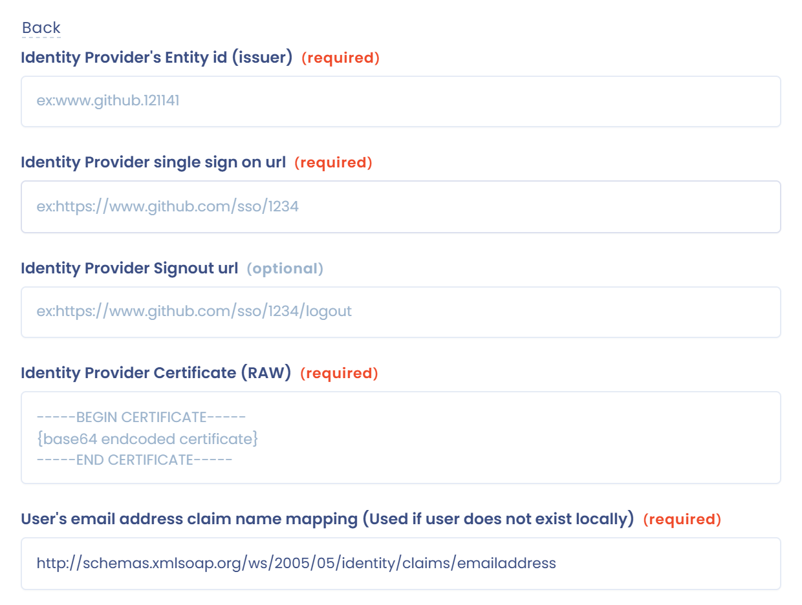

# SAML 2

Setting up SSO with SAML 2 takes three steps:

* configure the authentication provider (**Identity Provider - IdP**): Active Directory, Google Workspace, etc.;
* configure the service provider (**Service Provider - SP**): Dastra;
* test the authentication.

For **ADFS servers**, see the dedicated page:


[adfs.md](adfs.md)


## 1. Configure the authentication provider

Set up a SAML configuration in your authentication provider.

* For AD FS: see the [ADFS](adfs.md) page.
* For Microsoft Entra ID (formerly Azure AD): see the [Active Directory (Microsoft Entra ID)](entra-id.md) page and the [Microsoft documentation](https://learn.microsoft.com/en-us/entra/identity/enterprise-apps/add-application-portal-setup-sso).
* For Google: [https://support.google.com/a/answer/6087519?hl=en](https://support.google.com/a/answer/6087519?hl=en)

To link the local accounts (those hosted in Dastra), you need to provide a property containing the user's email (by default, Dastra looks for the property named [http://schemas.xmlsoap.org/ws/2005/05/identity/claims/emailaddress](http://schemas.xmlsoap.org/ws/2005/05/identity/claims/emailaddress)). You can change this name in the **User's email address claim name mapping (Used if user does not exist locally)** field.

Here is the information you need to fill in the service provider:

* **Identity Provider's Entity id** (issuer);
* **Single sign on url**;
* **the certificate in RAW format** (Base64 encoded).

To configure your authentication provider, you need the following information, displayed at the top of the SAML form in Dastra:

* **Issuer**: `https://www.dastra.eu` by default;
* **SP Redirect URI** (ACS): `https://account.dastra.eu/{connection identifier}/Acs`. This URL is specific to each connection: copy it from the top of the SAML form when you add the SSO login in Dastra (step 2), then save that login;
* **SP start url (Sign on URL)**, if your provider asks for a sign-in URL for the application;
* **SAML Logout url (optional)**, if your provider handles sign-out.

## 2. Configure the service provider

In Dastra, open the [SSO administration page](https://app.dastra.eu/general-settings/sso) (**Organisation Configuration** > **Single sign on**, available to organization owners only) and click **Add a SSO login**. Choose the **SAML2** protocol.

<figure><figcaption></figcaption></figure>

Then choose how to provide the configuration of your identity provider:

* **Upload your saml configuration manifest (.xml)**: upload the metadata file (XML manifest) supplied by your provider. Dastra fills in the form fields from this file. Click the back button to switch method.
* **Manual configuration**: fill in the fields yourself.

<figure><figcaption></figcaption></figure>

With manual configuration, fill in the form fields with the information from your authentication provider:

<figure><figcaption></figcaption></figure>


You can force all users of the organization to use a particular SSO (**Assign to all users** option). Be careful: if the SSO malfunctions, you can no longer access your account as an administrator. Keep a local fallback account, or exempt users with the **Specific users exempted from SSO (e.g. security administrators)** field (see [Single Sign On (SSO)](README.md)). Managing SSO per user is preferable.



**Special case of external users**\
Only accounts internal to a subscription are subject to SSO. Accounts of external users (who have an additional subscription) are not subject to SSO.


## 3. Test the SSO

When the configuration is complete, test the authentication by clicking **Test** on the right of the connection in the list. If you run into a problem, open a ticket from the [support page](https://app.dastra.eu/general-settings/support).

<figure><figcaption></figcaption></figure>
