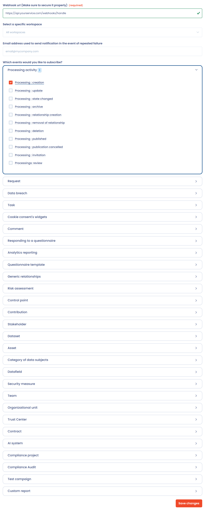
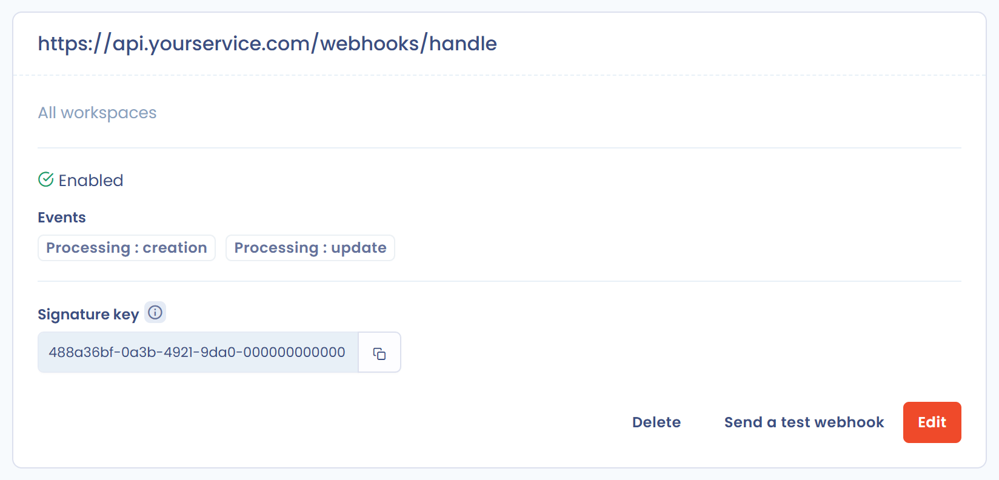
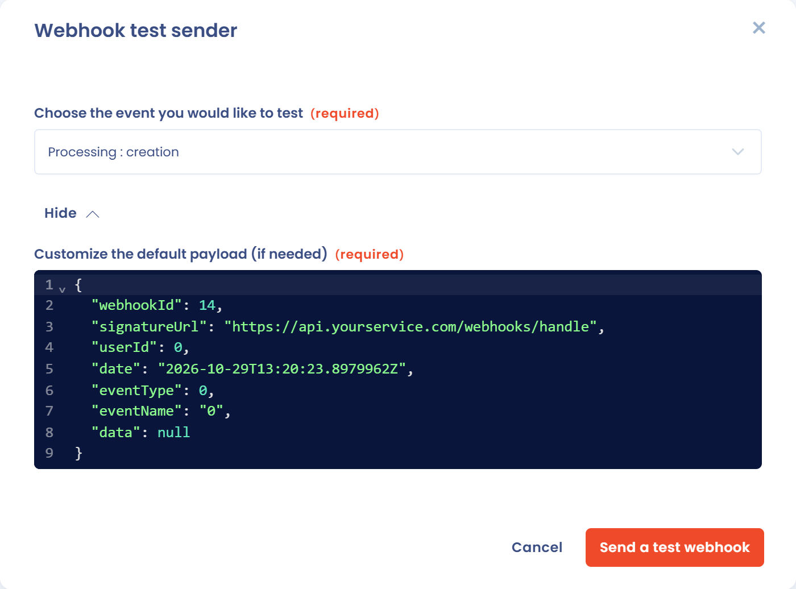

# Webhooks

## Concept

A webhook triggers an action in response to an event. Webhooks are used to make systems communicate: they alert you as soon as something happens in Dastra. The aim is to notify third-party applications (APIs, CRM, serverless functions, etc.) in real time.

## Configuration

Webhooks are configured at the organization level and are reserved for owners. Click the gear icon in the top bar (**Organization settings**), then **Webhooks** in the left menu. The direct address is [https://app.dastra.eu/general-settings/webhooks](https://app.dastra.eu/general-settings/webhooks).

<figure><figcaption><p>The list of webhooks</p></figcaption></figure>

1. Click **Create a webhook url**.
2. Enter the **Webhook url**. To learn what it receives, see [How to receive the webhook](webhooks.md#comment-receptionner-le-webhook).
3. Choose the workspace in **Select a specific workspace**. If you choose none, the webhook applies to **All workspaces**.
4. Optional: enter the **Email address used to send notification in the event of repeated failure**. Dastra sends an email to this address when the webhook goes into error.
5. Select the event or events you want to subscribe to in **Which events would you like to subscribe?** At least one event is required. The type of data returned depends on the event: for example, if you choose the creation of a data subject request, the request body contains a JSON describing that request.
6. Click **Save changes**.

<figure><figcaption><p>The webhook form</p></figcaption></figure>

The available events are those of the notification center, grouped by object type (processing activities, data subject requests, data breaches, etc.).


An organization can declare up to 30 webhooks.


This takes you to the webhook details screen. It shows the url, the workspace, the status of the webhook (**Enabled** or **Disabled**), the **Last error message** if any, the subscribed events and the **Signature key**, which you can copy. The **Edit**, **Send a test webhook** and **Delete** buttons are there too.

<figure><figcaption><p>The details of a webhook</p></figcaption></figure>

## How to receive the webhook <a href="#comment-receptionner-le-webhook" id="comment-receptionner-le-webhook"></a>

To receive webhook requests, you need to create an event capture API endpoint. The request is made as a POST and is always structured in the same way. The request body contains a JSON with the details of the event triggered.

Here is the general structure of the request sent:

```json
{
 "webhookId": <id of the webhook configured in dastra>,
 "signatureUrl": "https://yourapi.com/webhooks/handle",
 "userId": <The user who triggered the event>,
 "eventType": <The id of the event>,
 "eventName": <The label of the event>,
 "data": <Event dynamic data>,
 "date": <date of the event>
}
```

A timeout of 10 seconds is applied to the request, after which it is in error. The response must be a success code (2xx), for example 200.

There may be a small delay between the moment the event occurs in the application and the sending of the webhook. This delay is linked to the asynchronous nature of webhook execution in our infrastructure. It depends on the load of the infrastructure and can go up to 60 to 120 seconds.


At present, there is no system for replaying failed webhooks and thus compensating for any unavailability of the receiving server. In this case, we recommend manual synchronization of failed events.


## Test your webhook url

To test your webhook in real-life conditions, open its details screen and click **Send a test webhook**. In the **Webhook test sender** window:

1. Choose the event to test in **Choose the event you would like to test**. The list shows the events the webhook is subscribed to.
2. If needed, change the data sent in **Customize the default payload (if needed)**. Dastra fills it with a sample for the chosen event.
3. Click **Send a test webhook**.

A confirmation message shows that your url answered with a 200 code. If the webhook had been blocked after errors, a successful test enables it again.

<figure><figcaption><p>The webhook test tool</p></figcaption></figure>

## Secure the webhook


Validating the incoming request is not mandatory, but it is recommended. It prevents someone who has observed the network from posting anything on your webhook url and triggering or multiplying the creation of items in your system.


Each time an event you subscribed to occurs, Dastra sends a POST request to the webhook url. Each request contains the `Dastra-Signature` header, which your server can read.

Its value is the HMAC-SHA256 of the exact JSON body of the request, computed with the webhook's signature key and then encoded in Base64.

> Dastra-Signature = **Base64**(**HMAC-SHA256**(\<JSON body of the request>, \<webhook signature key>))

Use the signature key exactly as it is displayed on the webhook details screen. Here are examples of signature validation:



```php
<?php
$secret = 'YOUR_WEBHOOK_KEY'; // signature key shown on the webhook details screen

$payload = file_get_contents('php://input'); // raw request body
$signature = $_SERVER['HTTP_DASTRA_SIGNATURE'] ?? ''; // value of the Dastra-Signature header

$computed = base64_encode(hash_hmac('sha256', $payload, $secret, true));

if (!hash_equals($computed, $signature)) {
    http_response_code(401);
    exit;
}

// the signature is valid: process the event
http_response_code(200);
```



```csharp
[HttpPost("webhooks/handle")]
public async Task<IActionResult> Handle()
{
    string signature = Request.Headers["Dastra-Signature"];
    string key = "YOUR_WEBHOOK_KEY";

    using var reader = new StreamReader(Request.Body, Encoding.UTF8);
    string payload = await reader.ReadToEndAsync();

    if (!ValidateSignature(signature, payload, key))
    {
        return Unauthorized();
    }

    // the signature is valid: process the event
    return Ok();
}

private static bool ValidateSignature(string signature, string payload, string secret)
{
    using var hmac = new HMACSHA256(Encoding.UTF8.GetBytes(secret));
    byte[] hash = hmac.ComputeHash(Encoding.UTF8.GetBytes(payload));
    string computed = Convert.ToBase64String(hash);

    return CryptographicOperations.FixedTimeEquals(
        Encoding.UTF8.GetBytes(computed),
        Encoding.UTF8.GetBytes(signature ?? string.Empty));
}
```



## Behavior on error

The webhook is considered in error when more than 5 errors have been recorded. Dastra stops sending events to its url as long as the last error is less than 24 hours old. If an email address is set in the configuration, it receives a message. A successful test resets the error counter.

## How to set up webhooks with the API

Retrieve the webhooks linked to your account (in all workspaces). The optional `workspaceId` parameter limits the list to one workspace.


[dastra-api.json](../../.gitbook/assets/dastra-api.json)


Create a new webhook url using the POST endpoint. Fill in the events to which you want to subscribe your webhook with the `subscribedEvents` parameter.


[dastra-api.json](../../.gitbook/assets/dastra-api.json)


A webhook ID is returned to you. It lets you read, update or delete the webhook.


[dastra-api.json](../../.gitbook/assets/dastra-api.json)



[dastra-api.json](../../.gitbook/assets/dastra-api.json)



[dastra-api.json](../../.gitbook/assets/dastra-api.json)

