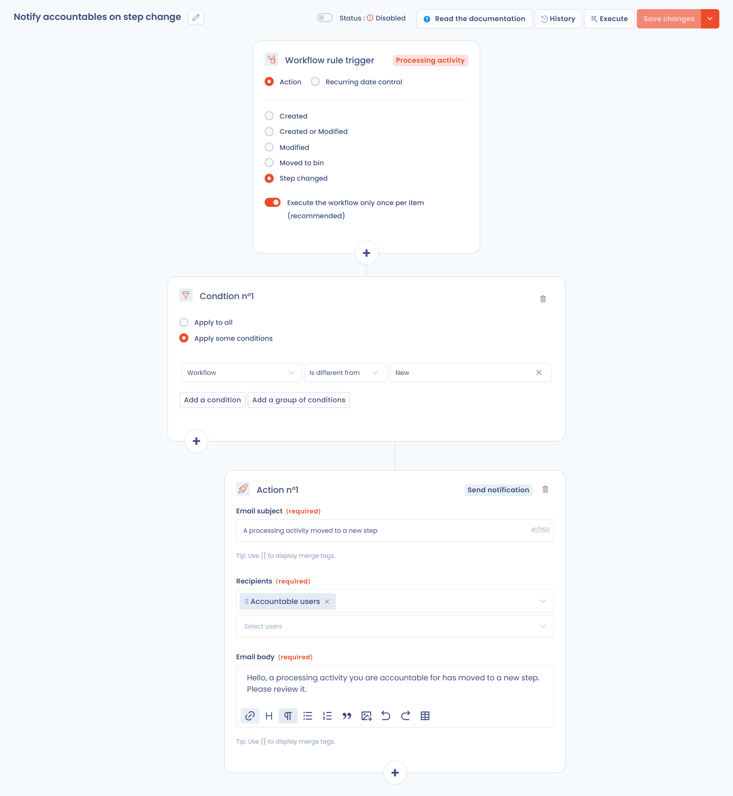
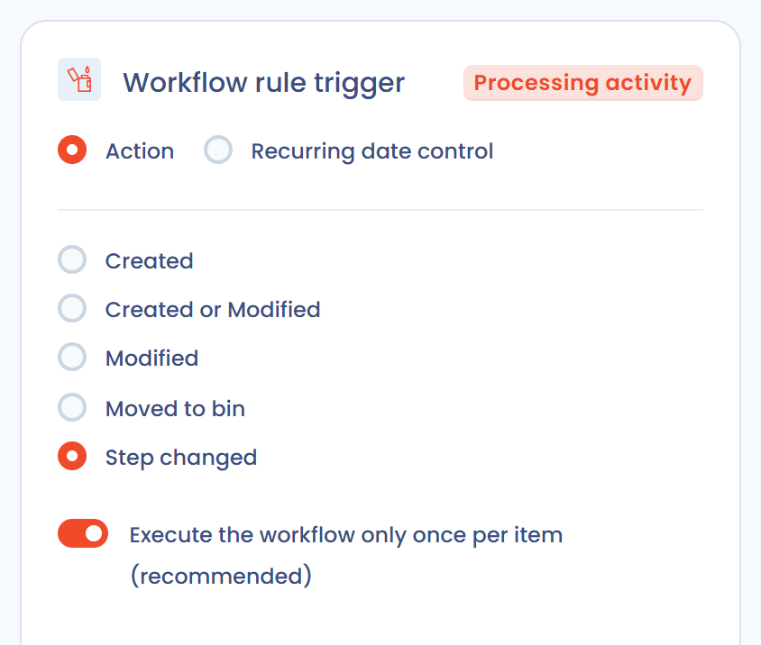

# Workflow rules


**Workflow stages vs workflow rules**

[Workflow stages](workflow-stages.md) define the steps an object moves through (for example New → In progress → Done). **Workflow rules** automate actions when those steps or other events occur. The two features work together.


## How it works

A workflow rule is a set of actions (email notifications, questionnaire scheduling, tasks, field updates…) that run when specific conditions are met. It automates sending notifications, assigning tasks and updating fields on a record.

Each rule follows a three-part logic: a trigger, conditions and actions.

<figure><figcaption><p>Trigger, conditions and actions</p></figcaption></figure>

A rule applies to one object type. The types offered depend on the modules enabled on your subscription:

| Object type                 |
| --------------------------- |
| Processing activity         |
| Request                     |
| Data breach                 |
| Task                        |
| Asset                       |
| Stakeholder                 |
| Datafield                   |
| Security measure            |
| Category of data subjects   |
| AI system                   |
| Contract                    |
| Responding to a questionnaire |


The number of workflow rules available depends on your plan, from **25 to 100 rules**. Additional capacity can be purchased if you need more. Contact your account manager for details.


## Creating a workflow rule

1. In the side menu, open **Automations**, then **Workflow rules**.
2. Click **Create a workflow rule**.
3. Choose **From scratch** to start from a blank canvas, or **From a template** (see [Template library](#template-library)).
4. Enter the **Rule name** and the **Object type**, then confirm.

The rule designer opens. At the top of the screen, the **Status** switch enables or disables the rule. The **History** and **Execute** buttons are described below. The menu of the **Save changes** button also offers **Save and exit** and **Save as template**.

### Trigger

The trigger is chosen between two values:

* **Action**: the rule fires when an event occurs on the object. The events are **Created**, **Created or Modified**, **Modified**, **Moved to bin** and **Step changed**. Moved to bin is not offered for assets, stakeholders, data fields, security measures and categories of data subjects.

<figure><figcaption><p>Creating a trigger on an action</p></figcaption></figure>

* **Recurring date control**: the rule is evaluated every day at a configured time and fires based on a date field of the object. Configure the following:

  * **Run every day at**: the time of the daily check, displayed with your time zone (for example 00:00 Europe/Paris).
  * **Date field to check**: the date field to evaluate (for example closing date, creation date, review date…).
  * When the rule fires, chosen from:
    * **Has passed**: the rule fires on the day the date is reached.
    * **Date modifiers**, which add an offset to the date:
      * **Will occur in**: the rule fires N hours, days, months or years *before* the date (for example 30 days before a contract expires).
      * **Has passed for**: the rule fires N hours, days, months or years *after* the date (for example 1 day after closing).

  The **View elements as if today** button previews the objects that would currently match the rule, which is useful for testing before you enable it.

<figure><figcaption><p>Creating a trigger on a recurring date control</p></figcaption></figure>

Only one trigger can be defined per rule.

For the events **Created or Modified**, **Modified**, **Moved to bin** and **Step changed**, the **Execute the workflow only once per item (recommended)** option is on by default. We strongly recommend keeping it on: running a rule several times on the same item can create duplicate tasks or repeated notifications.

### Conditions

A rule has up to five conditions. Each condition carries its own actions. The **+** buttons of the designer add a condition.

For each condition, choose:

* **Apply to all**: the rule runs on every item that matches the trigger, with no further filtering.
* **Apply some conditions**: filter by the value of one or more fields of the object (for example "Step is equal to New").

Conditions can use any field of the object and can be grouped, with the option to switch between **And** and **Or**. Use **Add a condition** to add a line within a group, and **Add a group of conditions** to create a separate logical block.

<figure><figcaption><p>Here the action runs if the step is "Identity verification" or "New" AND the email validation date is filled in</p></figcaption></figure>

### Actions

To add an action, click the **+** button of a condition, then choose the action in the **Choose an action to perform** window. A condition can hold up to **20 actions**. Beyond that, the add button is disabled and a message says the maximum has been reached.

<figure><figcaption><p>A condition can hold up to 20 actions</p></figcaption></figure>

These are the actions you can trigger:

| Action                                  | What it does                                                                                    | Excluded object types                                                                                    |
| --------------------------------------- | ----------------------------------------------------------------------------------------------- | -------------------------------------------------------------------------------------------------------- |
| **Edit a field**                        | Update a field of the object                                                                    |                                                                                                          |
| **Define owner**                        | Assign the object to a user, to a member of a team or to a variable of the object               | Stakeholder, datafield, security measure, category of data subjects, responding to a questionnaire       |
| **Add a task**                          | Create a task linked to the object                                                              |                                                                                                          |
| **Send notification**                   | Send an email notification                                                                      |                                                                                                          |
| **Add tag (s)**                         | Add one or more tags to the object                                                              | Datafield, responding to a questionnaire                                                                 |
| **Schedule a response to a questionnaire** | Schedule a questionnaire response automatically                                              | Responding to a questionnaire                                                                            |
| **Execute an AI agent**                 | Run an AI agent (see [Executing an AI agent](#executing-an-ai-agent))                           |                                                                                                          |
| **Send a Teams notification**           | Post a card in a Microsoft Teams channel, if the Microsoft Teams integration is installed       |                                                                                                          |
| **Send an HTTP request**                | Call the API of an external platform, if the HTTP / Custom API integration is enabled           |                                                                                                          |

For data subject requests, additional actions are available:

* **Send a message to the requester**: send a message to the requester.
* **Close the request**
* **Anonymise the request** (only available if the request is closed)

The **Move to recycle bin** action is available for requests and for processing activities.


Example: notify several people when a task is created. Choose the **Task** object type and, depending on the task's conditions (for example a tag being added), add a **Send notification** action.


### Organizational unit of a created task

The **Add a task** action includes an **Organizational unit** field that determines the unit to which the created task is attached:

* **Default (inherited from object)**: the task is attached to the organizational unit of the trigger object, if it has one. This value applies when the field is left empty.
* **A specific unit**: select a unit in the tree; the task is attached to this unit, regardless of the unit of the trigger object.

For rules on repository objects (**Asset**, **Datafield**, **Security measure**, **Stakeholder**, **Category of data subjects**), which have no organizational unit, the field is required.

<figure><figcaption><p>Choosing the organizational unit of the task created by the rule</p></figcaption></figure>

### Assignee and owner of a created task

The **Add a task** action includes the **Assigned to** and **Task owner** fields. Each accepts a variable of the trigger object (its creator, its owner, its accountable person, etc.) or a named user. If the variable is not filled in on the object, the task is still created.

The **OU Owner** variable gives the task to the owner of the trigger object's organizational unit. If that unit has no owner, the owner of the closest parent unit is used. If the object has no organizational unit, the action uses the **Default organizational unit** selected in the action, with the same rule. If no owner is found, the task is created without an assignee, without blocking the rule.

To spread the work over a team, choose **Select a user from team** in the **Define owner** action, then select the team in **Select a team**. Dastra picks a user from the team following the round-robin model: each time the rule fires, the next member of the team is chosen.

### Linking a message template to an action

For rules linked to **data subject requests**, the **Send a message to the requester** action can rely on an existing **message template** rather than manually entered content.

<figure><figcaption><p>The Send a message to the requester action offers Select a template</p></figcaption></figure>

In the action, click **Select a template**, then choose a **Request message** template from your workspace. When the rule fires, the template content is retrieved and custom variables (for example `{{ givenName }}`, `{{ refId }}`) are substituted automatically.

<figure><figcaption><p>Choosing a request message template from the workspace</p></figcaption></figure>

* The message sent always uses the up-to-date version of the template, even if it is modified after the rule is created.
* If the linked template is deleted, execution fails explicitly: the message is not sent silently.
* Rules using manual content are not affected. You can switch back from a linked template to manual content at any time by clicking **Unlink**.

<figure><figcaption><p>Once linked, the template can be changed or unlinked; variables are substituted at execution time</p></figcaption></figure>

### Sending a Teams notification

When the [Microsoft Teams integration](../integrations/microsoft-teams.md) is installed and enabled on the workspace, the **Send a Teams notification** action posts a card to the Teams channel linked to the webhook. There is no recipient to pick.

Fill in the following fields:

* **Card title** (required, 150 characters maximum).
* **Message**: rich text displayed in the card.
* **Include a link to the object in the card**: adds a direct link to the trigger object in Dastra to the card. This option is on by default.

The title and the message accept custom variables from the trigger object: type `{{` to display the list of available variables (see [Custom variables in notifications](#custom-variables-in-notifications)).


The action only appears in the list of actions when the Microsoft Teams integration is installed and enabled. If the integration is uninstalled or disabled, the action form displays a warning: the action fails until the integration is configured.


### Sending an HTTP request

The **Send an HTTP request** action calls the API of an external platform when the rule fires: ticketing tool, ITSM, internal service, automation hub. Use it when no native connector exists for your tool.

**Prerequisite**: the [HTTP / Custom API](../integrations/custom-http.md) integration is enabled in **Workspace settings** > **Integrations**, with a connection for the target platform (API key, Basic credentials or OAuth 2.0). Adding or editing this action requires the **Integrations** permission on the workspace.

Fill in the following fields:

* **Method** (GET, POST, PUT, PATCH or DELETE) and absolute **URL** (`https://…`). The host is fixed; the path and the query string can contain variables.
* **Authentication** tab: the connection to use, or **No authentication** for a public endpoint. Credentials stay on the connection, never in the rule.
* **Headers** tab: up to 20 headers, whose values accept variables.
* **Body** tab (POST, PUT and PATCH): a **JSON** or **XML** body written as a template.

Type `{{` in the URL, a header or the body to insert the fields of the trigger object (see [Custom variables in notifications](#custom-variables-in-notifications)). The rendered body must be well-formed JSON or XML; otherwise nothing is sent and the execution is logged as an error.

* **Test the request** renders the request with a real object of the workspace. **Preview** sends nothing; **Send the request** makes the real call and shows the target's response.
* **Generate with AI** drafts the request from an instruction and the payload the target expects. Only field names and types are shared with the assistant, never your data or credentials.

<figure><figcaption><p>The Send an HTTP request action</p></figcaption></figure>


Disabling or uninstalling the HTTP / Custom API integration, or deleting a connection, automatically disables the rules that depend on it. Re-enable them once the dependency is restored. Each request sent is traced in the integration logs.


### Executing an AI agent

The **Execute an AI agent** action runs an [AI agent](../general/ai-assistant/agents/README.md) of your workspace when the rule fires. It is reserved for plans that include custom AI agents and for users allowed to manage them.

Fill in the following fields:

* **AI agent to execute**: only agents published in Agent mode are offered. If the list is empty, create an agent in the AI Agents module first.
* **Instruction message**: an optional message sent to the agent on every run. It accepts custom variables from the trigger object (type `{{`).
* **Agent input fields**: the fields defined by the agent appear after you select it. Fill in at least the required ones.

### Custom variables in notifications

In custom notifications for example, it is often useful to inject information from the object that entered the workflow: the name of a processing activity or its publication date are variables you can insert in the text with the variable injection system. Dastra uses a templating engine based on [LiquidJS](https://shopify.github.io/liquid/basics/introduction/).

To access the variables of the trigger object, type `{{`: the list of available variables is displayed. The custom fields of the workspace are available as `customFields.<key>`.

Display a string variable (the reference of a processing activity):

```
{{ref}}
```

Display all values of an array variable (the tags):

```

  {{ tag.label }}

```

Display only the first value of an array variable (the first accountable person of a processing activity):

```

{{accountable.displayName}}
```

### Examples

**Example of an action-based workflow**

This example notifies the accountable people of a processing activity when its step changes, as long as the current step is not "New".

<figure><figcaption></figcaption></figure>

**Example of a date-based workflow**

This example automatically cleans up data subject requests whose requester identity was not validated one month after creation.

<figure><figcaption><p>Every day, close and anonymize the requests whose requester identity has not been validated one month after creation</p></figcaption></figure>

## Execution history

Each rule keeps the history of its executions. Click **History** in the designer to see, for each processed object:

* **Date last execution**
* **Status**
* **Number of exec.**
* The result: **Success**, **Last exec failed** or **In error**, with the number of errors

The menu of each row offers:

* **See linked object**: open the object that triggered the rule.
* **Restart rule execution**: run the rule again on the same object.
* **Reset**: delete the history entry of this object.

## Manual execution

You can run a rule at any time with the **Execute** button of the designer, or with **Execute workflow** in the menu of the **Save changes** button. A window asks you to select the object on which to run the rule. The trigger is ignored: only the conditions and the actions are applied.

Manual execution is useful to test a rule, or to apply it to an object created before the rule. It is only available once the rule is saved.

## Template library

The workflow rule template library brings together two sources:

* **Dastra's default library**: ready-to-use rules covering the most common automation scenarios (data breach handling, contract expiration, supplier reviews, data subject request lifecycle…). Dastra maintains and updates it.
* **Your organization's custom templates**: any rule your team has saved as a template. They appear in the same library and can be reused by every user of the workspace.

Templates can be filtered by object type and language.

**Creating a rule from a template**

When you create a rule, choose **From a template** to start from a ready-made configuration instead of a blank canvas.

<figure><figcaption><p>Choose to start from a template rather than from a blank canvas</p></figcaption></figure>

<figure><figcaption><p>Selecting a template from the library</p></figcaption></figure>

**Saving a rule as a template**

Open an existing workflow rule, open the menu of the **Save changes** button and click **Save as template**. Give it a name and a description, then confirm. The template is immediately available in the library and can be reused by every user of the workspace.

<figure><figcaption><p>Saving a workflow rule as a reusable template</p></figcaption></figure>

This is useful to standardize automation rules across the organization and to avoid rebuilding identical workflows on each object or entity.
