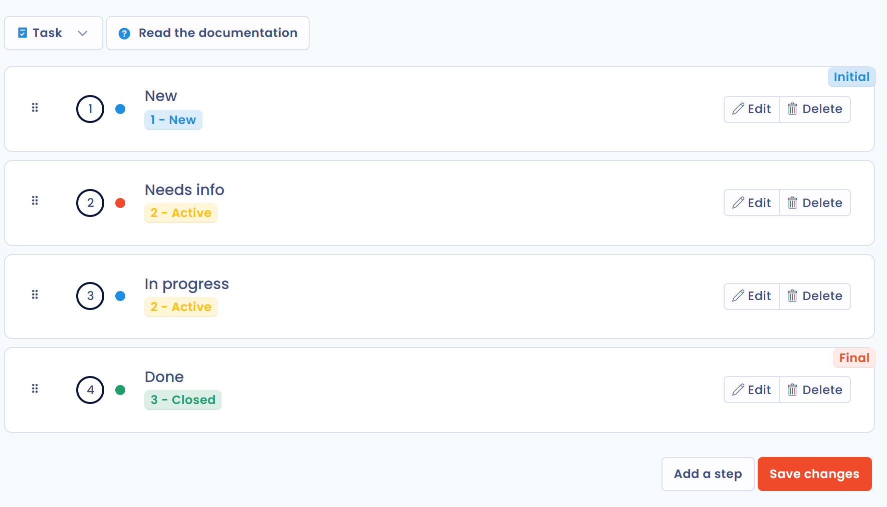

# Workflow stages


**Workflow stages vs workflow rules**

Workflow stages define the statuses that objects move through. To automate actions when a stage changes (send a notification, create a task…), see [Workflow rules](workflow-rules.md).


## Purpose of workflow stages

Workflow stages model a work process: objects move from one step to the next. You can break down your compliance procedures in an operational way by defining the stages to follow directly in Dastra.

Each object type has its own set of configurable stages:

* Data subject requests
* Data breaches
* Tasks
* Processing activities
* Assets
* Stakeholders
* Data fields
* Security measures
* Categories of data subjects
* AI systems
* Contracts

Each stage is linked to an **Internal status** that depends on the object type. For a processing activity, for example, the statuses are "draft" and "published".

## Customize workflow stages



In the side menu, click **Workspace settings**, then, in the **Process** section, click **Workflow stages**. This page is reserved for users who are allowed to manage advanced settings.

<figure><figcaption>
The Workflow stages entry in the workspace settings
</figcaption></figure>

Choose the object type in the list at the top of the page: you see the stages available for that process, with their internal status. Customize them to match your organization's processes, then click **Save changes**.

* **Edit** a stage to change its name, its description or its internal status, and to reserve the edition of the object in this stage to users with a specific role.
* **Add a step** to create a new one.
* Drag and drop a stage to change the order. The first stage is marked **Initial** and the last one **Final**.

<figure><figcaption>
The stages of the processing activity workflow
</figcaption></figure>

## Delete a workflow stage

To delete a stage, click **Delete** next to it, then confirm.

Any objects currently attached to the deleted stage are automatically reassigned to the first stage with the same internal status.

For example, if you delete the "In progress" stage in the task workflow:

<figure><figcaption>
The task workflow before deleting the "In progress" stage
</figcaption></figure>

Objects attached to it move to the first stage with the same status, for example "Needs info":

<figure><figcaption>
The task workflow after the deletion
</figcaption></figure>
