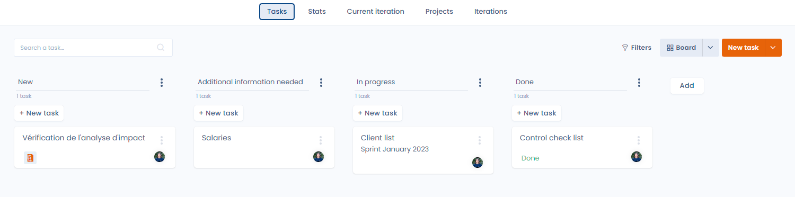

# Planning

## Why plan?

The need to demonstrate the accountability of your organization vis-à-vis data protection is at the heart of the GDPR philosophy. Article 24 summarizes this concept:

> (...) the controller implements appropriate technical and organizational measures to ensure and be able to demonstrate that the processing is carried out in accordance with these regulations. "

Once their data processing has been mapped and evaluated, organizations are required to implement both technical and organizational measures to protect this processing. But the implementation of this principle of accountability is not always easy for companies, because the regulation requires “reporting” without providing precise and quantified indicators.

At Dastra, we believe that keeping a **clear, collaborative** and **auditable** action plan can provide the organization with both tangible evidence of its company's accountability for data protection, but also to save time for all stakeholders by eliminating downtime and reduce the risk of delay or failure of projects by adopting an "agile" approach.

## Access the Planning module

To access the planning module, go to the application and click on the "planning" module on the left of the screen

<figure><figcaption></figcaption></figure>

This will take you to the planning module:

<figure><figcaption></figcaption></figure>

## Go further


[gerer-vos-taches.md](create.md)



[create-or-modify-a-project-or-an-iteration.md](projects.md)



[exportez-vos-taches.md](export.md)



[share-as-calendar.md](calendar-sync.md)



[customise-the-task-workflow-1.md](workflow.md)



[allez-plus-loin-avec-la-planification.md](workflow.md)

