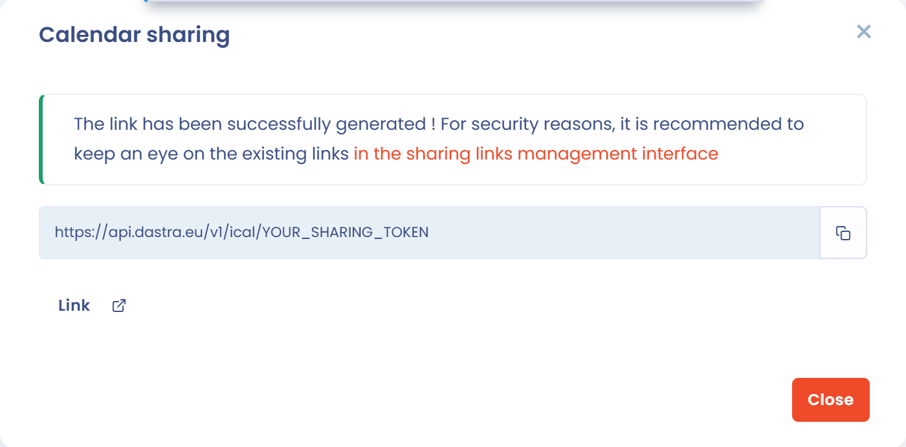

# Share as calendar

Dastra generates a calendar link in .ics format. Once you add this link to your mail application, your tasks appear in a work calendar such as Outlook or Google Calendar.

## Generate the calendar link

1. In the side menu, click **Tasks**, then choose **Tasks** in the submenu.
2. Click the arrow of the **Create task** button, then **Share as calendar (Outlook...)**. This entry requires the permission to export tasks.

<figure><figcaption>
The Share as calendar entry of the Create task menu
</figcaption></figure>

3. In the **Calendar sharing** window, click **Create link**.

<figure><figcaption>
The generated calendar link
</figcaption></figure>

The link is copied to your clipboard and displayed in the window. It lets you synchronize the calendar of the tasks assigned to you with any calendar application.

## Add the link to your calendar

In your calendar application, add the link as an internet calendar. The procedure depends on the application:

* [Import calendars into Outlook](https://support.microsoft.com/en-us/office/import-calendars-into-outlook-8e8364e1-400e-4c0f-a573-fe76b5a2d379)
* [Import events into Google Calendar](https://support.google.com/calendar/answer/37118?hl=en\&co=GENIE.Platform%3DDesktop)


Do not share this link widely. For security reasons, monitor the existing links in **Workspace settings** > **Sharing links**.


## Go further


[Customize the task workflow](workflow.md)

