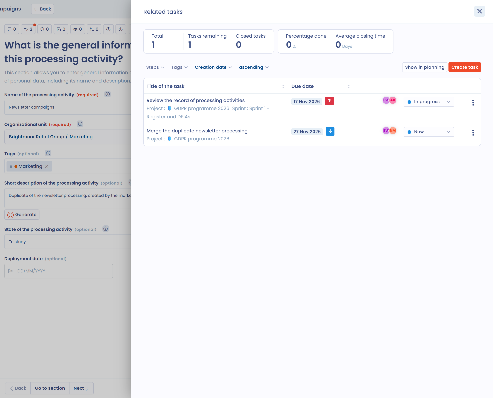
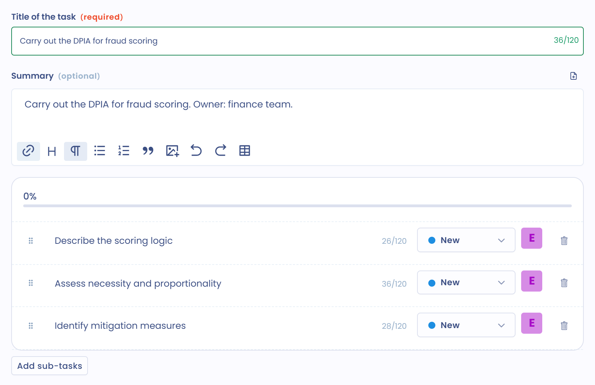

# Create or edit a task

In Dastra, a task is a piece of work to be done. It has an assignee, a due date and a tracking step. This page explains how to create, assign, edit and delete a task.

## Create a task

You can create a task in three ways:

* from the **Tasks** page of the planning module;
* from the record of another item in the application;
* from an email received at a collection address.

### From the planning module

1. In the side menu, click **Tasks**, then choose **Tasks** in the submenu.
2. Click **Create task**. The **Create task** panel opens on the right of the screen.

<figure><figcaption>
The Create task button and the actions of its menu
</figcaption></figure>

3. Fill in the **Title of the task** (120 characters maximum) and the **Organizational unit**, which are required. Complete the other fields as needed.
4. Click **Save changes**. To create several tasks in a row, click **Save and add another**.

<figure><figcaption>
The task creation panel
</figcaption></figure>

The panel includes:

* **Organizational unit**: prefilled with the unit selected in the workspace, or the first available unit;
* **Project**, **Sprint** and **Tags** to classify the task;
* **Assigned to**, **Start date** and **Due date**;
* **Priority** and **Internal reference**, in the expandable part of the panel;
* the custom fields you added to tasks.

### Link a task to items

A task can be linked to one or more items of the application. In the panel, click **Associate element**, choose the type of item, then one or more items of that type. The linked items are listed under **Associated elements**.

The available types are:

* **Processing activity**;
* **Request**;
* **Data breach**;
* **Responding to a questionnaire**;
* **Stakeholder**;
* **Asset**;
* **Dataset**;
* **Risk assessment**;
* **Control point**;
* **Security measure**;
* **AI system**;
* **Contract**;
* **Datafield**;
* **Category of data subjects**;
* **Compliance project**;
* **Compliance Audit**.

You then find the task in the record of each of these items (see below). The **Associated with** filter of the **Tasks** page lists the tasks linked to a given type of item.

### From the record of another item

The records of processing activities, data subject requests, data breaches, stakeholders, assets, datasets, security measures, contracts, AI systems, control points and risk assessments have a task button: a list icon with a check mark and the number of linked tasks.

1. Open the record of the item.
2. Click the task button. The **Related tasks** panel lists the tasks linked to this item, with filters by step and by tag.
3. Click **Create task**. The task is linked to the item and takes its organizational unit.

<figure><figcaption>
The Related tasks panel on the record of a processing activity
</figcaption></figure>

The **Show in planning** button of the panel opens the **Tasks** page with the tasks of the item.


An action plan can also be generated from a validated questionnaire. See [Monitor questionnaires](../questionnaires/monitor.md).


### From an email

Dastra can turn each email received at a collection address into a task, with its attachments. To set up the address, click the arrow of the **Create task** button, then **Transform emails into tasks**. The setup page opens in **Workspace settings** > **Integrations**. See [Incoming mail data collection](../settings/mailboxes.md). This entry requires the permission to manage integrations.

### Create sub-tasks

A task can contain a list of sub-tasks. Save the task first: the **Add sub-tasks** button stays inactive until the task exists. Then edit the task and click **Add sub-tasks**.

<figure><figcaption>
The sub-tasks of a task
</figcaption></figure>

When all the sub-tasks are closed, Dastra offers to close the main task.

## Assign a task

Two fields identify the people involved:

* **Assigned to**: the person who carries out the task. By default, it is you when you create the task;
* **Task owner**: the person responsible for the task. They are notified when the step changes.

The **Task owner** field is in the expandable part of the panel. Each user receives notifications according to their preferences: see [Notifications](../settings/notifications.md). To follow up with someone, mention them in the discussion of the task (see the [FAQ](faq.md)).

## Edit a task

To edit a task, click it: the **Task edition** panel opens. In the **Table** view, you can also click the three dots at the right of the row, then **Edit**.

<figure><figcaption>
The menu of a task in the Table view
</figcaption></figure>

This menu also offers **Copy link**, **Create a copy**, **Merge** and **Move to recycle bin**. **Create a copy** duplicates the task and its sub-tasks: the title of the copy ends with " - copy".


To change the step of a task, drag and drop it in the **Columns** view. The default steps are **New**, **Info needed**, **In progress** and **Done**. To change them, click the arrow of the **Create task** button, then **Configure columns**: see [Customize the task workflow](workflow.md).


### Send a task to Jira

When the Jira integration is active for tasks, the actions menu of the task offers **Send to Jira**. See [Jira](../integrations/jira.md).

## Move a task to the recycle bin or delete it

A task moved to the recycle bin is not deleted: it shows the **Into recycle bin** mention and disappears from the lists. You can restore it at any time.

1. In the three-dot menu of the task, or in the actions menu of the panel, click **Move to recycle bin**, then confirm.
2. To find the tasks of the recycle bin, open **Filters** and select **View recycle bin**.

<figure><figcaption>
The View recycle bin filter
</figcaption></figure>

3. In the menu of the task, click **Restore** to put it back in the list, or **Delete**, then confirm, to delete it.

<figure><figcaption>
The actions of a task in the recycle bin
</figcaption></figure>


Deleting a task is permanent. Its sub-tasks are deleted with it.


To delete tasks without going through the recycle bin, see the [FAQ](faq.md).

## Go further


[Create or edit a project or a sprint](projects.md)

