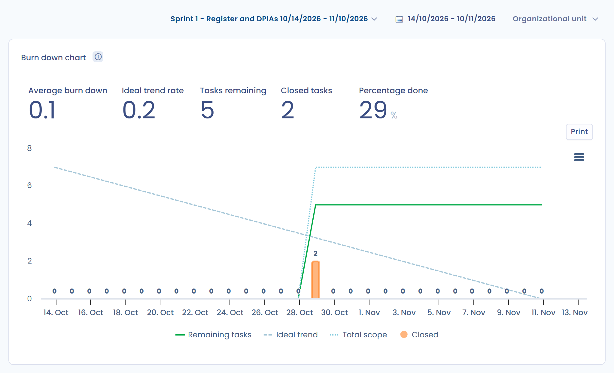
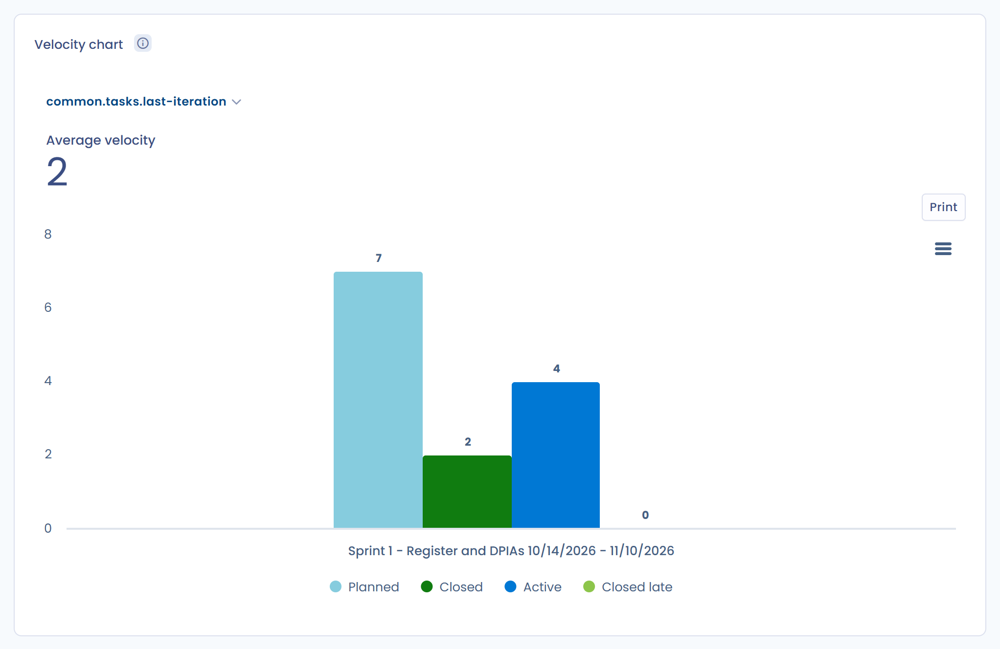
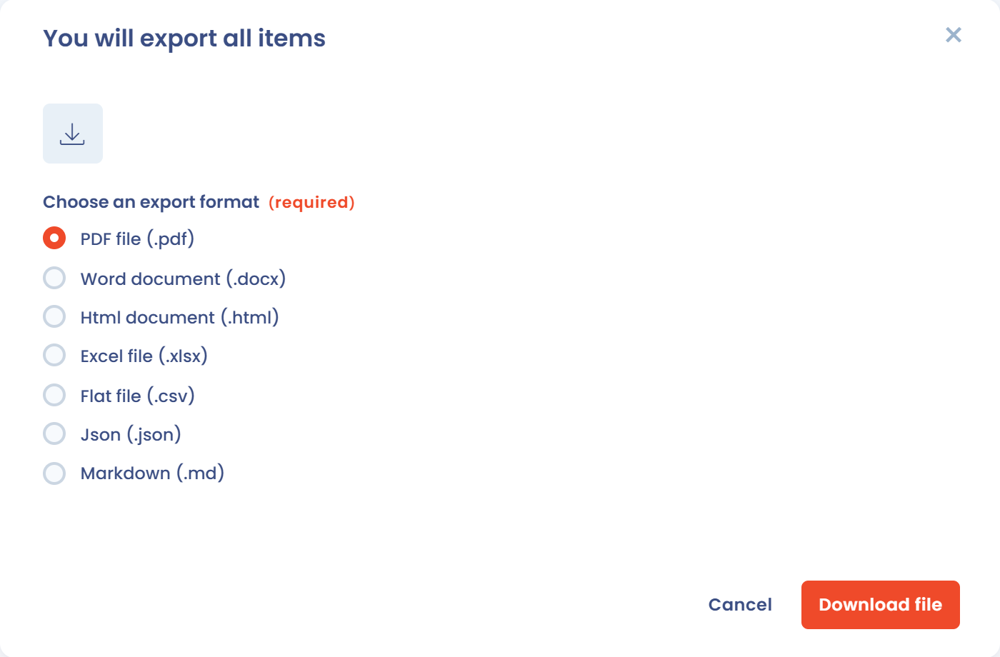
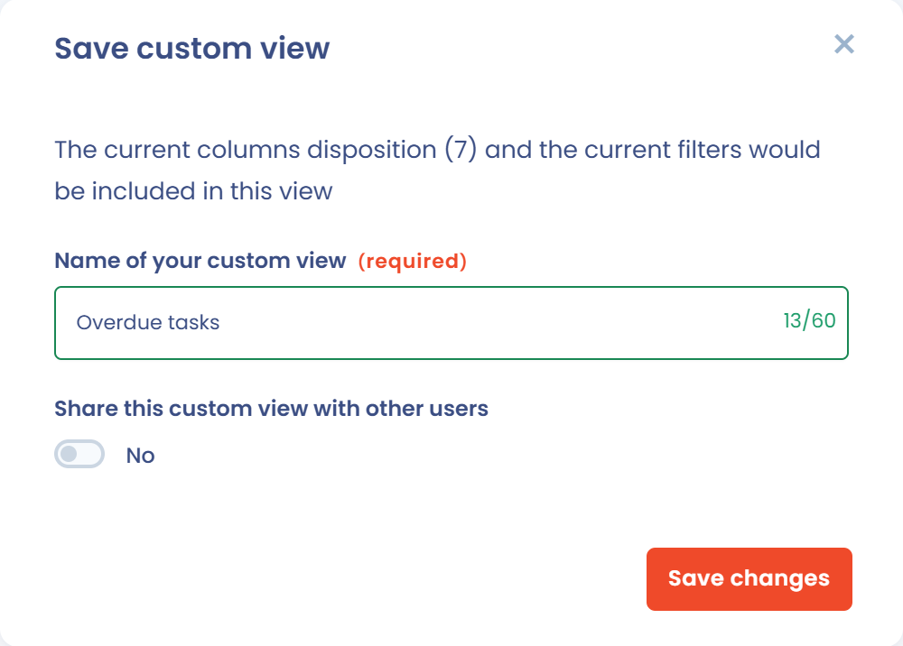

# Monitor, filter or export tasks

All the tasks of the action plan can be tracked from the **Tasks** page of the planning module and from the **Stats** page, then exported. This lets you steer your processes with indicators, to demonstrate your organization's accountability under the GDPR.

## Choose a view

The view selector in the toolbar of the **Tasks** page offers four views: **Columns**, **Table**, **Tree** and **Calendar**.

### Columns view

The **Columns** view lays out the tasks by workflow step, one column per step. Drag and drop a task from one column to another to change its step.

<figure><figcaption>
The Columns view
</figcaption></figure>

In the header of a column, click the name of the step to rename it, or **+** to create a task at that step. The **Add column** button adds a step. To reorder the steps or set their internal status, see [Customize the task workflow](workflow.md).

### Table view

The **Table** view displays the list of all tasks. Click a row to open the task. Select rows to apply a batch action: **Edit fields...**, **Merge**, **Export**, **Attach tasks to an object**, **Move to recycle bin** or **Delete**.

Click **Customize columns** to choose the displayed columns, and **Filters** to filter the list.

<figure><figcaption>
The Table view
</figcaption></figure>

### Tree view

The **Tree** view groups the tasks by the criterion chosen in the **Group by** list. The default grouping is **Project**. The other criteria are **Iteration**, **Organizational unit**, **Assigned to**, **Processing activity**, **Request**, **Stakeholder**, **Asset**, **Data breach**, **Dataset**, **Control point** and **Security measure**.

Click **Collapse all** or **Deploy all** to close or open all the groups.

<figure><figcaption>
The Tree view grouped by project
</figcaption></figure>

### Calendar view

The **Calendar** view places each task between its start date and its due date. Choose the **Day**, **Week** or **Month** display, and use **Today** and the arrows to navigate.

The **Unplanned tasks** button opens the list of tasks that have no start date or no due date. Drag a task onto a day of the calendar to plan it: its start date and due date are then filled in. A task that is already planned keeps its duration when you move it. To remove the dates of a task, drag it into the **Drop a task here to unplan it** area.

<figure><figcaption>
The Calendar view and its unplanned tasks
</figcaption></figure>

## Filter tasks

In every view, the search box and the **Filters** button narrow down the displayed tasks. The filters cover the organizational unit, project, sprint, assignee, priority, step, tags, status, type of associated item and recycle bin.

<figure><figcaption>
The filters of the Tasks page
</figcaption></figure>

## Track progress with the statistics

In the side menu, click **Tasks**, then **Stats**. The page has two tabs.

The **Basic charts** tab shows the general indicators of the action plan and the **Task states by project** chart. This chart shows the number of tasks per step. Choose the criterion in the **Group by** list: tasks are grouped by project by default, and you can group them by organizational unit, sprint, assignee or associated item.

<figure><figcaption>
The Basic charts tab
</figcaption></figure>

The **Advanced charts** tab holds three charts. By default, they cover the last 30 days. You can limit them to a sprint, a period or an organizational unit.

### Burn down chart

The burn down chart shows how the amount of remaining work evolves over a given period, for example a sprint.

<figure><figcaption>
The burn down chart
</figcaption></figure>

### Cumulative flow chart

This chart shows over time how the tasks are distributed across the steps of their life cycle.

<figure><figcaption>
The cumulative flow chart
</figcaption></figure>

### Velocity chart

This chart shows the evolution of the number of tasks closed per sprint.

<figure><figcaption>
The velocity chart
</figcaption></figure>

## Export tasks

1. On the **Tasks** page, click the arrow of the **Create task** button, then **Export**. To export only some tasks, select them in the **Table** view and choose the **Export** batch action.
2. In the window, choose the export format. The export applies the filters set on the page.
3. Click **Download file**.

<figure><figcaption>
The task export window
</figcaption></figure>

## Custom views

A custom view saves, under a name, the combination of filters and columns of a view. You then switch between saved views from the selector in the toolbar, next to the search box.

<figure><figcaption>
The custom view selector
</figcaption></figure>

### Create a view

1. Apply the filters and column selection you want in the **Columns**, **Table** or **Tree** view.
2. Open the view selector (it shows **Default view**), then click **Save custom view**.
3. Enter the **Name of your custom view**, then click **Save changes**.

The view appears in the selector under **My views**. When you change the filters of an active view, the **Update** entry of that view saves the changes.

<figure><figcaption>
Saving a custom view
</figcaption></figure>

### Share a view

In the save window, turn on **Share this custom view with other users**. This option is reserved for users who manage advanced settings. Other users of the workspace find the view under **Shared views**, which helps standardize action plan monitoring across a team.

### View examples

* "Overdue tasks": tasks whose due date has passed and whose step is not **Done**.
* "My backlog": tasks assigned to you, at the **New** step.
* "Current sprint": tasks of the sprint in progress.

## Go further


[Share as calendar](calendar-sync.md)

