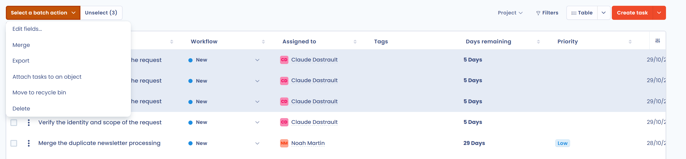
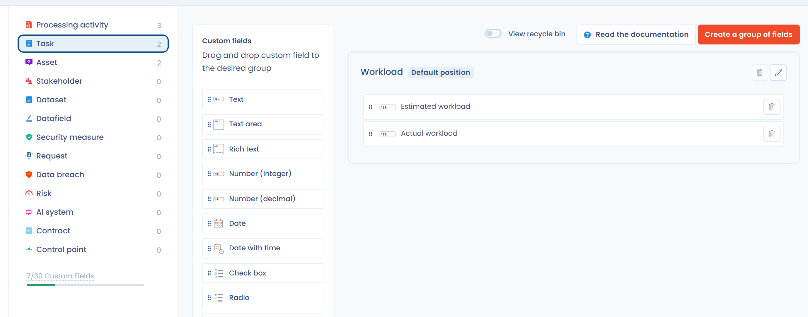
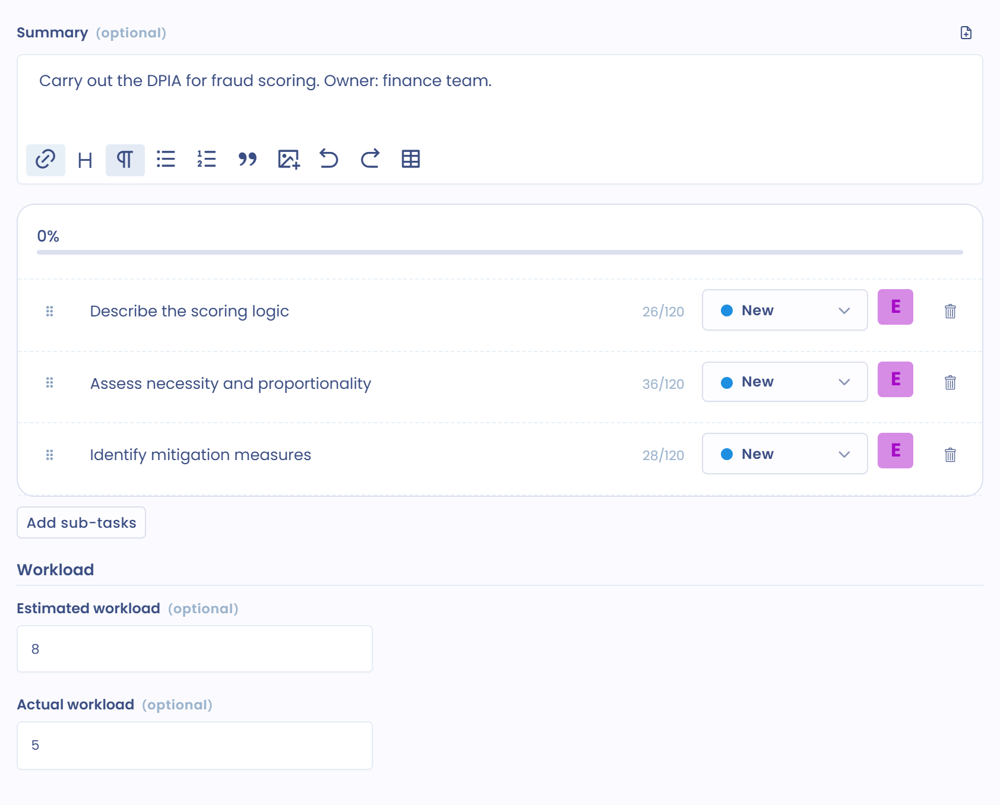

# FAQ

## How do I attach several tasks to a project?

Use the batch actions and the field editor.

1. In the **Table** view of the **Tasks** page, select the tasks to attach to the project.

<figure><figcaption>
The batch actions menu
</figcaption></figure>

2. Click **Select a batch action**, then **Edit fields...**.
3. In the window, select the **Project** field, then the project you want.

<figure><figcaption>
Editing the Project field in batch
</figcaption></figure>

4. Click **Save changes**.

## How do I delete a task?

There are two ways.

### Through the recycle bin

This way lets you go back as long as the task is not deleted.

1. Click the three dots of the task, then **Move to recycle bin**.
2. Open **Filters** and select **View recycle bin**.
3. Click the three dots of the task, then **Delete**, and confirm.

<figure><figcaption>
The View recycle bin filter
</figcaption></figure>

<figure><figcaption>
The actions of a task in the recycle bin
</figcaption></figure>

### Directly from the Table view

Select the tasks, click **Select a batch action**, then **Delete**, and confirm.


Deleting is permanent. To keep a trace of the task, move it to the recycle bin without deleting it.


## How do I record the workload of a task?

You can enter the estimated and actual workload on each task. This lets you measure in your review the time spent on tasks.

To do so, add custom fields to tasks: in the side menu, click **Workspace settings**, then **Custom fields**, and choose **Task** in the list on the left. See [Custom fields](../general/custom-fields.md).

<figure><figcaption>
A group of workload fields
</figcaption></figure>

The fields appear in the task panel. You can then export their values to a workbook or use them in the task filters.

<figure><figcaption>
Example of workload fields
</figcaption></figure>

## How do I follow up with someone about a task?

Mention them in the discussion of the task: open the task, click the **Internal discussion** button, then type **@** followed by their name. The mentioned person receives a notification. See [Internal discussions](../general/discussions.md).
