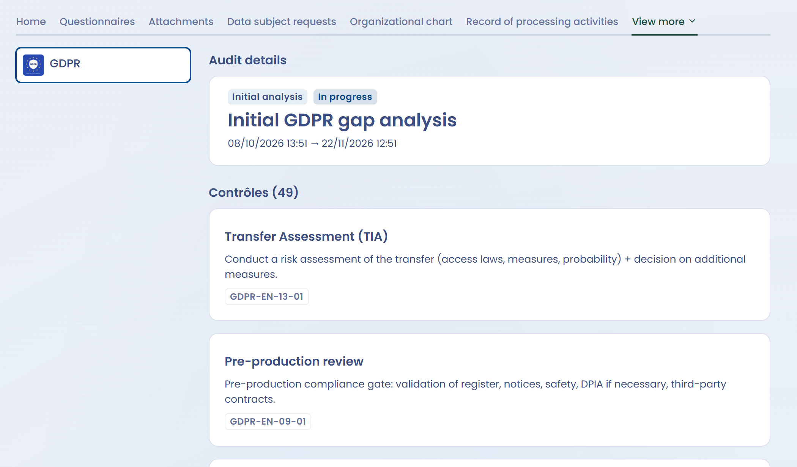

# Configure your Trust Center

This page presents the editing page of a Trust Center, explains how to publish it and describes how a compliance project is displayed. It is intended for the people who configure the portal.

## The editing page

The editing page is made of sections that you open or close with a click. The first three are always available:

* **Configuration**: the name, organizational unit, owners, welcome message, features to display and quick links. See [Homepage and general configuration](home.md).
* **Security**: mandatory authentication, download approval and IP address filtering. See [Security](security.md).
* **Design**: the logo, cover image and accent color. See [Appearance and design](design.md).

The following sections unlock when the matching feature is checked in **Configuration**:

* **Questionnaires**: see [Questionnaires](questionnaires.md).
* **Data subject requests**: see [Data subject requests](data-subject-requests.md).
* **Attachments**: see [Attachments](attachments.md).
* **Compliance**: see [Display the compliance project](#display-the-compliance-project) on this page.

The other features are turned on with a checkbox, without a dedicated section: [Record of processing activities](ropa.md), [Organizational chart](org-chart.md), [Contacts](contacts.md) and [AI systems](ai-systems.md).

<figure><figcaption>
The buttons of the editing page of a draft Trust Center
</figcaption></figure>

## Publish and cancel publication

A newly created Trust Center is a draft: the indicator at the top right of the page shows **The Trust Center is in Draft mode** and the portal is not accessible online.

To publish it:

1. Click **Publish**, at the top right of the editing page. The button is disabled while a required field is empty.
2. Confirm the question "Would you like to save and publish the Trust Center?". All changes are saved.

The indicator then shows **The Trust Center has been published** and the portal becomes accessible to anyone who has the link, within the rules of the **Security** section.

To make the portal inaccessible, click **Cancel publication**. This applies immediately, without confirmation. From the list of Trust Centers, the menu of each row also offers **Enable** and **Disable**.

## Display the compliance project

This feature adds a **Compliance** tab to the portal. It presents a summary of a compliance project: for each framework of the project, the active audit with its attachments and the applied controls. It requires the [Compliance](../../compliance/README.md) feature in your subscription.

### Choose the project to display

1. In the **Configuration** section, check **Display compliance project**.
2. Open the **Compliance** section.
3. In **Select the compliance project you want to display**, choose the project. A Trust Center displays one project.
4. Save, then publish the Trust Center if it is not published yet.

The **Compliance** section is flagged as an error until a project is selected.

<figure><figcaption>
Choosing the compliance project to display
</figcaption></figure>

### What visitors see

The **Compliance** tab of the portal shows one card per framework on the left. Only the frameworks of the project that have an [active audit](../../compliance/projects/audits.md) are listed. When a visitor clicks a framework, the page presents:

* **Audit details**: the type, status, name and start and end dates of the active audit, then its attachments;
* **Contrôles**: the applied controls of the framework that are active and whose tests all pass. Each control shows its reference, title, description and the references of the requirements it answers.

<figure><figcaption>
The Compliance tab of the public portal
</figcaption></figure>

To keep the portal up to date, set the active audit of each framework in the compliance project and keep the tests of your controls current. See [Audits](../../compliance/projects/audits.md).
