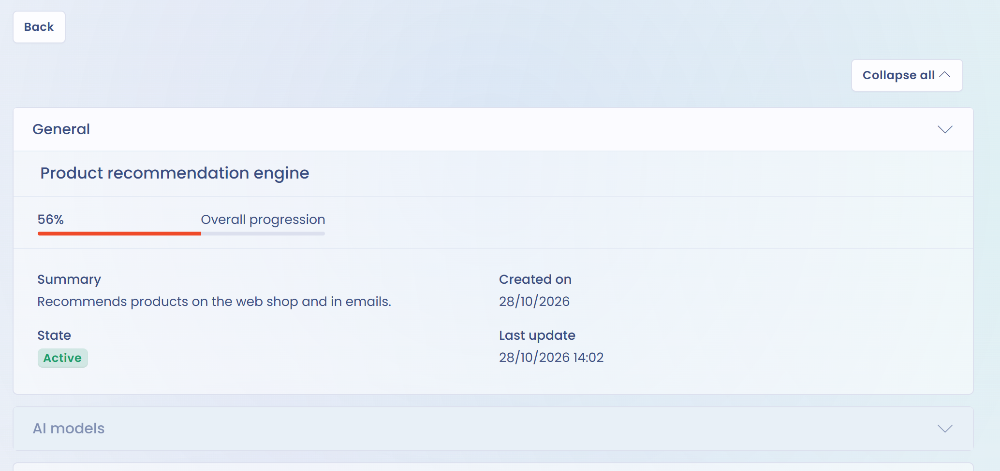

# AI systems

The Trust Center can publicly present the AI systems declared in your workspace. Each system opens on a read-only record. This presentation supports transparency toward your customers, partners and data subjects.

## Enable the AI systems tab

Check **AI systems** in the **Configuration** section of the editing page. The box is not checked by default.

<figure><figcaption>
Check AI systems in the features to display to add the tab to the public portal
</figcaption></figure>


The AI systems tab is only available to organizations whose subscription includes the AI systems module. If the box is greyed out, contact the Dastra team to enable the module.


Once the feature is enabled, an **AI systems** tab appears on the public portal.

<figure><figcaption>
Public view of the Trust Center with the AI systems tab
</figcaption></figure>

## Published systems

No setting lets you choose systems one by one. As soon as the tab is enabled, the portal lists every AI system that meets these three conditions:

* it belongs to the Trust Center's organizational unit or to one of its child units;
* its state is **Active**;
* it is not archived.

To remove a system from the portal, change its organizational unit, change its state or archive it.


Enabling the tab immediately publishes every system that meets these conditions. Before you do, check the list of the unit's systems in the [record of AI systems](../../ai-systems/record.md).


Visitors can search for a system by name and, when the Trust Center's unit has child units, narrow the list to one of them. See [Homepage and general configuration](home.md).

## Information displayed

In the list, each system appears with its reference, name, tags, organizational unit and its creation and update dates. A click opens its record, with a **Back** button.

<figure><figcaption>
The record of an AI system on the public portal
</figcaption></figure>

The Trust Center does not choose the fields of this record: it reuses the **Summary** of the AI system in the application, in read-only mode. Depending on what is filled in, it presents:

* the name, organizational unit, tags, progress, reference, description, state, creation and update dates, and the creator;
* the AI models;
* the AI system users, with their role;
* the assets, datasets and categories of data subjects;
* the risk analysis, with the risk level and its justification;
* the expected benefit;
* the documentation, including the transparency notice and attached files.


The record can show the names of the AI system users and of its creator. Check this information before enabling the tab. Download buttons for files only appear for a visitor signed in to Dastra.


To complete the record, see [Establishing a record of AI systems](../../ai-systems/record.md) and [Transparency notice](../../ai-systems/transparency-notice.md).

## Link with the AI Act

Publishing your AI systems in the Trust Center gives your stakeholders a central reference point. This publication does not replace the information that the AI Act requires toward data subjects, nor the technical documentation required for high-risk systems.
