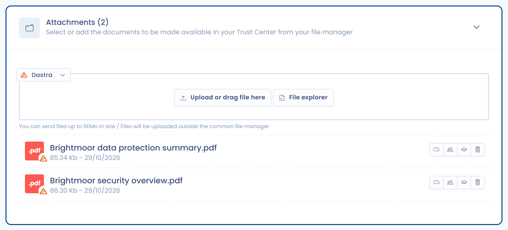
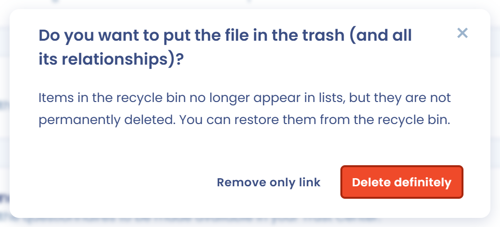

# Attachments

This page explains how to make documents available to the visitors of your Trust Center.

## Enable the feature

Check **Attachments** in the **Configuration** section, as explained in [Homepage and general configuration](home.md). A public **Attachments** page is then added to your Trust Center, and the **Attachments** section unlocks on the editing page.

<figure><figcaption>
The attachments configuration section
</figcaption></figure>

## Add attachments to your Trust Center

In the **Attachments** section, add files by uploading them or by selecting them among the existing files of document management. They are then listed on the public **Attachments** page of your Trust Center. Files uploaded from this section are saved in the **Trust Centers** folder of document management.

By default, a visitor must request access to a document before downloading it. To change this behavior, see [Security](security.md).

## Remove an attachment

In the **Attachments** section, click the trash icon of a file. Dastra asks whether to put the file in the trash with all its relationships, and offers two choices:

* **Remove only link**: the file is no longer made available in this Trust Center, but it stays in document management and in its other uses;
* **Delete definitely**: the file is placed in the trash, in every place where it is used.

<figure><figcaption>
The removal dialog of an attachment
</figcaption></figure>

[More information about document management in Dastra.](../../files/README.md)
