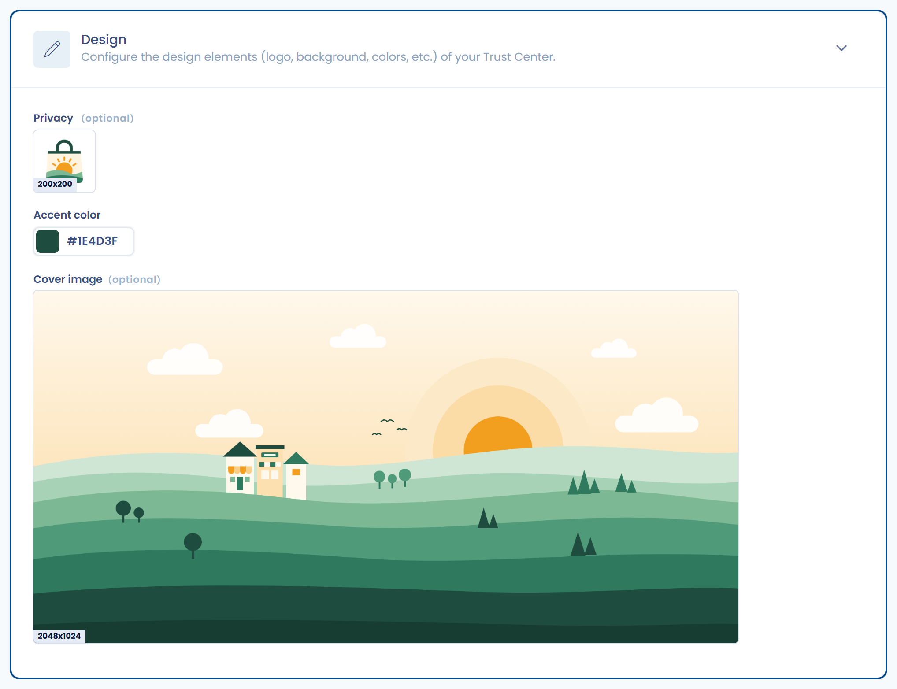

# Appearance and design

The **Design** section of the editing page gathers the visual elements of your Trust Center: the logo, the accent color and the cover image. All three are optional.

<figure><figcaption>
The Design section of a Trust Center
</figcaption></figure>

## Logo

Add the logo of your choice, in square format. It appears in the header of the Trust Center, next to its name. Without a logo, only the name of the Trust Center is displayed.

## Accent color

The **Accent color** field colors the interactive elements of the public portal: links, the active tab, primary buttons and the active page of lists. Without a color, the portal uses its default color.

## Cover image

Add a cover image, in rectangular format (2:1 proportions). It appears at the top of the Trust Center header, above the logo and the name.
