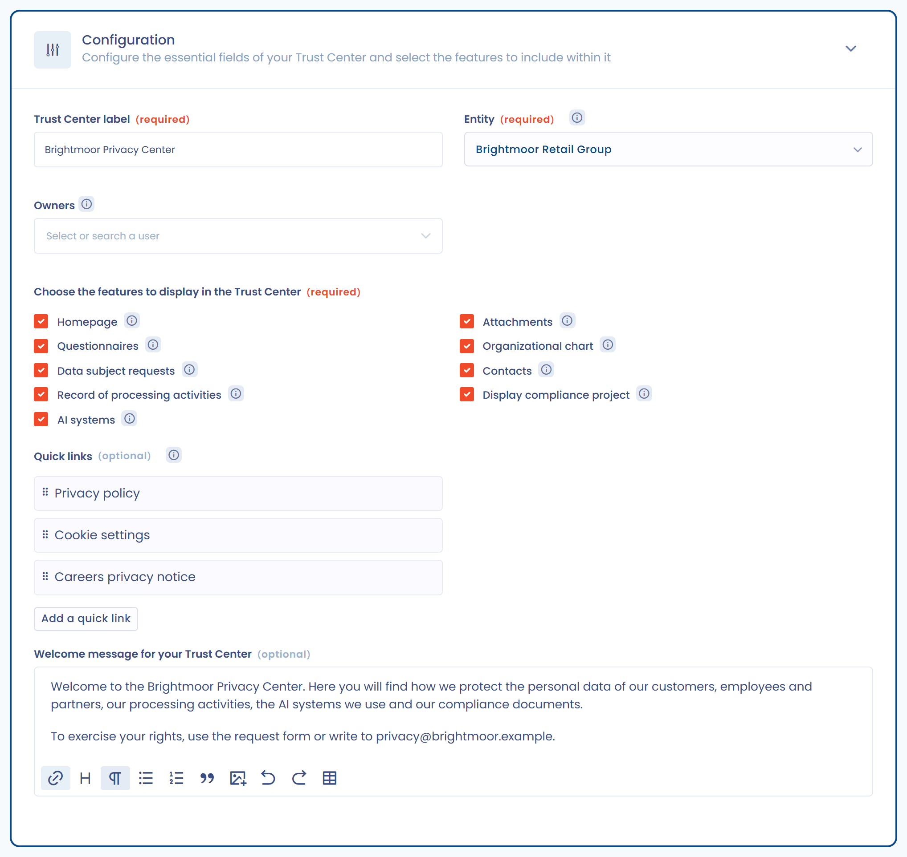

# Homepage and general configuration

The **Configuration** section of a Trust Center's editing page gathers the essential options: name, organizational unit, owners, features to display, quick links and welcome message.

<figure><figcaption>
The Configuration section of a Trust Center
</figcaption></figure>

## Trust Center label

The name of the Trust Center appears in the header and on every page of your portal. It is required.

## Organizational unit

Link your Trust Center to an organizational unit, in the **Entity** field. This choice determines the data that each enabled feature publishes. For the details of its effect, see the page of each feature. Questionnaire responses given from the Trust Center are also saved in this unit.

Visitors can narrow the display down to part of this scope with the **Organizational unit** selector, available on the record of processing activities and AI systems pages. It appears when the Trust Center's unit has child units. It shows the tree of published units, that is the Trust Center's unit and its child units, and offers a search by name. Once a unit is chosen, the page only lists the items of that unit and its child units, combined with the other filters.

The selector only narrows the display: the published scope remains that of the organizational unit configured here.

<figure><figcaption>
Narrowing the Trust Center display down to an organizational unit
</figcaption></figure>

## Owners

The **Owners** field is optional. Owners are the people responsible for the Trust Center. They receive its notifications and handle document access requests. For the rules that apply when no owner is set, see [Security](security.md).

## Features to display

In **Choose the features to display in the Trust Center**, check the features to publish. A greyed-out box is a feature that your subscription does not include. The information icon of each box summarizes what the feature adds to the portal.

* **Homepage**: see below.
* **Questionnaires**: see [Questionnaires](questionnaires.md).
* **Data subject requests**: see [Data subject requests](data-subject-requests.md).
* **Record of processing activities**: see [Record of processing activities](ropa.md).
* **AI systems**: see [AI systems](ai-systems.md).
* **Attachments**: see [Attachments](attachments.md).
* **Organizational chart**: see [Organizational chart](org-chart.md).
* **Contacts**: see [Contacts](contacts.md).
* **Display compliance project**: see [Display the compliance project](README.md#display-the-compliance-project).

Features that need setup unlock a section on the editing page. For the others, the checkbox is enough.

## Homepage

The homepage is optional. When the **Homepage** box is unchecked, the **Home** tab does not appear in the portal, and the welcome message, quick links and contacts are not displayed. The **Quick links** and **Welcome message for your Trust Center** fields are then greyed out.

### Quick links

Click **Add a quick link** to create a shortcut to a resource, for example your website or your privacy policy. A Trust Center accepts up to 20 links. Each link has:

* an emoji, optional;
* a **Label**, required, up to 70 characters;
* a **Shortcut url**, required.

Links appear in a side menu of the homepage. A link to another site opens in a new window.

### Welcome message

The **Welcome message for your Trust Center** field is a rich text editor. It lets you format the text and include images or videos. The message is displayed on the homepage of the portal.
