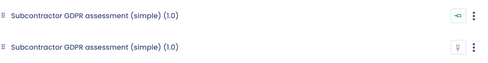

# Questionnaires

This page explains how to make questionnaires available to the visitors of your Trust Center.

## Enable the feature

Check **Questionnaires** in the **Configuration** section, as explained in [Homepage and general configuration](home.md). A public **Questionnaires** page is then added to your Trust Center, and the **Questionnaires** section unlocks on the editing page.

<figure><figcaption>
The questionnaires configuration section of your Trust Center
</figcaption></figure>

## Add a questionnaire

1. In the **Questionnaires** section, click **Add questionnaires**.
2. In the selection window, choose one or more questionnaires. They are the ones you installed in the Questionnaires module of this workspace.
3. Click **Add** to confirm.

<figure><figcaption>
The questionnaire selection window
</figcaption></figure>

You can remove or add other questionnaires at any time. The added questionnaires are visible on the public **Questionnaires** page.

## Questionnaires instructions

The **Questionnaires instructions** field is a rich text editor. It lets you format the text and include images or videos. The message appears on the public **Questionnaires** page, above the list of questionnaires.

## Rename questionnaires

By default, a questionnaire has the name of the installed template in the Trust Center. To change the name and description displayed in the portal without changing the original template, open the questionnaire's menu and click **Edit questionnaire label and description**.

<figure><figcaption>
Edit the name and description displayed in the Trust Center
</figcaption></figure>

## Change the display order

Reorder the questionnaires by drag and drop. The order of the public portal follows the order of this configuration page.

## Pin questionnaires

To highlight a questionnaire, click its pin icon. Pinned questionnaires always appear at the top of the list, regardless of their configuration order. They also appear in the sidebar of the homepage, when the homepage is enabled.

<figure><figcaption>
Pin a questionnaire
</figcaption></figure>

## Impact of the organizational unit on responses

Visitors of your Trust Center can answer all the questionnaires made available to them. Responses are saved in the Questionnaires module and attached to the Trust Center's organizational unit (see [Homepage and general configuration](home.md)).


To work in a Trust Center, a questionnaire must have link sharing enabled. If it does not, link sharing is enabled automatically when you add the questionnaire. It can no longer be disabled while the questionnaire is in a Trust Center.

