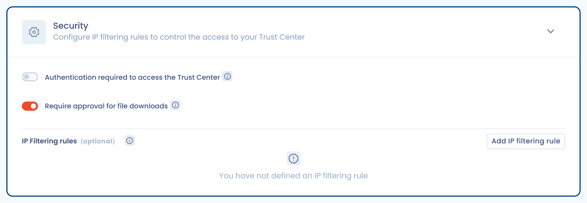

# Security

The **Security** section of the editing page gathers three settings: mandatory authentication, approval of document downloads and IP address filtering. You designate the Trust Center owners in the **Configuration** section.

<figure><figcaption>
The Security section of a Trust Center
</figcaption></figure>

## Mandatory authentication

Turn on **Authentication required to access the Trust Center** to make sign-in mandatory. Visitors must then sign in to Dastra with an account of your organization before they open the portal. If an SSO is assigned to all users, they are directed to that SSO.

We recommend setting up [SSO](../../settings/sso/README.md) with automatic user creation: all your employees can then access the Trust Center without any particular role or permission.

## Owners

The **Owners** field is in the **Configuration** section. See [Homepage and general configuration](home.md).

## Document access control

The **Require approval for file downloads** option only appears when the **Attachments** feature is checked. It is turned on for a new Trust Center.

When it is turned on:

1. Visitors see the list of documents but cannot download them directly. They submit an **access request** with their email address and a message.
2. The Trust Center owners receive an email that links to the request. If there is no owner, the organization owners receive it.
3. The owner opens the request, enters a **Justification of the decision** if needed, then clicks **Approve access request** or **Reject access request**. The visitor receives the justification by email.
4. If the request is approved, the visitor receives an email that contains a download link valid for 30 days.

Requests are handled in the **File access requests** screen, which lists all requests with their status. The link in the notification email opens it directly on the request concerned.


When owners are designated, only they can approve or reject requests. Without an owner, requests are notified to the organization owners.


## IP address filtering

In this section, you can also define rules that limit access to your Trust Center to specific IP ranges. By default, without any IP filtering added by you, your Trust Center will be accessible to anyone with the access link, provided that the Trust Center is activated.

Click **Add IP filtering rule**, then enter the rule name and the start and end of the IP range. An IP address that belongs to none of the ranges is refused.


This filtering is **separate** from the organization-wide [IP filtering](../../settings/ip-filtering.md), which does not apply to the Trust Center.

