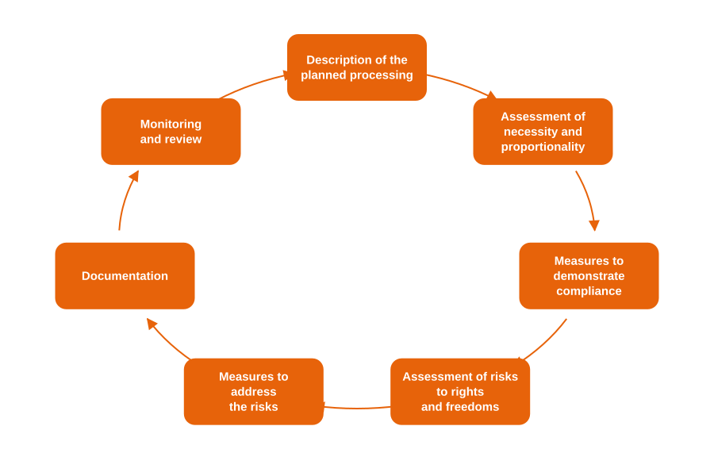

# Data protection impact assessment (DPIA)

## Definition

The **data protection impact assessment (DPIA)**, provided for by [Article 35 of the GDPR](https://eur-lex.europa.eu/eli/reg/2016/679/oj#d1e3546-1-1), is a **compliance mechanism** that aims to:

* **Identify and minimize the risks** of infringement on the rights and freedoms of individuals,
* **Prove compliance** with the GDPR,
* And **integrate privacy from the design phase** (_Privacy by design_).

> The DPIA focuses on **risks to individuals**, not risks to the organization.

You may also meet the term privacy impact assessment (PIA) for the same approach.

***

## The three components of a DPIA

A DPIA is structured around three major steps:

1. **Description of the processing** → Objectives, context, stakeholders, technologies, data involved.
2. **Assessment of necessity and proportionality** → Legal compliance analysis: purposes, legal bases, individual rights, retention periods, etc.
3. **Risk study and security measures** → Identification of privacy risks and determination of control measures (technical and organizational).

> The DPIA is simultaneously **legal**, **technical** and **organizational**: it engages the whole project team.

***

## Objective of the DPIA

The DPIA enables an organization to:

* **Demonstrate compliance** (accountability principle),
* **Anticipate risks** and compliance costs,
* **Document choices** and design decisions,
* **Build trust** with users, clients or employees.

***

## When a DPIA is mandatory

A DPIA is **mandatory** when processing is **likely to result in a high risk** to the rights and freedoms of individuals.

### Examples of processing activities concerned

* Intelligent video surveillance,
* Automated profile scoring,
* Large-scale collection of health data,
* Use of biometrics or AI on personal data.


As a general rule, processing that meets at least **2 of the following criteria** (European Data Protection Board, EDPB) calls for a DPIA:

* Evaluation or scoring,
* Automated decision-making with legal or similar effects,
* Systematic monitoring,
* Sensitive data,
* Large scale,
* Cross-referencing of data,
* Vulnerable individuals,
* Innovative use (AI, IoT, big data),
* Blocking of a right or service.

A single criterion can be enough for particularly sensitive processing. Supervisory authorities also publish lists of processing operations that require a DPIA: see the [DPIA guidance, country by country](../../other/dpia-by-country.md).


***

## Timing and updates

The DPIA must be carried out **before the implementation of the processing**, ideally from the design phase. It is a concrete application of the **Privacy by Design** principle.

It must also be:

* **Reviewed regularly**,
* **Revised upon any significant change** to the processing or to its level of risk (Article 35, paragraph 11),
* **Linked to your record** in Dastra for continuous monitoring.

<figure><figcaption>
An iterative process
</figcaption></figure>

> The DPIA is an **iterative process**: it accompanies the entire lifecycle of the processing activity.

***

## Carrying out a DPIA

### 1. Assess the necessity and proportionality of the processing

Ask yourself the right questions:

* Are the **purposes** determined, explicit and legitimate?
* Is the **legal basis** clear?
* Is data **minimized**, accurate and up to date?
* Are **retention periods** limited?
* Are **data subjects** properly informed?

### 2. Review the protection of individuals' rights

* Transparent information, clear consent, right of access, erasure and objection.
* Contracts with processors.
* Safeguards for international transfers.
* Corrective measures planned in case of a breach.

### 3. Analyze privacy risks

For each **feared event**:

* Identify the **potential impacts** on individuals (privacy breach, discrimination, reputational harm…).
* Estimate the **severity** and **likelihood** of the risk.
* Determine the **existing or planned protection measures**.
* Assess the **residual risk** and, if necessary, propose **additional measures**.


Final objective: reach an **acceptable level of residual risk**, documented and justified.


***

## Stakeholders to involve

| Stakeholder              | Role in the DPIA                                                |
| ------------------------ | -------------------------------------------------------------- |
| **Data controller**      | Bears responsibility for the DPIA and leads its implementation  |
| **DPO**                  | Advises on the DPIA and monitors its performance               |
| **CISO / IT department** | Provides technical expertise and security measures             |
| **Business teams**       | Provide operational details of the processing                  |
| **Processors**           | Communicate necessary information for the assessment           |
| **Data subjects**        | May be consulted or represented in certain cases               |

> The DPIA is a collaborative process: it involves legal, technical and operational teams alike.

***

## DPIA and artificial intelligence

The **AI Act** introduces a specific obligation to **document and assess high-risk AI systems**. Organizations must include:

* The origin of training data,
* Robustness tests and bias assessments,
* Planned human oversight controls,
* Transparency measures.

For AI systems, Dastra offers a dedicated impact assessment in the **AI governance** module, under **Impact analysis**, to cover both the GDPR and the AI Act.

***

## Dastra best practices

* Determine whether a DPIA is needed in the **Impact assessment** section of the processing activity, which evaluates the 9 EDPB criteria,
* Start the DPIA from a **questionnaire template** of the library,
* Export the DPIA report as a **PDF** for audits,
* Plan the next review with the **regular reviews** of the processing activity.


Dastra guides you step by step through the DPIA with an interactive questionnaire template.


***

## For more information


[Impact assessment](../../features/ropa/activity/impact-analysis.md)



[PIA / DPIA](../../features/questionnaires/types/dpia.md)

