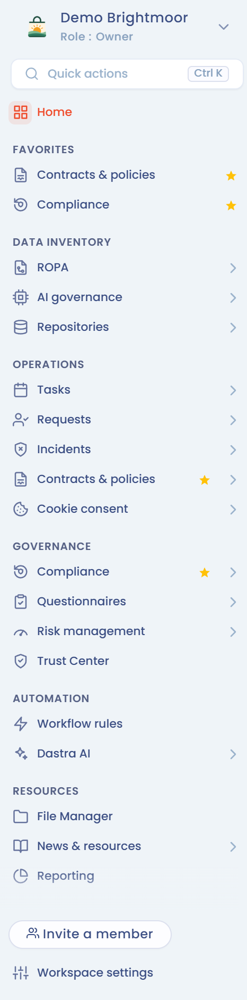
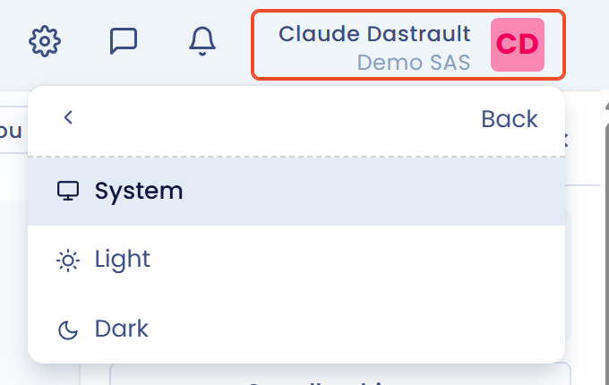
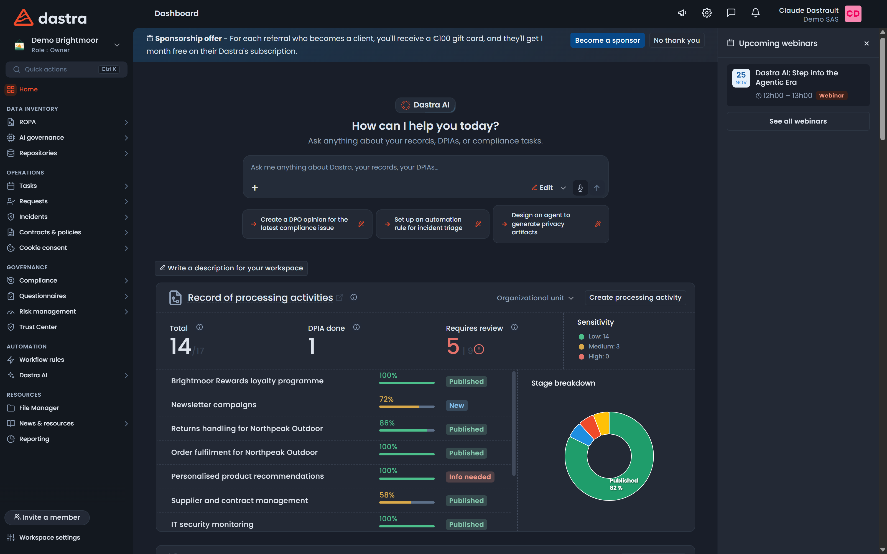
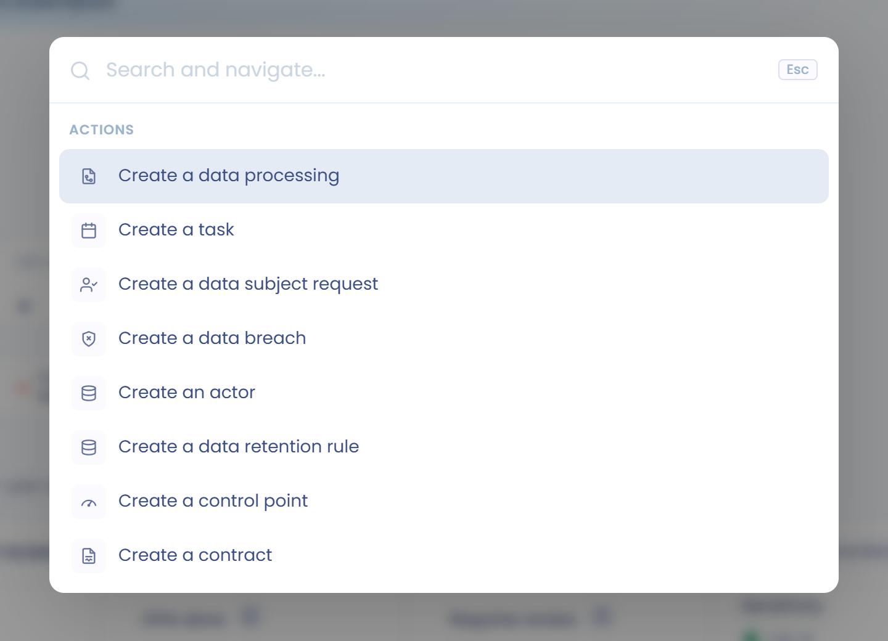

# Navigate in Dastra

This page presents what lets you move around Dastra: the side menu, the top bar, the theme and the command palette. It is for anyone discovering the application.

The modules you see depend on your organization's plan and on your rights. A module you do not see is either not included in your plan or requires a right that your role does not have.

***

## The side menu

The side menu is on the left of the screen. From top to bottom, it contains:

* the workspace selector, which shows your role in the current workspace;
* the **Quick actions** button, which opens the [command palette](navigation.md#the-command-palette);
* the **Home** entry, to go back to the workspace home page;
* the **Favorites** section, once you have pinned at least one module;
* the five sections of modules;
* the **Invite a member** button, if you have the right to manage users, and the **Workspace settings** entry.

<figure><figcaption>
The side menu
</figcaption></figure>

Click a module to expand its pages, or click the arrow on the right of its name. On a small screen, the menu opens from the button at the top left of the top bar.

### The five sections

| Section | Modules |
| --- | --- |
| **Data inventory** | **ROPA**, **AI governance**, **Repositories** |
| **Operations** | **Tasks**, **Requests**, **Incidents**, **Contracts & policies**, **Cookie consent** |
| **Governance** | **Compliance**, **Questionnaires**, **Risk management**, **Trust Center** |
| **Automation** | **Workflow rules**, **Dastra AI** |
| **Resources** | **File Manager**, **News & resources**, **Reporting** |

The **Dastra AI** module groups the full-screen conversations, the artifacts and, depending on your plan and rights, the agents, the inbox and the skills. See [Dastra AI](../features/general/ai-assistant/README.md).

A section in which no module is available to you is hidden.

### Favorites

To pin a module, point at its name in the menu and click the star that appears on the right. The module joins the **Favorites** section at the top of the menu, and also stays in its original section. Click the star again to remove it.

Favorites are personal and specific to each organization. They do not change the menu of other users.

### The workspace selector

At the top of the menu, the selector shows the name of the current workspace and your role in it (**Owner** if you own the organization). If you have several roles, they are all listed; point at the line to see them in full.

Click the selector to switch workspace, and use the search field to find a workspace by name. Your favorite workspaces, marked with a star in the list, come first. For the workspace concept, see [Key concepts](setup/key-concepts.md).

***

## The top bar

The top bar shows the breadcrumb of the current page. On the right, it gives access to:

* a form to send feedback to the Dastra team;
* the **Organization settings**, with the gear icon;
* the comments and the notifications center;
* your profile menu, where you switch organization and theme, and where you find your user profile, the notifications center and the help.

***

## The light or dark theme

Dastra comes in a light theme and a dark theme. To choose:

1. Open your profile menu at the top right.
2. Click **Theme**.
3. Choose **Light**, **Dark** or **System**.

With **System**, Dastra follows your computer's settings and changes theme with them. Your choice is saved in your account, so you find it again in your other browsers.

If you have not chosen yet and your computer is in dark mode, Dastra switches to the dark theme and opens the **Dark theme enabled** window. Click **Keep the dark theme** or **Back to the light theme**. If you close the window without choosing, the **System** theme is kept and the question is not asked again in that browser.

<figure><figcaption>
Choosing the theme in the profile menu
</figcaption></figure>

<figure><figcaption>
The dashboard in the dark theme
</figcaption></figure>

External respondents to a questionnaire and requesters also have a theme choice in their space: two buttons, one for the light theme and one for the dark theme. The public pages of a Trust Center always stay in the light theme.

***

## The command palette

The command palette finds a record, a page or a documentation page with a single entry. Open it with the **Ctrl+K** shortcut (**Cmd+K** on Mac), or with the **Quick actions** button of the side menu. Press the shortcut again to close it.

<figure><figcaption>
The command palette
</figcaption></figure>

### Search

Type your search in the **Search and navigate...** field. The palette searches:

* the pages of the application;
* the records of your workspace;
* the pages of the Dastra documentation, which open in a new tab.

Press **Enter** to open the selected page, or to show the full search results page when nothing is selected.

If Dastra AI is available to you, the **Ask AI** line sends your entry to the assistant in a new conversation. Press **Ctrl+Enter** (**Cmd+Enter** on Mac) to go straight there.

### Quick actions

When the field is empty, the palette offers creation actions. They appear according to your rights and the modules in your plan:

* **Create a data processing**
* **Create a task**
* **Create a data subject request**
* **Create a data breach**
* **Create an actor**
* **Create a data retention rule**
* **Create a control point**
* **Create a contract**

Move through the list with the arrow keys, then press **Enter**.

***

## Ask Dastra AI a question

If Dastra AI is available to you, the dashboard shows an input field. Write your question and send it: the Dastra AI panel opens and the answer starts. See [Dastra AI](../features/general/ai-assistant/README.md).


[quickstart.md](quickstart.md)



[key-concepts.md](setup/key-concepts.md)

