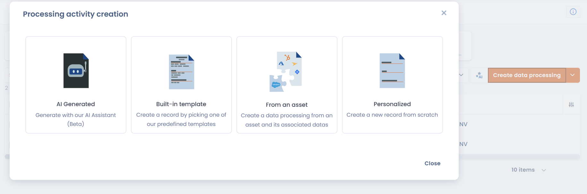

# 🚀 Get started in 5 minutes

This guide takes you from your first login to your first documented processing activity in the Dastra record.

***

## Step 1: get access to Dastra

To use Dastra, your organization needs a subscription.

* If your organization already uses Dastra, ask an administrator to invite you. You will receive an invitation by email.
* Otherwise, contact the Dastra team through the [demo request form](https://www.dastra.eu/en/contacts/demo).

Then log in at [https://app.dastra.eu](https://app.dastra.eu).

***

## Step 2: create your workspace

A **workspace** is the environment in which you document your processing activities. One workspace usually corresponds to one legal entity or one compliance scope.

If you are joining an existing workspace, go to step 3. Only account owners can create a workspace.

1. On the workspaces page, click **Create Workspace**.
2. Enter a name in **Choose a label for your workspace** (for example, the name of the legal entity).
3. Click **Continue**.

Dastra then opens the users page of the new workspace, where you can add its members.

<figure><figcaption>
Give your workspace a name
</figcaption></figure>


[create-and-set-up-a-workspace.md](setup/workspace.md)


***

## Step 3: add your first processing activity

The **record of processing activities** is at the heart of Dastra. Start with a simple activity, such as payroll or business email.

1. In the left menu, click **Record of processing activities**.
2. Click **Create data processing**.
3. Choose how to create it:

<figure><figcaption>
Choose how to create your first processing activity
</figcaption></figure>

| Mode                  | Description                                                                                                         |
| --------------------- | ------------------------------------------------------------------------------------------------------------------- |
| **AI Generated**      | Describe the activity in a few words and the AI Assistant writes a first version (if it is enabled in your workspace) |
| **Built-in template** | Start from a Dastra template (payroll, recruitment, CCTV, etc.)                                                     |
| **From an asset**     | Create the processing activity from an asset and its associated data                                                |
| **Personalized**      | Start from a blank processing activity                                                                              |

For a first activity, choose **Personalized** or **Built-in template**.

4. With **Personalized**, fill in the two required fields:

<figure><figcaption>
Name and organizational unit are the only required fields at creation
</figcaption></figure>

* **Name of this processing activity** (for example, _Payroll management_)
* **Organizational unit**: the entity or department the activity belongs to


The data controller, its data protection officer and its representative are taken from the entity of the selected organizational unit.


5. Click **Create data processing**.

The processing activity is added to the record. You can then complete its questionnaire: purposes, datasets, recipients, security measures, etc.


[editer-le-registre](../features/ropa/README.md)


***

## Step 4: invite a colleague

Invite the people who will work with you in the workspace.

1. Go to **Workspace settings > Users**.
2. Click **Invite user**.
3. Enter their email address and select their roles.
4. Click **Send invitation**.

The invited person receives an access link by email.


[invite-users.md](setup/users.md)


***

## What's next?

To go further:


[tutorial](tutorial/README.md)



[commencer](setup/README.md)



[editer-le-registre](../features/ropa/README.md)



[../features/ai-systems/README.md](../features/ai-systems/README.md)

